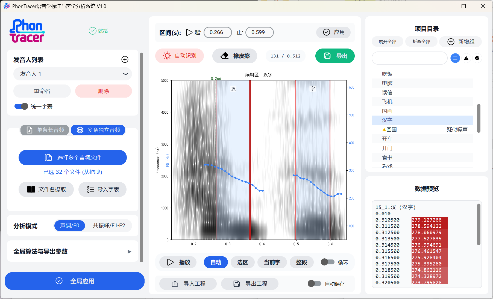
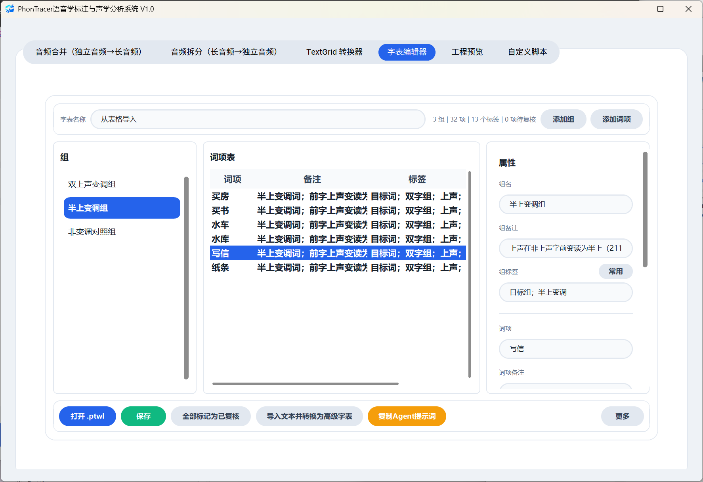
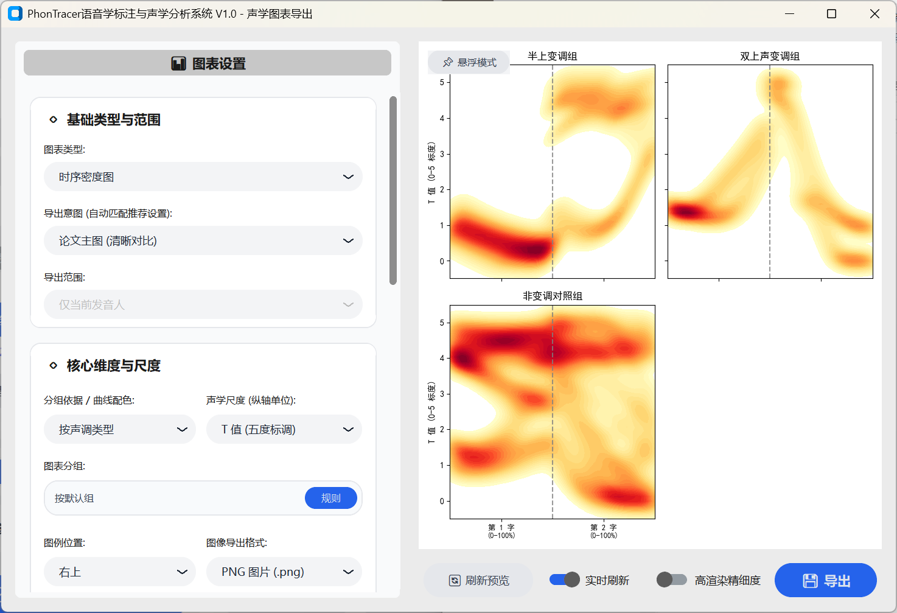
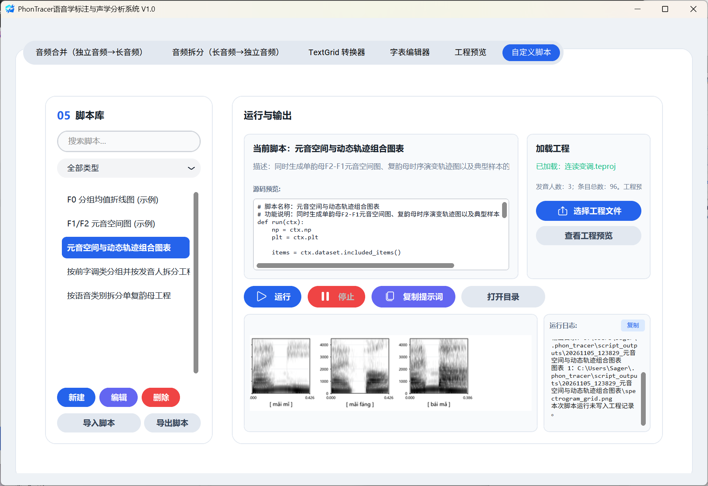
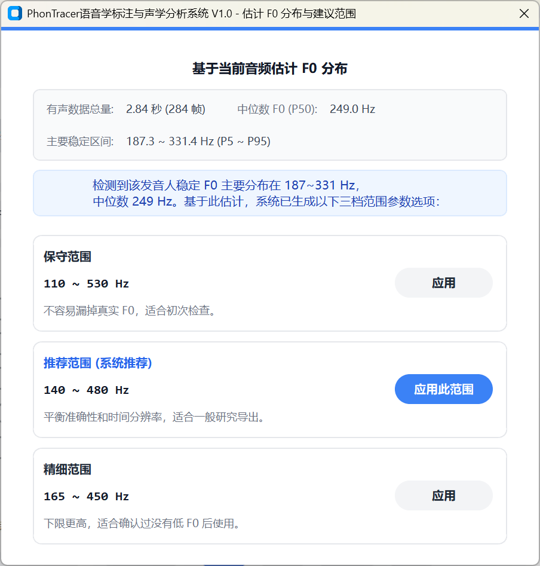
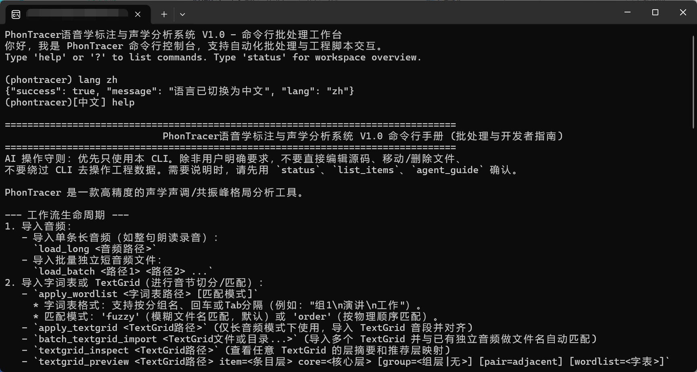
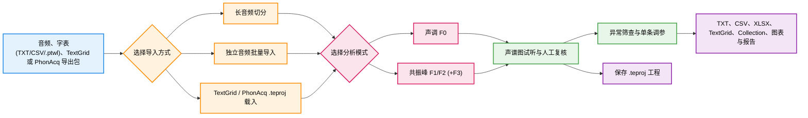

<div align="center">
  
  <h1>PhonTracer</h1>
  <p><strong>面向语音学标注与声学分析的桌面工具套件</strong></p>

  <p>
    <a href="https://github.com/KasumiKitsune/PhonTracer/releases"></a>
    <a href="https://www.python.org/"></a>
    <a href="#安装"></a>
    <a href="LICENSE"></a>
    
  </p>
</div>

---

###  项目简介

> **PhonTracer** 是一个面向语音学标注与声学分析的桌面工具套件，支持批量提取和人工复核声调 `F0`、元音共振峰 `F1/F2`（含可选 `F3`），并提供 `.teproj` 工程归档、异常筛查、多发音人隔离管理、科学图表与研究报告导出，以及命令行批处理工作台。

项目底层通过 [Parselmouth](https://parselmouth.readthedocs.io/) 调用 **Praat** 的声学分析引擎，适合需要“自动提取 + 声谱图复核 + 批量制图与导出”的实验语音学、方言调查与教学场景。前端田野调查与多发音人字表采录可配合同系列工具 **[PhonAcq](https://github.com/KasumiKitsune/PhonAcq)** 使用，其导出的 `.teproj` 工程包或标准 `.zip` 归档包可直接载入本软件继续精修与出图。

---

###  界面预览

<table width="100%">
  <tr>
    <td width="50%" align="center">
      <br>
      <b>主程序 F0 分析与人工复核界面</b>
    </td>
    <td width="50%" align="center">
      <br>
      <b>Toolkit 高级字表 (.ptwl) 编辑器</b>
    </td>
  </tr>
  <tr>
    <td width="50%" align="center">
      <br>
      <b>声学科学可视化工具箱</b>
    </td>
    <td width="50%" align="center">
      <br>
      <b>自定义脚本沙箱与 AI 协作面板</b>
    </td>
  </tr>
  <tr>
    <td width="50%" align="center">
      <br>
      <b>发音人 F0 估计与参数推荐对话框</b>
    </td>
    <td width="50%" align="center">
      <br>
      <b>PhonTracerCLI 交互式命令行控制台</b>
    </td>
  </tr>
</table>

---

###  核心能力

- **双分析模式**：支持声调 `F0` 与元音共振峰 `F1/F2`（可叠加显示与导出 `F3`）提取，可按任务随时切换。
- **声谱图交互复核**：同屏查看宽带声谱图、轮廓轨迹与顶部波形缩略条；支持红线边界过零点吸附拖拽、双音节内界联动调整、单字胶囊点按试听、`Alt + 左键` 一键修复八度跳变，以及圆形橡皮擦涂抹剔除/恢复异常散点。
- **多源导入与 Praat 互操作**：支持直接打开 [PhonAcq](https://github.com/KasumiKitsune/PhonAcq) 导出的 `.teproj` 工程包、“长音频 + 字表”自动切分、独立音频（`WAV` / `MP3` / `FLAC` / `OGG`）批量匹配，以及双向读写 Praat `TextGrid` 和一键打包音频、标注、Pitch 与 Formant 的 `.Collection` 集合文件。
- **高级字表 (`.ptwl`) 与草稿容错解析**：支持带分组元数据与自定义科研字段的 `.ptwl` 高级字表，同时兼容带注释、编号、括号或分隔线的日常手打草稿 `.txt` / `.csv` 字表；组标签、词项别名、自定义字段与复核状态随 `.teproj` 保存，可用于图表重分组与脚本统计。
- **发音人多维隔离与单条调参**：每位发音人拥有独立音频工作区与声学参数；对个别特殊词条单独重算参数时自动开启参数隔离（项目树以蓝点 `•` 标识），不改动同发音人其余词条，右键「属性」即可核对参数来源。
- **异常筛查与质控区分**：项目树自动标记边界异常、有效点不足、相邻点跳变与跨边界切分风险，支持一键筛选待复核词条；单样本叠置质检图明确区分红色声学警告实线与琥珀色组内统计偏离（`>2.8σ`）参考虚线。
- **多版式科学图表导出**：内置**中文期刊、国际期刊、汇报演示**三套版式预设，支持按词项标签、组标签、复核状态或自定义字段重新分组上色。声调模式涵盖分组均值轨迹（`Hz` / 五度 `T` 值与赵元任五度标尺双轴）、单样本质检图、16 组合连读变调方阵、调类效应量（$\eta^2$）时程图、音节物理时长图与均值热图；共振峰模式涵盖 `Hz / Lobanov / Bark / ERB / Mel` 舌位空间图（含 VSA 面积）、复韵母动态轨迹与滑移图、核密度热图及 Pillai 合并度矩阵。
- **自定义脚本沙箱与内置高阶模板**：`Toolkit` 与 `PhonTracerCLI` 内置受控 Python 沙箱（开放 `numpy`、`scipy`、`pandas`、`matplotlib` 与受控 `parselmouth` 接口，屏蔽任意系统访问与未授权模块），支持通过声明式 `PARAMS` 自动生成界面参数控件，输出图表（`Figure`）、统计表（`Table`）或受控工程补丁（`ProjectPatch`）。内置嗓音发声态（`H1-H2 / CPP / HNR`）、擦音频谱四阶矩（`COG`）、基频八度跳变自动诊断重算等模板，并可一键复制工程结构说明供 AI 辅助编写脚本。
- **工程归档与研究方法报告**：`.teproj` 完整保存音频副本、边界、手工修整状态与脚本运行记录；在 `Toolkit` 或 `CLI` 中可直接导出含工程 SHA-256 指纹、参数表、组间统计（ANOVA / 效应量）的研究方法报告（`MD` + `XLSX`）。

---

###  套件组成

<table width="100%">
  <tr>
    <th width="20%">入口</th>
    <th width="50%">用途</th>
    <th width="30%">平台说明</th>
  </tr>
  <tr>
    <td><b>PhonTracer</b></td>
    <td>主桌面程序：语料导入、F0 / 共振峰提取、声谱图人工复核、异常筛查、单条参数隔离、科学图表导出与工程保存。</td>
    <td>Windows x64 / ARM64、macOS</td>
  </tr>
  <tr>
    <td><b>Toolkit</b></td>
    <td>六合一独立工具箱：音频合并（保持原采样率）、长音频自适应静音切分、TextGrid 转换器、高级字表 (<code>.ptwl</code>) 编辑器、工程预览与研究方法报告导出、自定义 Python 脚本沙箱。</td>
    <td>Windows x64 / ARM64、macOS</td>
  </tr>
  <tr>
    <td><b>PhonTracerCLI</b></td>
    <td>面向批处理与自动化代理的命令行工作台，覆盖完整工程分析、<code>fix_warnings</code> 异常修复、<code>stats</code> 统计、<code>export_bundle</code> 一站式交付、<code>run_script</code> 沙箱脚本与 <code>tool_*</code> 音频字表工具。</td>
    <td>随 Windows 套件发布（源码跨平台运行）</td>
  </tr>
</table>

---

###  工作流程



**典型工作流如下：**

1. 创建或切换发音人，按性别预设或发音人音域估计配置分析参数（若使用 PhonAcq 导出的 `.teproj` 可直接打开跳过切分步骤）。
2. 导入长音频与字表（普通/草稿文本、CSV 或 `.ptwl` 高级字表）、批量导入独立音频，或载入已有 `TextGrid`。
3. 选择声调 `F0` 或共振峰 `F1/F2` 模式执行批量提取。
4. 在声谱图中点按试听、微调红色切分边界，必要时用橡皮擦/剔除点工具或 `Alt + 左键` 修整异常散点。
5. 利用项目树异常筛选定位待查词条，对个别发声特殊的词条单独调参重算。
6. 选择版式预设与分组维度，导出科学图表、源数据表格、Praat `.Collection` 或 `TextGrid`。
7. 保存为 `.teproj` 工程归档，或在 `Toolkit` / `PhonTracerCLI` 中运行高阶脚本并生成研究方法报告。

---

###  分析模式

#### 声调 F0
- 底层通过 Parselmouth 调用 Praat 自相关（Autocorrelation）音高分析算法。
- 支持配置**音高下限 (`floor`)**、**音高上限 (`ceiling`)**、**浊音阈值 (`voicing_thresh`)**、**VAD 能量阈值 (`db`)**、**跳过声母时长 (`skip_front`，秒)**、**静音裁剪 (`trim_silence`)** 与**归一化采样点数 (`pts`，默认 11 点)**。
- 支持按当前发音人语料自动估计基频分布并推荐参数（提供保守、推荐、精细三档）。
- 支持在声谱图中通过 `Alt + 左键` 修正单点八度跳变，或用橡皮擦涂抹剔除异常散点。
- 对嘎裂声、清化段等无法可靠测量的片段保留缺失值，避免强行插值引入伪影。

#### 共振峰 F1/F2
- 底层通过 Parselmouth 调用 Praat 的 Burg 线性预测共振峰分析算法。
- 默认提取并显示 `F1`、`F2` 轨迹，勾选「显示 F3」后可同屏叠加检视并同步导出 `F3` 数据。
- 支持在声谱图中使用「剔除点」工具按最近点定位剔除异常共振峰散点，并实时更新采样预览。
- 支持根据当前发音人样本分布自动给出共振峰上限等参数建议。

**共振峰主要参数说明：**

| 参数 | 内部字段 | 默认值 | 说明 |
| --- | --- | --- | --- |
| 共振峰分析上限 | `formant_max_hz` | `5500` | 控制 Praat Burg 搜索频率上限（通常男声约 `5000`、女声约 `5500`），并非 F2 截断值 |
| 共振峰数量 | `formant_count` | `5` | Praat Burg 线性预测阶数对应的共振峰个数 |
| 窗长 | `formant_window_length` | `0.025` | 分析高斯窗半宽对应时长（秒） |
| 预加重 | `formant_pre_emphasis` | `50` | 高频预加重起始频率（Hz） |
| 采样策略 | `formant_sample_strategy` | `整段11点` | 可选 `整段11点`（复韵母动态轨迹）或 `中段均值`（单元音稳态格局） |
| 显示 F3 | `show_f3` | `False` | 是否在声谱图中叠加绘制 `F3` 轨迹并纳入导出表格 |

---

###  输入与复核

#### 输入方式

PhonTracer 支持四类常见输入流程：

| 输入方式 | 适用场景 | 说明 |
| --- | --- | --- |
| **PhonAcq 工程直接交接** | 使用 [PhonAcq](https://github.com/KasumiKitsune/PhonAcq) 完成现场采录 | 直接打开 PhonAcq 导出的 `.teproj` 工程包（或导入其标准 `.zip` 归档中的 `.wav`、`.TextGrid` 与字表），免去手工重命名与二次对齐 |
| **长音频 + 字表** | 连续录音按词条自动拆分 | 支持普通/草稿文本（自动识别注释、编号与分组标题）、CSV 与高级字表 `.ptwl` 格式 |
| **独立音频批量导入** | 每个词条已有单独音频文件 | 支持 `WAV`、`MP3`、`FLAC`、`OGG` 文件，提供文件名模糊匹配和顺序匹配模式 |
| **TextGrid 导入** | 已有 Praat 标注或需继续复核 | 支持载入已有分段边界与词字标注，在当前工程中继续提取与修整 |

#### 人工复核与异常提示

自动提取不是最终结论。PhonTracer 将分析结果放回可试听、可编辑的声谱图界面，方便逐条核查：

- **视野与试听**：鼠标滚轮缩放时间轴、右键拖拽平移视野、点击顶部波形导航条快速定位；点击音节胶囊或双击字区间即可单独试听该音节，也可拉出局部选区循环试听。
- **边界精修**：拖拽红色边界线实时微调起止时间（自动吸附过零点）；多音节词条内部重合边界按拖拽方向自动区分前字终点或后字起点，按住 `Shift` 拖拽可同步平移相邻两字共享分界线。
- **散点修整**：开启「橡皮擦 / 剔除点」后，滚轮调节圆形感应半径，左键涂抹剔除异常点，右键（或 `Shift + 左键`）局部恢复原始散点；F0 模式下支持 `Alt + 左键` 一键折半/翻倍修正八度跳变点，全程支持 `Ctrl + Z` 撤销。
- **异常定位**：利用项目树右侧状态标签与异常筛选按钮快速定位待复核词条。

> [!NOTE]
> 项目树会针对边界过短/重叠、分析点缺失、有效点比例偏低、相邻点剧烈跳变以及跨边界拆分风险给出提示。提示用于辅助人工检查，不代表自动质量认证。

---

###  工程保存与恢复

PhonTracer 使用 `.teproj` 作为可移植工程归档格式。单个工程文件内完整保存：

- 多发音人档案、全局参数与单条隔离参数配置
- 导入的音频副本
- 词条、分组、音节内部分界及 `.ptwl` 高级字表元数据
- F0 与共振峰提取结果
- 人工擦除、恢复或边界微调后的复核状态
- 自定义脚本源码、参数记录及运行日志

导入已有 `.teproj` 时会先弹出工程概览预览；若当前工作区已有语料，可选择覆盖当前工作区或合并追加发音人。

> [!TIP]
> 启用自动保存后，程序会将当前状态定期写入本地恢复工作区，并在异常退出后下次启动时提示恢复。需要跨设备迁移、长期归档或协作分享时，请显式保存 `.teproj` 工程文件。

---

###  导出能力

| 类别 | 格式 | 适用场景 |
| --- | --- | --- |
| **文本与源数据** | `TXT`、`CSV` | 制表符分隔文本及科学图表配套绘图源数据表，便于接入 R / Python 后续统计 |
| **Praat 互操作** | `TextGrid`、`.Collection` | 导出标准三层 `groups / words / chars` TextGrid，或一键打包音频、标注、修整后 Pitch 与 Formant 的 `.Collection` |
| **Excel 动态报表** | `XLSX` | 包含原始测量与统计汇总页，自动写入基频五度 `T` 值换算活公式与共振峰均值/离散度公式，保留高级字表自定义字段 |
| **科学图表** | `PNG`、`SVG`、`PDF` | 支持当前发音人 / 分发音人 / 多人整合导出，内置三套出版预设，支持自定义分组重上色与多组自动分页 |
| **研究方法报告** | `MD`、`XLSX` | 在 Toolkit「工程预览」或 CLI 中导出含 SHA-256 文件指纹、提取参数、ANOVA 统计摘要与脚本记录的方法说明及数据审计档案 |
| **工程归档** | `.teproj` | 单文件保存完整音频、边界、复核状态与自定义脚本历史 |

---

###  安装与快速开始

#### 安装

请从 [GitHub Releases](https://github.com/KasumiKitsune/PhonTracer/releases) 下载对应平台与用途的发布包：

| 用途 | 平台 | 发布资产 | 内容与说明 |
|---|---|---|---|
| 主套件安装 | Windows x64 | `PhonTracer_Setup_Windows_x64.exe` | PhonTracer、Toolkit 与 PhonTracerCLI；自动注册 `.teproj`、`.ptwl` 文件关联 |
| 主套件便携 | Windows x64 | `PhonTracer_Suite-Windows-x64.zip` | 同上，免安装解压即用 |
| 主套件安装 | Windows ARM64 | `PhonTracer_Setup_Windows_ARM64.exe` | 原生 Windows ARM64 安装程序 |
| 主套件便携 | Windows ARM64 | `PhonTracer_Suite-Windows-ARM64.zip` | 原生 Windows ARM64 便携压缩包 |
| 主套件 | macOS Apple Silicon | `PhonTracer_Suite-macOS.dmg` | PhonTracer 与 Toolkit（原生 M 系列芯片构建） |

Windows 便携版解压后可直接运行 `PhonTracer.exe`、`Toolkit.exe` 或 `PhonTracerCLI.exe`。macOS 用户打开 DMG 后将应用拖入“应用程序”目录即可；若首次打开提示“无法验证开发者”，可在“系统设置 → 隐私与安全性”中点击“仍要打开”，或对应用执行 `xattr -cr`。

#### 从源码运行

建议使用 Python 3.12 环境：

```bash
git clone https://github.com/KasumiKitsune/PhonTracer.git
cd PhonTracer
python -m pip install -r requirements.txt
python main.py
```

其他入口启动方式：
```bash
python toolkit.py
python cli.py
```

#### Windows CLI 示例

命令行工作台输出结构化 JSON，支持交互式会话、单条指令执行与 `--script-file` 全流程批处理：
```powershell
# 查看内置工作流指南与全部指令说明
PhonTracerCLI.exe --version
PhonTracerCLI.exe agent_guide
PhonTracerCLI.exe help all
PhonTracerCLI.exe help tools

# 对已有工程执行自动异常修复、分组统计与全套产物一键交付
PhonTracerCLI.exe --project session.teproj fix_warnings --apply scope=all
PhonTracerCLI.exe --project session.teproj export_bundle ./deliverables scope=integrated format=png

# 按批处理剧本一次性完成切分、提取、质检与打包导出
PhonTracerCLI.exe --project session.teproj --script-file pipeline.txt
```

---

###  相关项目与工具链联动

PhonTracer 可与同作者开发的上下游开源工具配合，组成**「田野/实验采录 → 边界与散点精修 → 出版制图与 Praat 互审」**的完整工作流：

- **[PhonAcq — 田野语音与方言字表采录系统](https://github.com/KasumiKitsune/PhonAcq)**（[在线导览](https://kasumikitsune.github.io/PhonAcq/) ｜ [安装包下载](https://github.com/KasumiKitsune/PhonAcq/releases)）  
  支持 **Android 手机/平板、Windows 与 macOS** 的方言调查与语音实验前端采录工具，提供多人独立建档、文字/图片词卡看读引导、局域网双设备无线遥控与现场信噪比/削波质检。采录完成后可**一键导出 PhonTracer `.teproj` 工程包**（或标准 `.wav` + `.TextGrid` + `wordlist.txt` 归档包），直接在 PhonTracer 中打开复核边界、修整异常散点、批量生成声学图表与研究方法报告。
- **[Praat 简体中文汉化版 (praat-simplified-chinese)](https://github.com/KasumiKitsune/praat-simplified-chinese)**  
  语音学分析软件 Praat 的简体中文本地化与日常交互改进维护版，可直接载入 PhonTracer 一键导出的 `.Collection` 集合文件（内含音频、三层 `TextGrid`、修整后 `Pitch` 与 `Formant` 对象）或标准 `TextGrid` 进行跨工具核验。

---

###  详细手册与更多资源

README 仅提供功能概览。完整操作步骤、声学参数调优说明和进阶图表解读请查阅随软件附带的使用手册：
- 📖 **[完整使用手册（合订本）](assets/manual/manual.md)**
- 📄 **[图文交互使用手册](assets/manual/manual.html)**

#### 验证与测试

```bash
python -m pytest -q tests
python -m compileall -q main.py cli.py toolkit.py modules tests
python scripts/check_release_version.py --expected v1.0.0
```

#### 更新与发布
- 可在主程序顶部菜单「关于」窗口中手动检查 GitHub Releases 新版本。
- 推送版本标签（如 `v1.0.0`）时，GitHub Actions 会基于 `PhonTracer_Suite.spec` 自动构建 Windows x64、Windows ARM64 与 macOS Apple Silicon 发布资产。

#### 核心文档与工程格式

- [架构与共享事实源](docs/ARCHITECTURE.md)
- [`.teproj` 工程格式 1.0](docs/PROJECT_FORMAT_V1.md)
- [论文使用与写作指南](docs/PAPER_USAGE_GUIDE.md)

---

###  已知边界

- 自动提取结果受录音信噪比、发音人音域/声道参数与切分边界影响，正式统计或发表前仍应人工复核。
- 发音人 F0 范围估计与共振峰参数建议仅用于辅助初始配置，不替代研究者结合语图的判断。
- 主程序支持直接拖入文件打开；`Toolkit` 为规避底层多线程图形锁冲突禁用了窗口拖拽，请通过界面按钮选择文件。
- 自动保存仅用于意外中断后的本机恢复；跨设备迁移或长期归档请显式保存 `.teproj` 工程。
- 本软件纯单机离线运行，零遥测、不上传任何语料与工程数据（本地配置与恢复缓存默认位于 `~/.phon_tracer/`）；自定义脚本沙箱在当前进程内运行，请仅执行可信脚本。

---

<br>

<div align="center">
  
  <p>© 2026 KasumiKitsune</p>
</div>
