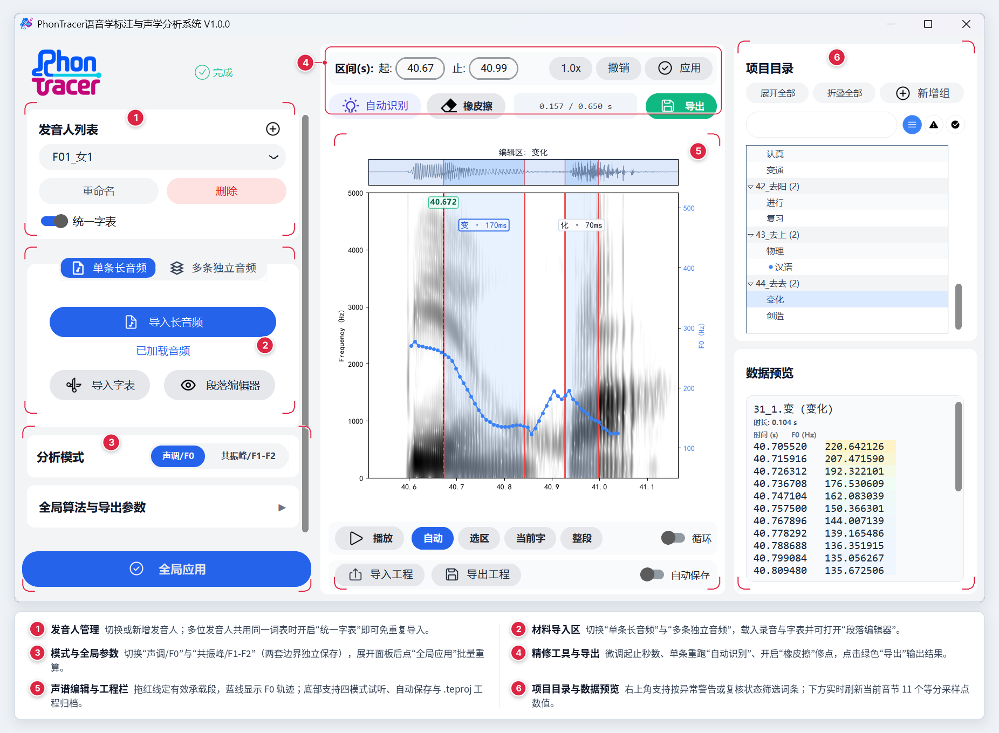

# 00 快速上手与实验全景导航

本手册面向使用 **PhonTracer (v1.0.0)** 开展声调、连读变调、元音格局及语音学实验的师生与研究人员编写。全套手册共分六册，围绕实验流程中最核心的问题展开：**实验前需要准备哪些输入材料、在软件中如何操作与精修、最终可以导出哪些数据与图表，以及如何结合语音学规范处理常见疑难发音与解读图表**。

分册导航：[00 快速上手与实验全景导航（本篇）](./00_快速上手与实验全景导航.md) ｜ [01 实验材料准备与导入指南](./01_实验材料准备与导入指南.md) ｜ [02 选区精修与疑难语音处理实战](./02_选区精修与疑难语音处理实战.md) ｜ [03 数据导出与声学图表解读指南](./03_数据导出与声学图表解读指南.md) ｜ [04 工具箱预处理与批处理附录](./04_工具箱预处理与批处理附录.md) ｜ [05 常见问题解答](./05_常见问题解答_QA.md)

## 一、软件定位与三个程序入口

PhonTracer 将语音声学实验中的“导入录音与字表 → 自动切分并提取基频（F0）或共振峰（F1/F2） → 声谱图可视化人工复核 → 导出统计数据表、出版级图表与 Praat 互通文件”整合为一套连贯的桌面工作流。

安装或解压软件后，可根据实验阶段选用以下三个程序入口：

1. **`PhonTracer`（主桌面程序）**：日常实验分析的主要界面。完成音频与字表导入、音段边界调整、异常轨迹点修整、多发音人管理，以及导出 Excel 表格、声学图表和 Praat 文件，均在此窗口中进行。
2. **`Toolkit`（独立工具箱）**：实验前后的配套辅助程序（可从系统菜单直接启动，也可在主程序顶部的“关于”窗口中点击打开），包含六个功能页签：
   - **`音频合并（独立音频→长音频）`**：将多个独立的单字或单词录音按顺序插入静音间隔，无损拼接为单条长音频。
   - **`音频拆分（长音频→独立音频）`**：根据字表或静音停顿，将整条长录音批量切分为独立命名的 `.wav` 文件。
   - **`TextGrid 转换器`**：在 Praat `.TextGrid` 标注文件与 PhonTracer 词表及工程结构之间进行转换，便于复用既有标注成果。
   - **`字表编辑器`**：可视化管理分组字表，支持将普通文本草稿转换为包含组标签、词项备注与自定义科研字段的 `.ptwl` 高级字表。
   - **`工程预览`**：快速查看 `.teproj` 工程内各发音人的词条统计与复核进度，并导出包含参数记录与方差分析摘要的研究方法报告。
   - **`自定义脚本`**：在受控环境中运行内置进阶语音学分析脚本，或结合大语言模型提示词生成定制化组合图表。
3. **`PhonTracerCLI`（命令行工作台）**：适用于大样本语料批量处理、脚本化流水线执行，或交由 AI 编程工具自动调用（详见 [04 工具箱预处理与批处理附录](./04_工具箱预处理与批处理附录.md)）。

## 二、「输入 → 操作 → 输出」实验路线速查表

在开始操作前，可对照手头已有的实验材料选择对应的处理路径：

| 手头已有的输入材料 | 推荐导入与操作路线 | 可导出的实验成果 | 对应详细章节 |
| :--- | :--- | :--- | :--- |
| **单条连续朗读的长录音（`.wav`）+ 调查字表**（最常见的声调与元音实验场景） | 主界面选 **`单条长音频`** → 点击 **`导入长音频`** 与 **`导入字表`** → 在 **`段落编辑器`** 核对词段与单字分界 → 主画布复核选区 | Excel 统计数据表（含均值、等分点、五度 T 值、原始 Hz、时长）、出版级图表、`.TextGrid`、`.Collection`、`.teproj` 工程包 | [01 实验材料准备与导入指南](./01_实验材料准备与导入指南.md) [02 选区精修与疑难语音处理实战](./02_选区精修与疑难语音处理实战.md) |
| **已按词切分好的多个独立 `.wav` 文件**（文件名含字词，或另附字表） | 主界面选 **`多条独立音频`** → 批量拖入或选择音频 → 点击 **`文件名提取`** 或 **`导入字表`** 配对 → 复核选区后导出 | 同上，支持按字表分组自动计算各调类或元音的均值与离散指标 | [01 实验材料准备与导入指南](./01_实验材料准备与导入指南.md) [03 数据导出与声学图表解读指南](./03_数据导出与声学图表解读指南.md) |
| **仅有长录音，希望先拆分为按词命名的独立 `.wav` 归档** | 打开 **`Toolkit`** → 使用 **`音频拆分（长音频→独立音频）`** 批量切分保存 → 按需导入主界面做声学分析 | 命名规范的分词 `.wav` 音频库，以及后续声学表格与图表 | [04 工具箱预处理与批处理附录](./04_工具箱预处理与批处理附录.md) |
| **已在 Praat 或强制对齐工具中完成的 `.TextGrid` 标注** | 在主界面或通过 **`Toolkit`** 的 **`TextGrid 转换器`** 载入音频与现有时间边界 → 直接复核曲线并导出 | 保留原标注时间轴的声学采样点数据表、统计图表与 `.Collection` 集合 | [01 实验材料准备与导入指南](./01_实验材料准备与导入指南.md) [04 工具箱预处理与批处理附录](./04_工具箱预处理与批处理附录.md) |
| **男、女多位发音人朗读同一份调查字表** | 左侧开启 **`统一字表`** → 点击 **`+`** 逐位添加发音人并导入录音 → 按发音人分别点击 **`检测`** 适配参数 → 导出时勾选归一化整合 | 多发音人 T 值或 Lobanov 归一化整合总表、跨发音人对比图表、完整 `.teproj` 工程包 | [01 实验材料准备与导入指南](./01_实验材料准备与导入指南.md) [03 数据导出与声学图表解读指南](./03_数据导出与声学图表解读指南.md) |
| **大批量发音人语料需自动化初筛与打包输出** | 使用 **`PhonTracerCLI`** 执行批处理脚本与 **`export_bundle`** → 如需精修再回主界面仅复核带 `⚠` 的词条 | 全套数据表、常规与双字调专项图表、质控图、Praat 文件及研究方法报告 | [04 工具箱预处理与批处理附录](./04_工具箱预处理与批处理附录.md) |

## 三、主界面分区导览

启动 `PhonTracer` 主程序后，界面从左至右依次划分为**左侧控制栏**、**中间声谱精修区**与**右侧目录及预览区**三个部分：

### 1. 左侧控制栏（管理发音人、材料导入与分析参数）

- **① 发音人管理区**：用于切换当前发音人，或通过 **`+`** 新增、**`重命名`**、**`删除`** 发音人。当多位发音人使用相同的调查字表时，开启 **`统一字表`** 开关即可共享同一套分组与词条列表，无需逐人重复导入。
- **② 材料导入区**：上方可切换 **`单条长音频`** 与 **`多条独立音频`** 两种工作流。在长音频模式下，依次通过 **`导入长音频`** 与 **`导入字表`** 载入实验材料，并可随时点击 **`段落编辑器`** 调整整段录音的词段切分。
- **③ 分析模式与全局参数区**：
  - 支持在 **`声调/F0`** 与 **`共振峰/F1-F2`** 两种模式间切换。软件在后台为两种模式**独立保存各自的音段边界与修点状态**，切换模式进行元音稳态段调整时，不会覆盖此前已确定好的声调承载段边界。
  - 点击展开 **`全局算法与导出参数`** 面板，可配置采样等分点数、基频上下限或共振峰分析上限（均配有智能估算范围的 **`检测`** 按钮）；修改全局参数后，点击底部 **`全局应用`** 即可对当前发音人的全部词条重新提取数据。

### 2. 中间声谱精修区（核对边界、修整轨迹、试听与存档）

- **④ 精确区间与精修工具栏**：
  - 上排显示当前音节的起止时间（秒），支持手动输入数值微调，右侧配有播放倍速切换（默认 **`1.0x`**，可放慢语速辅助辨听边界）、**`撤销`** 与 **`应用`** 按钮。
  - 下排提供针对当前词条重算的 **`自动识别`**、用于抹除局部异常散点的 **`橡皮擦`**（在共振峰模式下显示为 **`剔除点`**）、光标位置时间读数，以及用于输出各类成果的绿色 **`导出`** 按钮。
- **⑤ 声谱图画布、试听栏与工程栏**：
  - 画布上方为局部波形预览条，下方为宽带声谱图。图中的**红色竖线**代表当前音节的有效起止边界，顶部胶囊实时标明字名与有效时长（如 `变 · 170ms`、`化 · 70ms`），声谱图上叠加绘制**蓝色基频曲线**（声调模式）或**橙色 F1、绿色 F2 散点**（共振峰模式）。
  - 底部第一排为试听控制栏，支持 **`自动`**、**`选区`**、**`当前字`**、**`整段`** 四种回放范围及 **`循环`** 播放；底部第二排为工程管理栏，提供 **`导入工程`**、**`导出工程`**（保存为 `.teproj` 文件）以及防止意外退出的 **`自动保存`** 开关。

### 3. 右侧目录及预览区（异常筛查与采样数值预览）

- **⑥ 项目目录与数据预览**：
  - 上半部分 **`项目目录`** 以分组树形式列出全部词条，支持展开、折叠、新增组与关键词检索。右上角提供三个状态筛选按钮：**全部词条**、**`▲` 仅显示异常警告词条**、**`✔` 按复核状态筛选**。词条旁若出现黄色 **`⚠`** 图标及短说明（如 `疑似噪声`、`F2跳变`），表示该条存在声学缺口或跳变风险，建议优先检查；词条前若带有蓝色圆点 **`•`**，则代表该条已启用单条目独立参数或经过人工精修。
  - 下半部分 **`数据预览`** 实时列出当前选中音节的持续时长，以及默认 **11 个归一化等分采样点**对应的精确时间（s）与频率数值（Hz），调整边界或擦除异常点后数值会立即同步更新。

## 四、五分钟标准实验流程演练

以常见的“单条双字调录音（`.wav`）配合一份分组字表（`.txt`）”为例，完成一次标准分析只需以下七步：

1. **建立发音人**：打开 `PhonTracer`，在左侧 **`发音人列表`** 中点击 **`重命名`** 设定发音人编号（如 `F01_女1`），并在导入区选择 **`单条长音频`**。
2. **导入音频与字表**：依次点击 **`导入长音频`** 选择 `.wav` 录音文件，点击 **`导入字表`** 选择对应的 `.txt` 或 `.ptwl` 字表。
3. **核对宏观切分**：打开 **`段落编辑器`**，确认右下角显示的检测区段数量与字表词条总数一致，抽听几个区段核对双字分界无误后，点击 **`确认并应用`**。
4. **匹配发音人参数**：在左侧选择 **`声调/F0`**（或 **`共振峰/F1-F2`**），展开 **`全局算法与导出参数`** 点击 **`检测`**，选用推荐范围后点击底部 **`全局应用`**。
5. **定位待查词条**：点击右侧 **`项目目录`** 右上角的 **`▲`** 按钮，筛选出带有黄色 **`⚠`** 提示的词条逐一查看。
6. **微调选区与修点**：在中间声谱图上左右拖动**红色边界线**避开清辅音干扰或词末气息滑落；对个别倍频跳点，开启 **`橡皮擦`** 左键涂抹剔除，再次点击 **`橡皮擦`** 应用重采样（具体判断准则详见 [02 选区精修与疑难语音处理实战](./02_选区精修与疑难语音处理实战.md)）。
7. **导出结果与保存工程**：点击中间工具栏绿色的 **`导出`** 按钮，按需输出 `.xlsx` 统计表格、论文图表或 Praat `.Collection` 文件；最后点击底部 **`导出工程`** 将当前完整状态保存为 `.teproj` 工程归档。
