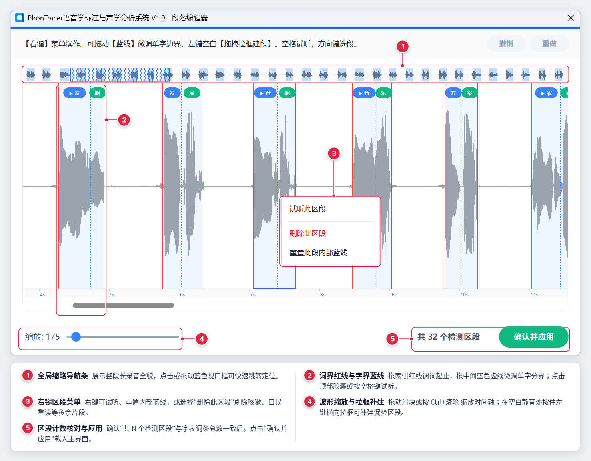

# 01 实验材料准备与导入指南

分册导航：[00 快速上手与实验全景导航](./00_快速上手与实验全景导航.md) ｜ [01 实验材料准备与导入指南（本篇）](./01_实验材料准备与导入指南.md) ｜ [02 选区精修与疑难语音处理实战](./02_选区精修与疑难语音处理实战.md) ｜ [03 数据导出与声学图表解读指南](./03_数据导出与声学图表解读指南.md) ｜ [04 工具箱预处理与批处理附录](./04_工具箱预处理与批处理附录.md) ｜ [05 常见问题解答](./05_常见问题解答_QA.md)

录音质量与字表组织方式直接影响自动切分与基频、共振峰提取的准确度。本篇介绍实验录音的采集规范、三种字表输入格式的编写方法、三类材料导入流程（含长音频 `段落编辑器` 的详细操作），以及多发音人工程的管理方法。

## 一、实验录音采集建议

在语音实验室或田野调查现场录制实验样本时，注意以下四个环节可以显著减少后续人工修正的工作量：

1. **控制环境低频底噪**：录音时尽量关闭空调、风扇、冰箱压缩机等持续低频噪声源，并避开临街车流与电流声。持续的低频背景声会叠加在声谱图底部的基频区，容易干扰低调值音节（如上声、阳平起点或轻声）的基频追踪。
2. **保持合适话筒距离以防喷麦**：建议将麦克风置于发音人嘴部**侧前方 10～15 cm** 处（偏离正前方约 30°～45° 角），并配合防风海绵罩使用。避免正对麦克风近距离直吹，否则在发 `p、t、k、c、ch、q` 等送气塞音、塞擦音时，强气流冲击振膜会在低频区产生爆破杂音，遮蔽紧随其后的元音起始共振峰。
3. **选用无损格式并统一采样率**：录音文件应保存为 **WAV 无损单声道（Mono）** 格式，避免使用 MP3、AAC 或社交软件语音等有损压缩格式（高频压缩会影响共振峰与擦音测量）。采样率采用 **16 kHz、24 kHz 或 44.1 kHz** 均可满足常规声调与元音分析需要；建议同一实验项目的所有发音人保持一致的采样率与量化精度（如统一采用 24 kHz 或 44.1 kHz、16-bit）。
4. **把握长音频朗读停顿节奏**：若采用单条长录音连续朗读整份字表，请引导发音人在**词与词之间保持约 0.4～0.8 秒的自然静音停顿**，既便于软件自动识别词界，又能避免跨词协同发音粘连。对于双音节或多音节词内部（例如“首都”“体贴”第二字清塞音声母成阻时的短暂闭塞静音），发音人按日常自然语速正常连读即可，软件已针对词内短暂停顿做了自适应防误切处理。

## 二、字表准备方法（支持三种格式）

PhonTracer 原生兼容纯文本 `.txt`、表格 `.csv` 以及结构化高级字表 `.ptwl`。研究者可以直接导入日常整理的实验草稿，无需预先手动清理注释或编号。

### 1. 普通文本与科研草稿（`.txt`）

除最基础的“一行组名、下方逐行列出词条”写法外，词表解析器还支持直接读取带有注释、序号和分隔符的调查草稿，自动过滤非词条信息：

- **自动忽略注释**：支持行首或行尾的 `//`、`#` 单行注释，以及跨行的 `/* ... */` 块注释。
- **自动跳过标题横幅与分隔线**：如 `=== 双字调调查字表 ===` 或 `--------` 等装饰分隔行不会误判为词条。
- **识别多种分组头格式**：兼容 `【组名】`、`[组名]`、`(组名)`、`（组名）`、`一、组名` 以及末尾带冒号的 `组名：` 等常见标题写法。
- **自动剥离行内编号与列表符**：自动去除词条前的 `1.`、`01)`、`(1)`、`①`、`- `、`* `、`• ` 等前缀符号。
- **支持同行多词与括号备注**：同一行可用斜杠 `/` 或 `／` 分隔多个并列词条（如 `买书 / 买房`）；词条后紧跟括号的 `词条(备注)` 写法会自动保留备注说明，不会将括号文字计入音节数。

以下是一份可直接导入软件的 `.txt` 字表示例：

```text
=== 普通话双字组声调调查字表（节选） ===
// 录音批次：2026秋季  采样率：24kHz
# 说明：每词自然朗读一遍，词间停顿约半秒

/* 第一部分：上声连读变调组 */
【31_上阴】
1. 首都(注意后字清塞音闭塞段) / 买书
2. 老师

(32_上阳)
① 买房
② 语言  # 零声母连读对照

43_去上：
- 物理
- 汉语
• ma4-ma0(拼音或音标词条示例)
```

> **多音节拆分规则说明**：
> - **汉字词条**：默认按**一个汉字对应一个音节**自动切分（例如 `首都` 自动识别为 2 个音节，括号内的备注不计入音节数）。
> - **拼音、国际音标（IPA）或外文词条**：请使用**半角连字符 `-`** 显式标明音节分界（如 `ma4-ma0`、`ba-na-na`），软件将严格按连字符数量拆分为对应音节。

### 2. 逗号分隔表格（`.csv`）

若实验词表平时在 Excel 中整理维护，可直接另存为 **UTF-8 编码的 `.csv` 文件**导入。表格中可按列包含组名、词条与备注信息，例如：

```csv
组别,词条,备注
11_阴阴,飞机,双音节阴平组
11_阴阴,开车,双音节阴平组
31_上阴,首都,半上变调观察项
```

### 3. 高级字表（`.ptwl`）

当实验需要按照声母清浊、古音调类、韵摄开合或词频等级等多个维度对同一批词条进行交叉分组绘图时，推荐使用 PhonTracer 专用的 **`.ptwl` 高级字表**：

- **多维科研元数据**：支持记录组备注、**组标签**（以分号分隔，如 `目标组; 半上变调`）、词项备注、**词项标签**及自定义属性字段。
- **快速转换生成**：打开独立工具箱 **`Toolkit`** 的 **`字表编辑器`** 页签，点击底部 **`导入文本并转换`** 即可将现有 `.txt` 或 `.csv` 草稿转换为 `.ptwl` 格式，并可配合 AI 提示词批量补充音韵属性标签（详见 [04 工具箱预处理与批处理附录](./04_工具箱预处理与批处理附录.md)）。
- **全流程贯穿**：`.ptwl` 中的所有标签与备注在导入后会随 `.teproj` 工程全程保存，后续在声学图表工作台中可直接按标签重新分组配色（详见 [03 数据导出与声学图表解读指南](./03_数据导出与声学图表解读指南.md)）。

## 三、三种材料导入工作流详解

根据手头实验材料的组织形式，可在主界面左侧导入区选择对应的导入方式：

### 路线一：`单条长音频` + 字表（配合 `段落编辑器` 核对切分）

适用于“一条连续朗读的长 `.wav` 录音配合一份调查字表”的标准流程：

1. 在主界面左侧导入区顶部选择 **`单条长音频`**。
2. 点击 **`导入长音频`** 载入录音文件，随后点击 **`导入字表`** 选择准备好的 `.txt`、`.csv` 或 `.ptwl` 字表。
3. 软件会自动完成语音端点检测与词条对齐。如需检查切分结果或修正词数偏差，点击 **`段落编辑器`** 打开可视化切分窗口：



在 **`段落编辑器`** 中，可对照图中序号完成以下核查操作：

- **① 全局缩略导航条**：位于窗口顶部，展示整条长音频的全貌包络。点击或拖动蓝色视口框，即可在数分钟的长录音中快速跳转至任意区段。
- **② 词边界红线与单字分界蓝线**：
  - 主波形中每个浅蓝区段代表一个词条，拖动左右两侧的**红色实线**可调整整词的起止时间；
  - 双音节或多音节词内部自动生成**蓝色虚线**作为单字初切分界，左右拖动**蓝色虚线**即可微调字间切分位置；
  - 点击区段上方的蓝/绿字头胶囊（如 `▶ 发`、`明`），或直接按键盘**空格键**即可试听当前区段，按键盘**左右方向键（`←` / `→`）**可依次切换前后区段。
- **③ 右键快捷操作菜单**：在任意区段上点击鼠标右键，可选择 **`试听此区段`**、**`重置此段内部蓝线`**，或点击 **`删除此区段`**。当发音人在朗读中途出现咳嗽、清嗓或口误重读，导致检出段数多于字表词数时，只需右键删除作废的那一段，后续词条名称便会自动顺延对齐。
- **④ 波形缩放与漏检补建**：拖动左下角 **`缩放`** 滑块（或按住 **`Ctrl + 鼠标滚轮`**）可放大或缩小时间轴视野，直接滚动鼠标滚轮可左右平移波形；若个别轻读词条未被自动检出，在空白波形处按住**鼠标左键横向拖拽拉框**，即可手动新建区段。
- **⑤ 区段计数核对与应用**：确认右下角提示的 **`共 N 个检测区段`** 与字表总词数一致后，点击绿色 **`确认并应用`** 按钮，切分结果即载入主界面（注：若后续再次进入段落编辑器仅微调了某几个词段，未改动词段中已做过的橡皮擦精修数据会自动保留，不会被重置清空）。

### 路线二：`多条独立音频` 批量导入

适用于录音已预先切分为单个字词 `.wav` 小文件的场景：

1. 在主界面左侧导入区顶部切换至 **`多条独立音频`**。
2. 点击 **`选择多个音频文件`**（或直接从系统文件夹框选多个 `.wav` 拖入窗口）。
3. 选择词条命名与分组匹配方式：
   - **直接使用文件名命名**：若音频文件名本身已包含字词（如 `01_吃饭.wav`、`02_电脑.wav`），点击 **`文件名提取`** 即可自动解析词条名与音节数。
   - **关联外部字表与分组**：点击 **`导入字表`** 选入字表文件，在弹窗中可选择**模糊匹配**（根据文件名自动匹配字表中的对应词条并挂载分组与标签）或**顺序匹配**（适用于文件名为 `001.wav`、`002.wav` 等纯编号且与字表顺序一致的情形）。

> **提示**：若目前只有整段长录音，但需要先生成按词命名的独立 `.wav` 语料文件再开展分析，可先使用 **`Toolkit`** 中的 **`音频拆分（长音频→独立音频）`** 功能完成切分（详见 [04 工具箱预处理与批处理附录](./04_工具箱预处理与批处理附录.md)）。

### 路线三：导入已有 Praat `TextGrid` 标注

若前期已在 Praat 中完成手工标注，或使用 Montreal Forced Aligner（MFA）等强制对齐工具生成了 `.TextGrid` 文件，可直接导入复用现有时间边界，无需重新切分：

- **图形界面转换与导入**：在主界面导入对应音频后载入 TextGrid，或打开 **`Toolkit`** 的 **`TextGrid 转换器`** 页签，预览标注层结构并指定词条层（Item tier）与核心承载段层（Core tier），还可同时挂载辅助字表补充调类分组信息，一键转换为 `.teproj` 工程后在主界面打开。
- **批量命令行导入**：若需一次性配对大量独立音频与同名 `.TextGrid` 文件，也可在 `PhonTracerCLI` 中使用 `apply_textgrid` 或 `batch_textgrid_import` 指令批量完成（详见 [04 工具箱预处理与批处理附录](./04_工具箱预处理与批处理附录.md)）。

## 四、多发音人管理与性别参数适配

在对比多位发音人或跨性别样本的实验设计中，建议将同一课题的所有发音人纳入**同一个 `.teproj` 工程**中统一管理：

1. **启用 `统一字表` 共享词表结构**：在首位发音人名下导入字表后，打开左侧 `发音人列表` 下方的 **`统一字表`** 开关。此后点击 **`+`** 新增发音人并重命名（例如按性别与序号命名为 `F01_女1`、`M01_男1`），新发音人会自动沿用相同的分组、词条顺序及 `.ptwl` 标签，只需为其导入对应录音即可。若个别发音人存在漏读或增补词条，可临时关闭该开关独立调整字表。
2. **按发音人分别执行参数 `检测`**：
   - 成年男性、女性与儿童在声带振动基频及声道长度上存在显著生理差异（例如成年男性常见基频约 70～250 Hz、共振峰搜索上限约 4500～5000 Hz；成年女性常见基频约 120～420 Hz、共振峰搜索上限约 5200～5500 Hz）。
   - 若直接沿用男声参数分析女声录音，高频声调容易被上限截断或误判为半频；反之若用女声参数分析男声，则容易在低频区混入倍频跳变或发生共振峰错位。
   - 因此，每新增并导入一位发音人的音频后，均建议展开左侧 **`全局算法与导出参数`** 面板，点击基频范围或共振峰分析上限旁的 **`检测`** 按钮，选用适合该发音人的推荐范围并点击 **`全局应用`**（各发音人的参数配置彼此隔离保存，互不影响）。

完成材料导入与参数初配后，请继续阅读下一篇 [02 选区精修与疑难语音处理实战](./02_选区精修与疑难语音处理实战.md)，了解声谱图选区边界的语音学判定准则与疑难发音处理方法。
