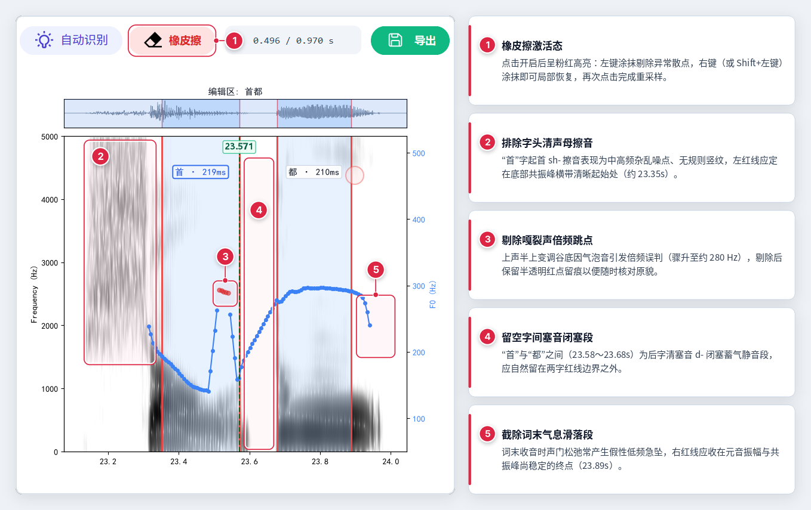
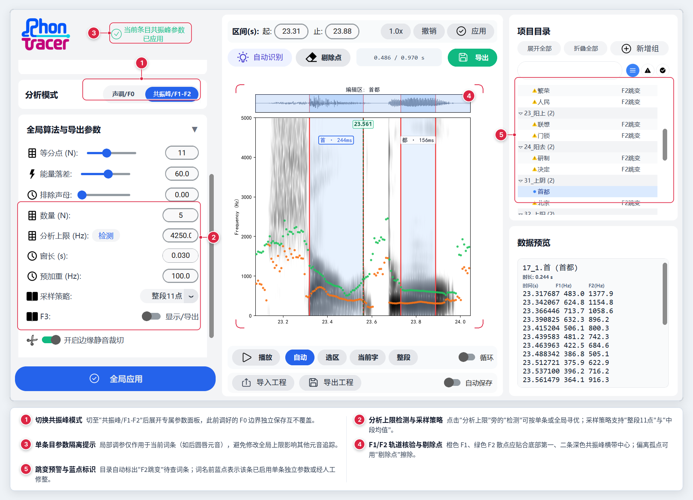

# 02 选区精修与疑难语音处理实战

分册导航：[00 快速上手与实验全景导航](./00_快速上手与实验全景导航.md) ｜ [01 实验材料准备与导入指南](./01_实验材料准备与导入指南.md) ｜ [02 选区精修与疑难语音处理实战（本篇）](./02_选区精修与疑难语音处理实战.md) ｜ [03 数据导出与声学图表解读指南](./03_数据导出与声学图表解读指南.md) ｜ [04 工具箱预处理与批处理附录](./04_工具箱预处理与批处理附录.md) ｜ [05 常见问题解答](./05_常见问题解答_QA.md)

自动切分与算法追踪能够快速完成大部分常规音节的初筛，但自然语音中不可避免地存在辅音气流扰动、八度跳变、嘎裂声（气泡音）及元音共振峰聚拢等现象。本篇将实验语音学的常见声学判据与 PhonTracer 的界面操作相结合，通过真实双字词例**“首都”（`shǒu dū`）**，详细说明如何确定音节边界、何时使用橡皮擦修整散点、如何规范处理嘎裂声以及如何校正共振峰追踪偏差。

## 一、选区边界与等分采样点的关系

在调整任何边界之前，需要先明确软件提取声学数值的基本逻辑：

在主界面声谱图中，每个音节左右两条**红色竖线**之间的浅蓝底色区域，即为参与声学测量的**有效承载段**。选区上方的胶囊标签实时显示该音节的字名与持续毫秒数（例如图 3 中的 `首 · 219ms`、`都 · 210ms`）。

PhonTracer 默认采用实验语音学通用的**时长归一化等距采样法**：无论某个音节实际持续 `150ms` 还是 `300ms`，系统都会在左右两条红线限定的时间窗内**等距抽取 `11` 个采样点**（对应 `0%、10%、20% … 100%` 共 11 个相对时间点；若研究需要改为 9 点或 21 点，可在左侧 `全局算法与导出参数` → `等分点 (N)` 中修改）。

由此可见，左右红线的位置直接决定了采样点的质量与音长数据的准确性：

- **左红线偏左**：若将字头清辅音摩擦噪声或除阻瞬态扰动框入其内，会导致第 1、2 个采样点数值异常偏高或偏低，失真反映声调起点。
- **右红线偏右**：若将词末收音时声门松弛产生的气息滑落段框入其内，会导致第 10、11 个采样点无故骤降，影响平调或升调终点的判断。
- **音长与内部点位连锁偏移**：起止边界过宽或过窄不仅改变音节物理时长（Duration）统计结果，还会使中间第 3～9 个等分采样点在真实语流中的相对位置整体偏移。

因此，人工复核的首要原则是**将左右红线准确限定在声学结构清晰、周期稳定的目标承载段起止位置**。

## 二、如何确定选区边界：声谱图判读准则

下面以普通话双字组“首都”（`shǒu dū`，上声 + 阴平，连读时前字变为半上低降调）为例，说明定界时观察声谱图的具体标准：

### 1. 声谱图判读的三个基本视觉特征

在宽带声谱图（Spectrogram）上核对边界时，主要观察以下三项声学线索：

1. **深色水平能量带（共振峰条带）**：横贯声谱图中下部的数条深灰色至黑色粗横带，对应元音发音时的声道共鸣频率（由下至上依次为 F1、F2、F3）。水平横带清晰连贯，表明元音腔体已经稳定形成。
2. **规则竖直细纹（声门脉冲）**：垂直方向紧密均匀排列的细竖线，每一条竖纹对应声带的一次开合振动。**出现规则竖纹代表声带处于周期性浊音振动状态**；无规则竖纹而呈雾状噪点或空白，则代表清辅音段或静音段。
3. **叠加的声学轨迹点**：在 `声调/F0` 模式下显示为**蓝色圆点连线**（基频曲线，对应右轴 Hz 标尺）；在 `共振峰/F1-F2` 模式下显示为**橙色 F1 与绿色 F2 散点**（对应左轴频率标尺）。

### 2. 字头边界：清声母与响音声母的切分原则

不同发音方法声母的声学表现差异明显，定左红线时可参照以下准则：

- **清擦音（`f, s, sh, x, h`）与送气塞音、塞擦音（`p, t, k, c, ch, q`）——排除在左红线之外**
  此类声母发音时声带不振动，声谱图上表现为中高频区域的无周期灰黑噪点带（如图 3 标注 **②** 所示，`23.15～23.33s` 区间为“首”字的清卷舌擦音声母 `sh-`）。左红线应定在**摩擦或送气乱纹结束、底部第一与第二共振峰深色横带及规则声门竖纹同时清晰起始的位置**（如图 3 中约 `23.35s` 处）。
- **不送气清塞音、塞擦音（`b, d, g, z, j`）——定在除阻瞬音后的首个规则元音脉冲处**
  此类声母除阻段较短，在声谱图上表现为一条细窄的垂直爆破线，随后元音迅速起振。左红线紧贴除阻线之后、首个稳定声门脉冲出现处即可。
- **鼻音声母（`m, n`）与边音（`l`）——识别“能量台阶”，按声调承载段定义取舍**
  浊响音声母发音时声带已开始振动，但鼻腔或舌侧分流使其中高频能量明显偏弱，声谱图颜色较浅；进入主要元音瞬间，总振幅陡增且共振峰横带骤然加深，形成清晰的**频谱不连续面（能量台阶）**。在声调与元音实验惯例中，若以主要元音及韵尾作为声调承载段（TBU），通常将左红线定在该能量台阶即主要元音起始处。在自动切分阶段，也可配合左侧参数面板中的 `能量落差`、`排除声母` 与 `开启边缘静音裁切` 辅助定位。

### 3. 词中双字交界：塞音闭塞段留空与共享红线操作

双音节词内部的字间过渡主要有两种情形：

- **字间夹有清辅音（闭塞段自然留空）**：如图 3 标注 **④** 所示，“首”与“都”之间的 `23.58～23.68s` 区间为后字清塞音声母 `d-` 的**持阻闭塞段**。此时口腔闭合蓄气，上方波形接近水平直线，声谱图呈空白静音态。前字“首”的右红线应收在声带脉冲结束处（约 `23.57s`），后字“都”的左红线起于 `d-` 除阻后元音起振处（约 `23.68s`），中间约 `100ms` 的闭塞静音段应保留在两字红线之外，不应计入任一音节时长。
- **元音连读或浊辅音平滑过渡（共享同一条红线）**：遇到零声母连读（如“西安”“语言”）或浊声母连读且前后音节紧密相接时，前字终点与后字起点可能重合为同一条红色竖线。针对重合红线，软件支持三种拖拽手势：
  - **按住鼠标左键向左拖动**：单独前移**前字终点**（后字起点保持原位，在两字间拉开间隙）；
  - **按住鼠标左键向右拖动**：单独后移**后字起点**（前字终点保持原位，在两字间拉开间隙）；
  - **按住键盘 `Shift` 键同时左右拖动**：**同步平移共享边界**，使前字终点与后字起点保持无缝贴合共同移动。

### 4. 字尾边界：截除末尾气息滑落，保留稳定鼻韵尾

- **截除词末气息滑落段**：单念词或句末音节收尾时，声门逐渐松弛打开，气流减弱常使最后二三十毫秒产生非目标性的低频急坠。如图 3 标注 **⑤** 所示，“都”字在右红线 `23.89s` 之内保持平稳的高平调（约 `265 Hz`），而 `23.89s` 之外波形振幅明显衰减，基频出现急剧下折。将右红线定在元音能量与共振峰尚稳定的终点（`23.89s`），即可避免末尾气息滑落拉低第 10、11 采样点。
- **保留稳定鼻音韵尾（`-n, -ng`）**：汉语鼻音韵尾属于韵母声调承载段的有机组成部分，承载着声调后半程的升降走势。只要鼻韵尾区间内的声门竖纹规则连续、基频轨迹平稳延伸，右红线就应将其完整包含在内。

### 5. 视图缩放与试听核验配合操作

在声谱图上确定边界时，建议结合视觉观察与听感复核：

- **缩放与平移**：鼠标悬停在画布上滚动**滚轮**可无级缩放时间轴，便于放大观察单根声门脉冲；非橡皮擦状态下按住**鼠标右键左右拖动**可平滑移动视野。
- **多范围试听与慢放**：利用底部播放栏切换 **`当前字`**、**`整段`** 或 **`选区`**（在画布上拖拽选定局部时间窗试听）模式，检查切分后的单字听感是否混入擦音噪音或误切元音主体；遇到短促音节，可点击顶部 **`1.0x`** 切换慢速回放仔细辨听。调整后可点击顶部 **`撤销`** 回退，确认无误后点击 **`应用`** 更新采样结果。

## 三、辅音微扰、八度跳变与橡皮擦的使用规范

当音节起止边界已经定准，但曲线局部仍有个别异常散点时，强行收缩红线会损失真实的音节时长。此时应使用工具栏中的 **`橡皮擦`**（图 3 标注 **①**）进行局部点位剔除。

### 1. 适用橡皮擦的两类典型情况

- **辅音声学微扰（弯头与翘尾）**：塞音、塞擦音除阻刚进入元音最初的 `10～30ms` 内，跨声门气压差急剧变化往往使起始基频短暂偏高（清声母后常见“弯头”），这属于辅音空气动力学带来的伴随微扰，而非声调音系目标。若直接右移左红线会过度削减元音时长，可保持红线在元音起点不动，仅用橡皮擦剔除起首 `1～2` 个受微扰顶高的散点。
- **局部帧八度跳变（倍频或半频误判）**：如图 3 标注 **③** 所示，“首”字前半程基频已平稳降至约 `140 Hz`，但在 `23.50～23.56s` 处突然有数个孤立点跃升至约 `280 Hz`（恰为真实基频的两倍），随后又回到低频。这类短时突跳是算法局部误抓第二谐波造成的倍频错误，适合直接用橡皮擦剔除。

### 2. 橡皮擦四步操作流程

1. **开启工具**：点击画布上方工具栏的 **`橡皮擦`** 按钮（共振峰模式下按钮文字显示为 **`剔除点`**），按钮呈粉红色高亮，鼠标光标变为圆形擦除刷。
2. **左键涂抹剔除**：按住**鼠标左键**划过需要剔除的异常点。被剔除的点不会完全消失，而是转为**半透明红色圆点留痕**（见图 3 标注 **③**），便于随时对照原始提取位置。
3. **右键局部恢复**：若误擦了相邻的正常点，无需重头撤销，直接在画布上按住**鼠标右键涂抹**（或按住 **`Shift + 左键`** 涂抹）红点区域，即可将其恢复为有效采样点。
4. **退出并应用重采样**：再次点击工具栏 **`橡皮擦`** 按钮（或在画布右键菜单中点击 **`退出橡皮擦并应用`**），系统即刻排除红点并重新计算等分点，右侧 `数据预览` 面板同步更新。

### 3. 不宜使用橡皮擦强行修补的三种情形

橡皮擦仅用于局部孤点修整；若出现系统性偏差，应优先调整声学提取参数而非逐点擦除：

| 观察到的异常表现 | 产生原因 | 规范调整方法 |
| :--- | :--- | :--- |
| **整条曲线大段翻倍（300～500 Hz）或折半（60～80 Hz）** | 当前 `F0 范围 (Hz)` 上下限偏离该发音人的实际音域 | 点击左侧 `F0 范围 (Hz)` 旁的 **`检测`** 按钮，选用系统估算的推荐范围重新提取 |
| **同一发音人大量低调词条在谷底普遍断线** | 基频下限设置偏高，或 `浊音阈值` 偏严过滤了弱周期信号 | 通过 **`检测`** 换用较宽的保守范围，或适度下调 `浊音阈值` 后重新识别 |
| **切换新发音人后出现大面积跳点** | 沿用了上一位不同性别发音人的基频或共振峰参数 | 先点击 **`检测`** 匹配当前发音人参数范围，再点击左下角 **`全局应用`** 刷新 |

## 四、遇到嘎裂声（气泡音）的判断与分级处理

在普通话上声（214）、上声半上变调（21，如图 3“首都”的前字）、全降调末尾以及部分方言低调中，基频常降至发音人生理音域底限，声带呈松弛厚重的不规则振动，形成**嘎裂声（Creaky Voice，亦称气泡音）**。

### 1. 如何在声谱图与听感上识别嘎裂声

- **声谱图特征**：原本细密均匀的底部声门脉冲竖纹，在低音段**突然变得稀疏，且相邻竖纹间距宽窄不一或呈成对交替排列**（如图 3“首”字 `23.48～23.56s` 底部竖纹明显变疏）。
- **听感特征**：单独回放该字（或调慢倍速细听）时，可听到明显的低沉颗粒感或断续脉冲音质。

由于常规基频提取算法依赖相邻周期的规律性，遇到嘎裂声时通常会产生三类现象：① 判定为非周期信号而直接断线；② 将双周期交替振动算作单周期，导致基频骤降一半（半频误判）；③ 转向追踪能量更规整的第二谐波，导致基频跃升一倍（如图 3 标注 **③** 的倍频跳点）。

### 2. 嘎裂声四步分级处理规范

针对不同程度的嘎裂声，建议遵循实验语音学数据清洗规范按以下四级方式处理：

1. **轻度嘎裂伴随孤立倍频/半频点——使用橡皮擦剔除伪点**
   若音节主体走势清晰，仅谷底个别帧因谐波误抓跳至倍频或半频（如图 3“首”字后半段的 280 Hz 跳点），使用 **`橡皮擦`** 将孤立假点抹除即可恢复真实的低降曲线。
2. **周期尚规则但低于全局下限被截断——使用“单条目参数隔离”局部重算**
   若放大声谱图观察到底部竖纹虽宽但仍具规律周期（例如女声上声谷底真实降至 `80 Hz`，而女声全局下限设为 `120 Hz` 导致低谷被截断），**请勿直接修改参数后点击左下角的 `全局应用`**，否则过低的全局下限容易在其他高音词条中引入环境低频杂音。
   正确做法是：在右侧选中当前词条 → 在左侧临时调低 `F0 范围 (Hz)` 下限（例如女声下探至 `75～90 Hz`，男声下探至 `50～65 Hz`） → **点击中间工具栏的 `自动识别` 按钮**。此时软件仅对当前词条独立保存并应用该参数，右侧目录中该词条前会亮起**蓝色圆点 `•`**（右键点击该词条选择 **`属性`** 可随时核查各参数是来自单条覆盖还是全局设置），完全不影响同发音人的其他词条。
3. **局部完全非周期嘎裂——保留自然缺口并确认复核状态**
   若声谱图竖纹已彻底紊乱、物理上不存在规则基频周期，强行压低阈值抓取噪点反而会引入失真数值。对于中间短暂的几帧缺失，保持自然缺口即可；若项目目录因此显示黄色 **`⚠`** 提示，人工核查确认无误后，可在右侧目录**右键点击该词条选择忽略警告**。
4. **全音节严重非周期或录音受损——标记“忽略此项”并记录排除原因**
   若某词条因全程重度嘎裂、发音人咳嗽、笑场或严重喷麦导致无法提取可靠轨迹，切勿人为拼凑曲线，也不必删除原始音频破坏词表对齐：
   - 在右侧 **`项目目录`** 右键点击该词条，选择 **`忽略此项（不参与导出）`**；
   - 再次右键点击该词条，选择 **`填写忽略原因...`**，如实记录客观声学原因（例如：`上声强嘎裂无规则声门周期` 或 `发音人清嗓干扰`）。
   被设为忽略的词条在导出 Excel 统计表与绘制分组图表时会自动排除；同时在导出研究方法报告时，系统会自动统计排除样本数及具体原因明细，便于在论文“数据处理与剔除标准”章节中如实陈述。

## 五、共振峰（F1/F2）模式的核验与参数调优

在主界面左侧将分析模式切换为 **`共振峰/F1-F2`** 后，即可对元音舌位与复韵母动态轨迹进行核验（同样以“首都”为例，见图 4）：

### 1. 散点轨道与声谱图横带的对应核查

切换至共振峰模式后（图 4 标注 **①**），声谱图上叠加两条彩色散点轨迹（如需同时考察卷舌元音 `er` 或儿化韵的第三共振峰变化，可开启左侧 **`F3: 显示/导出`** 开关）：

- **橙色散点（`F1`，第一共振峰）**：与舌位高低（开口度）呈负相关——低元音（如 `[a]`）开口大、F1 数值高；高元音（如 `[i]、[u]`）开口小、F1 数值低。
- **绿色散点（`F2`，第二共振峰）**：与舌位前后及圆唇度相关——前展唇元音（如 `[i]`）F2 高；后圆唇元音（如 `[u]、[o]`）F2 低，向 F1 靠拢。

核验共振峰提取是否准确的核心标准是（图 4 标注 **④**）：**橙色 F1 与绿色 F2 散点应分别贴合在声谱图底部第一条、第二条深色水平共振峰能量带的中心位置**。若绿色散点中途越过第二条深色带跳至第三条能量带上，右侧项目目录会自动标出 **`⚠ F2跳变`** 提示（图 4 标注 **⑤**）。

### 2. 利用 `分析上限 (Hz)` 智能检测解决后元音跳变

Praat Burg 共振峰算法中的 **`分析上限 (Hz)`** 并非画图显示上限，而是指定在 `0 Hz ～ 分析上限` 的频率区间内固定搜寻指定数量（默认 `5` 个）的共振峰。常规情况下，成年男声多设在 `4500～5000 Hz`，成年女声多设在 `5200～5500 Hz`。

但在后高圆唇元音（如“首都”中的 `ou`、`u`）里，F1 与 F2 均集中在 `300～1000 Hz` 的低频窄带内；若沿用较高的全局分析上限，算法容易将紧邻的 F1、F2 合并为一个峰，转而将第三共振峰误判为 F2，从而引发 `F2跳变`。

遇到此类情况时，可按以下步骤精准修正（见图 4 标注 **②、③**）：

1. 在右侧选中存在跳变的词条，点击左侧 `分析上限 (Hz)` 旁的 **`检测`** 按钮；
2. 在弹出提示中选择**仅针对当前选中条目估算**（若刚导入新发音人尚未定基调，则可选择全局评估）；
3. 系统会自动评估并应用适合该词条的最佳上限（如图 4 左上角提示 `✓ 当前条目共振峰参数已应用`，针对“首都”单独应用了 `4250.0 Hz`，右侧词条前同步标出蓝点 `•`），绿色 F2 散点随即回到第二条共振峰横带中心；若首尾仍有少量偏离孤点，再点击上方工具栏的 **`剔除点`** 涂抹擦除即可。

### 3. 共振峰采样策略选择：`中段均值` 与 `整段11点`

在左侧共振峰参数面板底部（图 4 标注 **②**），请根据实验目标选择对应的 **`采样策略`**：

- **`中段均值`**：适用于**单元音稳态分析**（如测量方言基础元音格局图），系统提取元音核心稳态段的平均值，有效减少前后辅音协同发音过渡段的干扰。
- **`整段11点`**：适用于**复韵母（双元音、三元音）及元音动态滑移轨迹分析**（如 `ai, ei, ao, ou, ia, uo` 等），完整保留从韵头、韵腹到韵尾的连续共振峰演变过程。

## 六、导出前复核自检步骤

完成全部词条修整后，建议在正式导出前执行以下四项例行检查：

1. **筛查未处理警告**：点击右侧 `项目目录` 右上角的 **`▲`** 异常筛选按钮，确认所有带 `⚠` 的词条均已修正边界、擦除跳点、局部调参或按规范标记忽略并填写原因。
2. **抽检首尾边界一致性**：随机抽查若干清擦音声母词条与句末词条，确认清辅音噪声段和词末气息滑落段均未混入选区。
3. **核对分析模式与采样策略**：确认当前处于准备导出的目标模式（`声调/F0` 或 `共振峰/F1-F2`），且等分点数或共振峰采样策略符合实验设计。
4. **保存 `.teproj` 工程包**：确认底部 **`自动保存`** 已开启，并点击 **`导出工程`** 保存一份完整的 `.teproj` 工程备份，以便后续随时追溯核查。

接下来请阅读 [03 数据导出与声学图表解读指南](./03_数据导出与声学图表解读指南.md)，了解各类统计表格与出版图表的导出方法及声学读图要点。
