# 03 数据导出与声学图表解读指南

分册导航：[00 快速上手与实验全景导航](./00_快速上手与实验全景导航.md) ｜ [01 实验材料准备与导入指南](./01_实验材料准备与导入指南.md) ｜ [02 选区精修与疑难语音处理实战](./02_选区精修与疑难语音处理实战.md) ｜ [03 数据导出与声学图表解读指南（本篇）](./03_数据导出与声学图表解读指南.md) ｜ [04 工具箱预处理与批处理附录](./04_工具箱预处理与批处理附录.md) ｜ [05 常见问题解答](./05_常见问题解答_QA.md)

把红线起止边界调准、跳歪的散点擦干净之后，就可以把结果导出来写论文或做汇报了。这一篇用最直白的话讲清楚两件事：**点哪个按钮导出什么文件**，以及 **PhonTracer 导出的 21 张真实声学图表每一张到底该怎么看、能从图里读出什么结论**。

---

## 一、先分清：导出的六种文件各有什么用？

主界面上有两个名字很像的按钮，新手最容易点混：
- **中间工具栏右侧绿色的 `导出` 按钮**：用来输出做统计和写论文的最终成果（Excel 表格、论文配图、Praat 文件）。
- **中间底部栏的 `导出工程` 按钮**：用来把你当前的标注进度存成 `.teproj` 工程包，下次打开接着标。

具体六种文件按下面的需求挑就行：

| 你接下来想做什么？ | 该选哪种格式？ | 文件里装了什么？ |
| :--- | :--- | :--- |
| **放进 Excel、R、SPSS、JASP 做统计检验** | **Excel 表格 (`.xlsx`)** | 每个词条等距抽取的采样点数值、音节时长（毫秒）、各组平均值与标准差。声调模式同时给原始 `Hz` 和 `0～5 度 T 值`；共振峰模式同时给原始 `Hz` 和归一化数值。 |
| **直接插进论文正文、学位论文或组会 PPT** | **声学图表 (`.pdf` / `.svg` / `.png`) + 源数据 (`.csv`)** | 排好版的声调五度图、连读变调图、热力图、雨云图、元音舌位图、质检排查图等；点右下角 `导出数据` 还能把画这张图用的均值和误差表存成 `.csv` 备查。 |
| **把修平的音高/共振峰曲线原样带进 Praat** | **Praat 工程集合 (`.Collection`)** | 把音频、切好的时间边界，**连同你在软件里用橡皮擦修干净的曲线**一起打包。直接拖进 Praat 打开，看到的曲线就是修好后的样子，不会重新冒出跳点。 |
| **只把切好的字音时间边界传给别人跑脚本** | **TextGrid 标注 (`.TextGrid`)** | 只存每个词和有效韵母段的起止时间点，**不存**你擦掉修平的音高点。适合配合外部 Praat 脚本提取别的声学指标。 |
| **用 Python 或 MATLAB 自己读纯数字** | **纯文本表 (`.txt`)** | 用制表符隔开的纯数字采样表，体积最小，方便写代码批量读取。 |
| **今天没标完想关机，或者留底备份整个实验** | **PhonTracer 工程包 (`.teproj`)** | 点主界面底部的 **`导出工程`** 生成。完整保留录音、红线位置、橡皮擦记录、单条独立参数和忽略词条原因，也可放进 `Toolkit` 工具箱直接生成研究方法报告或跑进阶画图脚本。 |

---

## 二、两步完成导出操作

点击中间工具栏右侧的绿色 **`导出`** 按钮，软件会分两步引导你导出（如果工程里只有 1 位发音人，会自动跳过第一步）：

### 第一步：选哪些发音人？要不要合并在一起算？（图 5 左）

1. **勾选发音人（①）**：想导谁就勾谁，可以用 **`全选`** / **`全不选`** 一键切换（比如先只勾全部男声导出一份，再勾全部女声导出一份）。
2. **要不要勾选 `整合选中发音人的结果`（②）？**
   - **不勾选（一人一份）**：软件会给每位发音人单独生成各自的表格或图表，适合看每个人自己的声调或元音系统。
   - **勾选（多人合并算总平均）**：男生嗓门低、女生嗓门高，不能把原始赫兹（Hz）直接混在一起硬求平均。勾选这一项后，软件会先把每个人的音高换算成统一的 **`0～5` 度相对高低（五度 T 值）**，或者把共振峰换算成消除声道长短差异的 **Lobanov 相对值**，再合并算出科学的多人总平均线。

### 第二步：挑你需要的导出格式（图 5 右）

- 想回 Praat 看修好的曲线，选 **`Praat 工程集合 (.Collection)`**（如果只想单独导某一个例词，直接在主界面右侧目录里**右键点那个词**也能单独导出 `.Collection`）。
- 想拿去做统计分析，点 **`Excel 表格 (.xlsx)`（④）**。
- 想画图看结果或做最后的数据检查，点最下面的 **`声学图表可视化导出`（⑤）**。

---

## 三、声学图表工作台怎么选版式和格式？

点开 **`声学图表可视化导出`** 后，就会看到左栏选参、右侧实时预览的图表工作台：

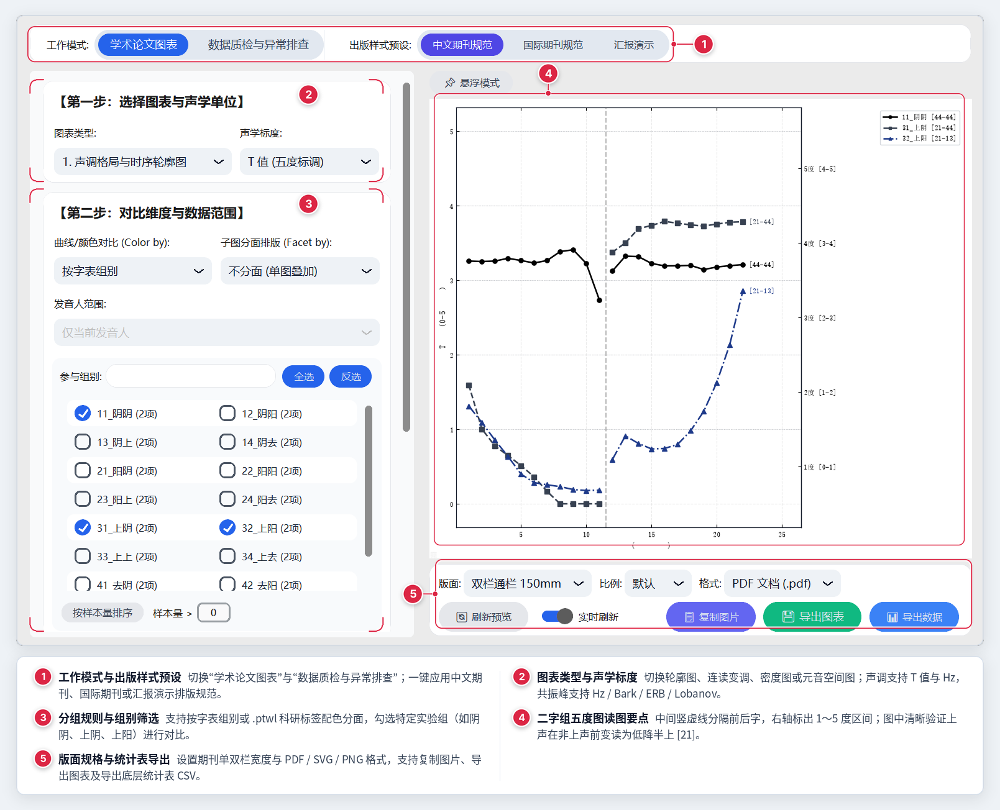

操作时顺着左上往左下看三个地方就够了：

1. **先选顶部的 `工作模式` 和 `出版样式预设`（①）**：
   - **`工作模式`**：定稿前先切到 **`数据质检与异常排查`** 抓漏网的错点；检查干净后再切回 **`学术论文图表`** 正式出图。
   - **三套现成的 `出版样式预设`**（不用自己调字号和粗细）：
     - **`中文期刊规范`**：适合投《中国语文》《方言》《民族语文》或写中文学位论文。四周有完整方框，除了颜色不同，还同时用“实线/虚线”和“圆点/方框/三角”把不同调类区分开——就算打印店印成纯黑白，每根线也分得清清楚楚。默认去掉图顶大标题（方便你在 Word 图片正下方敲“图 1 ……”）。
     - **`国际期刊规范`**：适合投英文期刊。自动去掉顶部和右侧多余的框线，采用对色盲读者友好的清爽配色，并在图例里注明阴影误差带的含义。
     - **`汇报演示`**：适合放进组会 PPT、课堂讲义或答辩幻灯片。自动变成 `16:9` 宽屏比例，把线条加粗、字号放大，并保留顶部大标题，后排听众也能看清。
2. **再选 `图表类型`、`声学标度` 和 `参与组别`（②、③）**：
   - 如果实验组别很多（比如双字连读有 16 种组合），可以在 **`参与组别`** 里只勾你想对比的那三四组，图面会清爽很多。
3. **最后在右下角保存图片或源数据（⑤）**：
   - **投论文优先选 `.pdf` 或 `.svg` 矢量图**（在文档里放大多少倍文字和线条都不会发虚）；做 PPT 或日常交流选高清 `.png` 或直接点 **`复制图片`**。
   - 别忘了顺手点一下右下角的 **`导出数据`**：它会把图上每条线算出来的平均值、标准差存成 `.csv` 表格，写论文正文要报具体数字时直接抄就行。

---

## 四、手把手教你读懂每一类声学图表（配 21 张真实录音实测图）

下面所有的图表，全部是用真实普通话人声录音工程（`普通话单字与双字调.teproj`、`普通话双字组16种声调实验.teproj` 和 `韵母.teproj`）在 PhonTracer 里直接导出的。我们把它们分成**声调与连读变调、数据质检排查、元音与共振峰、工具箱进阶脚本**四大类，逐张讲透怎么看。

---

### （一）声调与连读变调类图表（实测图 01～10）

#### 1. 单字调五度折线图 & 三套排版样式对比（实测图 01～03）

- **什么时候用？** 最基础、最核心的声调图，用来展示一个方言或语言里有几个单字调、每个调具体的升降走势和五度调值（如 `[55]`、`[24]`）。
- **横纵轴和线条怎么看？**
  - **横轴（`1～11`）**：因为每个人读每个字的快慢不一样，软件把每个字的韵母等分成 11 个时间点（第 1 点是字头，第 6 点是正中间，第 11 点是字尾），这样长短不同的字就能对齐在一起求平均了。
  - **左纵轴（`T 值 0～5`）与右纵轴（`1度～5度`）**：把录音的赫兹换算成 `0～5` 的相对音高分数，右边直接标好了传统方言调查的五度标尺——落在 `4～5` 之间就是 **5 度（高音）**，落在 `0～1` 之间就是 **1 度（低音）**。
  - **半透明阴影带（如果有开启）**：代表同组不同字之间的波动范围。阴影越窄，说明大家读得越整齐；阴影突然变宽，说明这一段有人读高有人读低。

下面三张图画的是**完全同一份真实单字调录音（1 男 1 女共 40 个字）**，只是切换了三种预设外观：

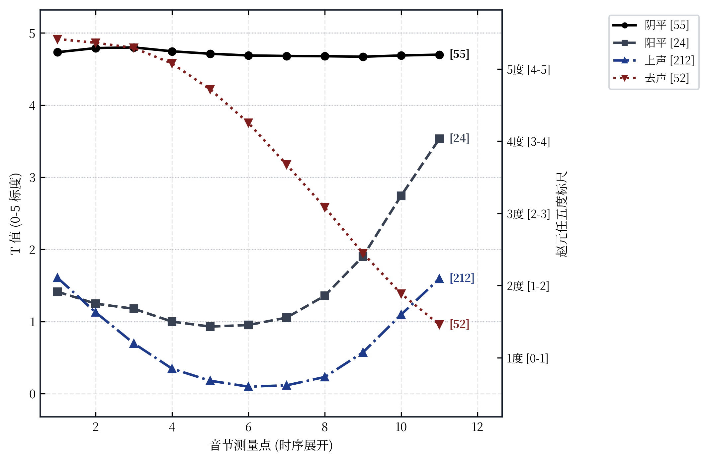

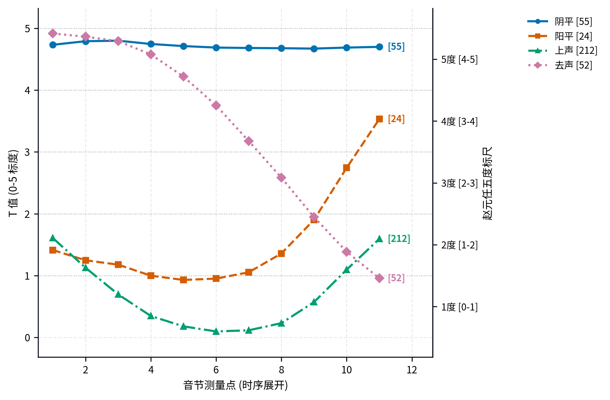

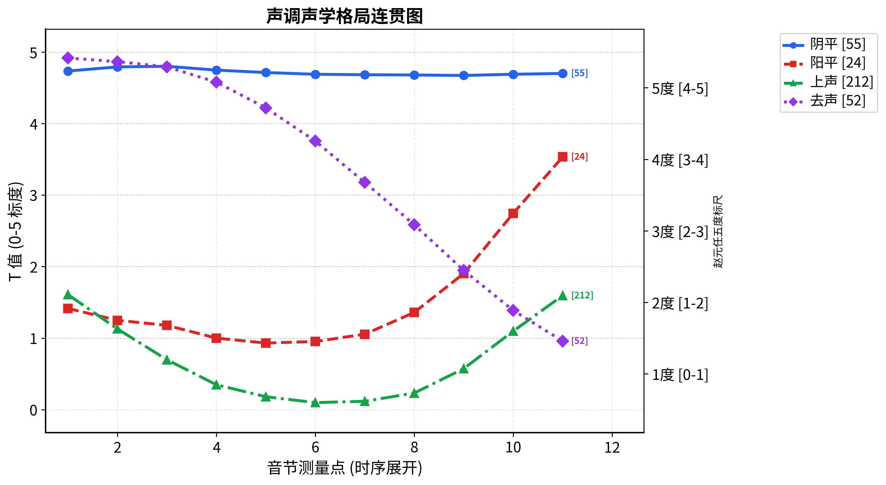

- **从这组真实录音图里能读出什么结论？**
  - **阴平（`[55]`）**：从第 1 点到第 11 点一直稳稳平走在 `4.7` 左右（对应右轴 `5度`），是典型的高平调。
  - **阳平（`[24]`）**：前一半在 `1～1.5`（`2度`）略微蓄势，后一半快速往上爬升到 `3.5`（`4度`），是中升调。
  - **上声（`[212]`）**：单字念的时候从 `2度` 往下降进 `0.1` 的最低谷（`1度`），在字尾又重新挑起来回到 `2度`，清楚呈现先降后升的曲折调。
  - **去声（`[52]`）**：从接近 `5` 的最高处一路干脆利落地往下滑到 `1` 附近，是全降调。

---

#### 2. 单字调原始赫兹（Hz）男女分面对比图（实测图 04）

- **什么时候用？** 想查看每位发音人**最原始的物理音高高低（每秒声带振动多少次）**，或者向审稿人、读者直观解释“为什么男女合并画图前一定要做五度 T 值换算”。
- **怎么看？** 纵轴不再是 `0～5` 的分数，而是真实的物理频率 **赫兹（Hz）**；左右两格分别画男声和女声。

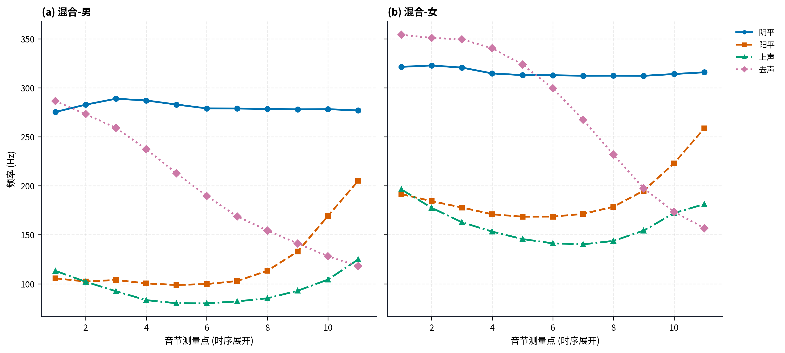

- **从这张图里能读出什么？**
  - 看左图 `(a) 混合-男`：男声最低音降到 **80 Hz** 左右，阴平高音在 **280 Hz** 左右。
  - 看右图 `(b) 混合-女`：女声天生声带短薄，哪怕压到上声最低谷也有 **140 Hz**，阴平在 **315 Hz**，去声开头更是冲到 **355 Hz**！
  - 你看：女生的中低音（180 Hz）甚至比男生的中音还要高。如果不换算成上面的五度 T 值就把男女赫兹混在一起算平均，算出来的数字既不像男声也不像女声——但各自单独看，左右两张图的“平、升、曲折、降”形状其实一模一样！

---

#### 3. 二字组重点连读变调五度折线图（实测图 05）

- **什么时候用？** 研究两个字连着读时声调怎么变化（比如普通话“你好”前一个字变成阳平，“首都”前一个字变成半上）。当实验组合很多（比如 16 种）时，只挑你最关心的 4～6 组画在一张图里对比最清楚。
- **怎么看？**
  - 横轴变成 **`1～22` 共 22 个点**：左边 **`1～11` 点是第一个字（前字）**，右边 **`12～22` 点是第二个字（后字）**。
  - 图正中间那条**竖直灰色虚线**就是前后两个字的分界线。前字末尾和后字开头之间故意断开了一小格，表示跨过了字界。

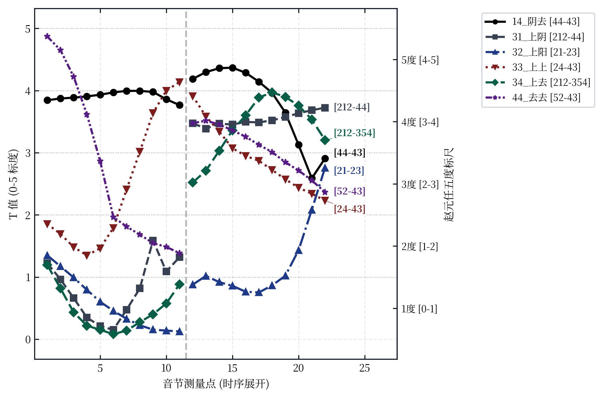

- **从这张图里能读出什么结论？**
  - 重点看前字都是上声的四条线（`31_上阴`、`32_上阳`、`33_上上`、`34_上去`）：
  - 在中间竖虚线左边（前字区间），只有深红色点线 **`33_上上 [24-43]`** 一路往上爬到了 `4` 度以上——直观证明了**“两个上声相连，前一个上声变成阳平”**！
  - 而另外三条（**`31_上阴`**、**`32_上阳`**、**`34_上去`**）在前字区间全都往下沉在 `0～1.5` 的低谷里，把单字调末尾原本往上翘的尾巴省掉了——这就是普通话日常说话最常见的**“上声在非上声前只读低降的半上 `[21]`”**。

---

#### 4. 双字组 16 种声调组合（4×4）连读变调全景网（实测图 06）

- **什么时候用？** 普通话四声两两组合一共有 `4 × 4 = 16` 种。如果把 16 根折线全塞进上面同一张框里，线条会缠成一团毛线根本没法看；选 **`连读变调与协同发音图`**，软件就会自动帮你按“前字是哪一调”拆成清爽的四个小格子。
- **怎么看？**
  - 四个小格分别装：**`(a) 前字为阴平`**、**`(b) 前字为阳平`**、**`(c) 前字为上声`**、**`(d) 前字为去声`**。
  - 每个小格里面有 4 根线，代表后面分别接阴平、阳平、上声、去声四种后字。
  - 看图秘诀：**先看每个小格左半边（前字）4 根线有没有拧成一股绳**——如果拧成一股绳，说明不管后面接什么字，前字都不变调；如果有一根线单独劈叉跑开了，那就是发生了连读变调！

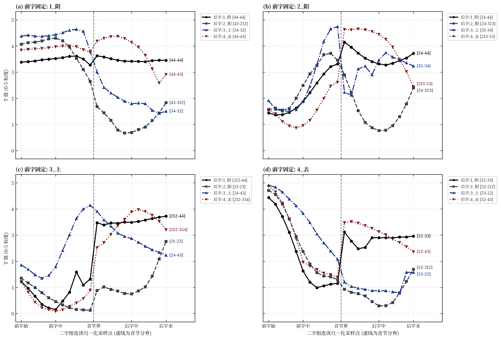

- **从这张图里能读出什么结论？**
  - 看 `(a)`、`(b)`、`(d)` 三个格子：左半边的前字 4 根线全都整齐地贴在一起（阴平全平在上面、阳平全往上爬、去声全往下掉，其中 `(d)` 里 `44_去去` 前字降得稍浅一点）。
  - 唯独看左下角 **`(c) 前字为上声`**：3 根线乖乖趴在底下，只有 **`33_上上`** 一根线大幅往上扬起！整套 16 种组合里哪里不变调、哪里变调，一张图全交待清楚了。

---

#### 5. 时序核密度热图：检查同组读音齐不齐（实测图 07）

- **什么时候用？** 折线图只画了一条“平均线”，万一你把两种完全不同的读法误分到了同一组（比如调查方言时，古全浊字读低升 `[13]`、古清音字读高升 `[35]`，混在同一个“阳平组”里硬求平均，就会画出一条谁也没读过的 `[24]` 假平均线！），用这张热图一眼就能验出来。
- **怎么看？**
  - 想象组里每一个字的音高线都是一支半透明的水彩笔，几十个字叠着涂过去：**颜色越红越深的地方，说明越多的字都从这条道上走过**；浅黄和留白的地方说明几乎没有字往那儿走。
  - **健康的图**：每个小格里只有**一条紧实的深红橙色主干道**。
  - **需要警惕的图**：如果某一个格子里**上下裂成了两条平行的深红带，中间反而发白**，说明这一组里混进了两种不同读法（比如条件变调或文白异读），应该回字表把它们拆成两组再统计。

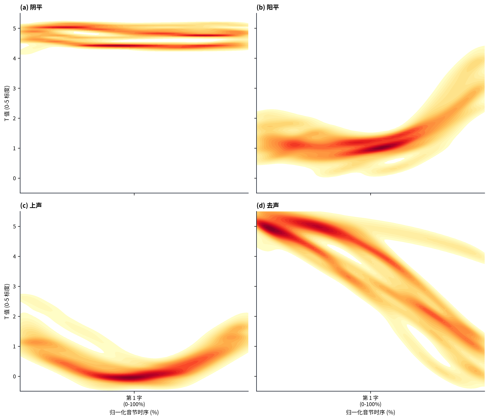

- **从这张图里能读出什么结论？**
  - `(a) 阴平`、`(b) 阳平`、`(c) 上声` 全都是结结实实的单条深红带，说明男女发音人的读法高度统一，算平均线完全放心。
  - `(d) 去声` 开头紧聚在左上角 `5` 度深红区，往右下角降落时像扇子一样稍微散开，说明大家起调都很高，只是每个人收尾降到底的深浅略有自然差别。

---

#### 6. 声调统计分布雨云图：把分布、中位数和每个字全摊开看（实测图 08）

- **什么时候用？** 想对比不同调类在整体音高（或斜率、拐点）上的集中程度和离散跨度，比传统干巴巴的柱状图信息量丰富得多。
- **为什么叫“雨云图”？怎么看？**
  - 它把三种图拼在了一起，像“一朵云下面正在下雨”：
  - **右边的彩色鼓包（“云朵”）**：看数据集中在哪儿——鼓包最凸出的高度，就是字数最扎堆的音高位置；如果鼓出两个包（双峰），说明组里有两拨不同读法。
  - **中间的小方框（箱线图）**：方框正中间的黑横线是**中位数**（排在最中间那个字的数值），上下框边包住了最核心一半（50%）的样本。
  - **左边散落的小圆点（“雨滴”）**：每一个小圆点就是**一个真实的录音字**！总共有几个字、有没有哪一个字孤零零掉队跑远了，数一数圆点全看得到。

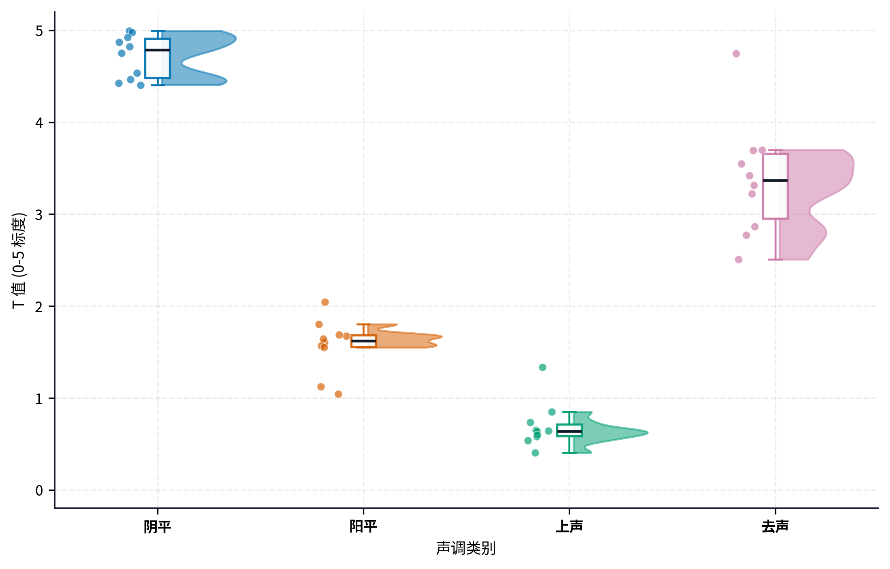

- **从这张图里能读出什么结论？**
  - 阴平整体高悬在 `4.4～5.0` 之间；上声整字平均音高最低（集中在 `0.6` 附近，箱子极扁说明非常稳定）；去声因为从最高处滑到最低处，不同字的整字均值跨度最宽（箱体最长），上方还有一个单独偏高的点（正是后面质检图抓出来的那个没降到底的去声字）。

---

#### 7. 音节物理时长（毫秒）堆叠对比图（实测图 09）

- **什么时候用？** 前面的五度折线图为了对齐形状，把长音和短音都拉成了同样宽的 11 个点——音长信息被抹平了。但研究**入声短调、轻声变短、焦点重音变长，或者单念跟连读的语速差别**时，必须看这张真实毫秒时长图。
- **怎么看？**
  - 纵轴单位是 **`毫秒 (ms)`**（`1000 ms = 1 秒`）。
  - 单字组只有一整根柱子；双字连读组会自动画成**上下两截叠在一起的柱子**：底下纯色一截是**前字时长**，上面带斜纹一截是**后字时长**，柱顶标出的数字是两个字加起来的总时长，工字形的黑竖线代表组内长短波动范围（标准差）。

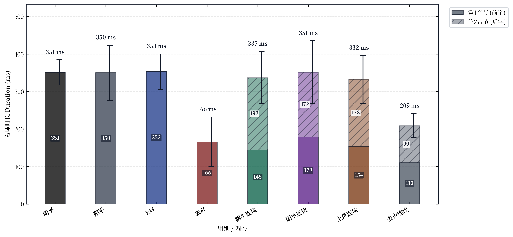

- **从这张图里能读出什么结论？**
  - **单字念的时候**：上声因为要先降后升拐个弯，耗时最长（平均 **`353 ms`**），阴平（`351 ms`）和阳平（`350 ms`）紧随其后；而**去声从高往下猛一砸就收音，干脆短促，平均只有 `166 ms`**，不到上声的一半长！
  - **一旦变成两个字连着读**：每个字的平均时长立刻压缩到 **`99～192 ms`**，读完整个双音节词的总时间（`332～351 ms`），居然跟慢慢单念一个字的时间差不多长——这就是连读语流里的音节压缩现象。

---

#### 8. 二字组前后字调类效应时间进程图：谁在控制当前这一刻的音高？（实测图 10）

- **什么时候用？** 这张图名字听着像高深统计，其实意思特别好懂——两个字连着读的时候，人的声带是有惯性的，也会提前做准备。这张图就是用来回答：**在从头到尾的 22 个时间点上，每一刻的音高到底主要听“前字”的，还是听“后字”的？**
- **三条线怎么看？**
  - 纵轴（`0.0～1.0`）可以直白理解成**“话语权占比”**（统计上叫方差解释率 $\eta^2$）：越接近 `1.0`，说明这一刻的音高几乎全由它说了算；越接近 `0`，说明它说了不算。
  - **蓝色实线（`前字调类`）**：前字原本是什么声调说了算的比例。
  - **橙色虚线（`后字调类`）**：后字是什么声调说了算的比例。
  - **绿色点划线（`交互项/残差`）**：需要“前字和后字凑在一起看”才能解释的部分（比如只有“上声 + 上声”凑成一对才触发的特殊变调）。

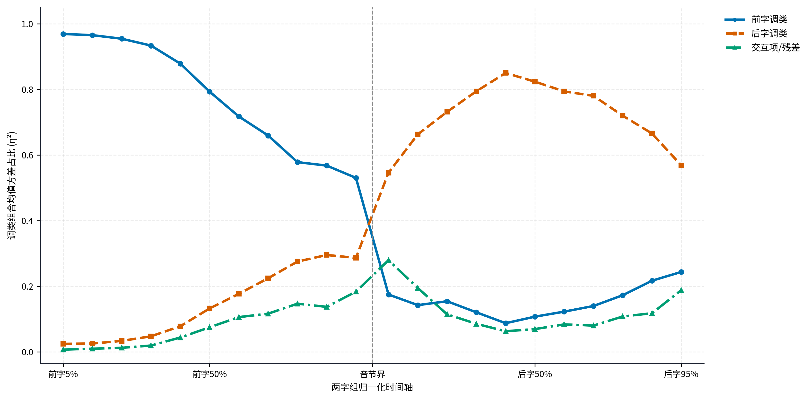

- **从这张图里能读出什么结论？**
  1. 词刚开头时（`前字5%`），蓝线高达 **`0.97`**，橙线接近 `0`——刚开始当然完全由前字自己的声调说了算。
  2. 还没跨过中间音节界（在前字后半段），**橙色虚线就已经提前抬头爬升到了 `0.30`**——说明嘴里还在念前一个字的后半截，声带已经在提前为衔接后一个字的高低做准备了（语音学上叫“逆向预期协同发音”）。
  3. **刚跨过正中间的 `音节界` 虚线**：蓝线和橙线精准完成“交接班”，后字橙线迅速冲上 **`0.85`** 主导音高；同时你会发现蓝线在后字开头还留着 `0.18` 左右的尾巴没立刻归零——这就是前一个字留下的声带惯性（“顺向滞后影响”）。
  4. 看底下的**绿色点划线**：正好在 `音节界` 交界处鼓起一个明显的山峰（**`0.28`**），正好对应上声连读变调在两字交界处产生的剧烈变化！

---

### （二）数据质检与异常排查类图表（实测图 11～12）

定稿导表之前，切到工作台顶部的 **`数据质检与异常排查`** 模式看这两张图，能在十秒钟内把整批录音里漏修的错点抓出来。

#### 9. 组内单样本原始曲线叠置排查图（实测图 11）

- **什么时候用？** 想按声调分组，把组里几十个字的原始曲线全叠在一起照妖镜式检查，看看有没有哪一个字跑偏了。
- **图上的颜色怎么看？（重点分清灰线、红线和琥珀色虚线）**
  - **浅灰色细线**：表现乖巧正常的绝大多数样本，退在背景里不抢眼。
  - **黑色虚线**：这一组的中心基准走势（中位数）。
  - **醒目的红色实线 + 小红框标签**：软件自动抓出来的离群或带声学警告的样本，并且贴心地把 **`发音人 : 汉字 #词条编号`** 直接印在红线旁边，不用你去表格里大海捞针！
  - *（补充说明：如果在软件界面里遇到**红色实线**与**琥珀色虚线**同时存在的情况——红色实线代表八度跳变或切分报错等硬伤，必须回主界面修到 **0 项**；而琥珀色虚线只是温和提醒这个字比同组平均偏高或偏低了一些，只要回听录音确认发音人确实这么念、蓝点也没抓错，就是正常的嗓音波动，直接保留即可，千万别为了图好看去人为改数据。）*

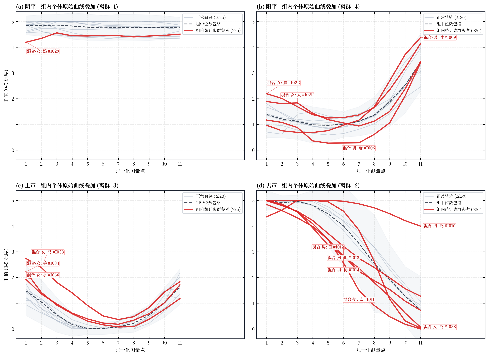

- **从这张图里怎么抓异常？**
  - 一眼扫过去，右下角 **`(d) 去声`** 最显眼：正常去声字全都从左上角 `5` 度一路斜冲到右下角 `1` 度，偏偏有一根红线 **`混合-男: 骂 #I010`** 到了后半截还高高挂在 `4` 度下不来！记下 `#I010` 这个编号，回主界面右侧目录点开它一听一查，马上就能确认是发音人没读到位还是右红线切早了。

---

#### 10. 词条级逐行偏差排序热力图：几百个词十秒扫完（实测图 12）

- **什么时候用？** 如果你的实验有两三百个词，叠在线图里还是嫌密，就用这张“体检排行榜”——软件会自动按每个词跟同组平均值的偏离大小从上往下排好队，**最可疑的词全部置顶排在最上面几行，并打上 `[!]` 标记**。
- **红白蓝三种颜色怎么看？**
  - **每一横行**就是一个具体的字，从左到右 11 小格对应第 `1～11` 号采样点。
  - **浅米白色（接近 `0`）**：跟同组大家读的平均值几乎一模一样，完全正常。
  - **深红色（`+1 ～ +3`）**：在这一段比同组平均值明显**偏高**。
  - **深蓝色（`-1 ～ -3`）**：在这一段比同组平均值明显**偏低**。

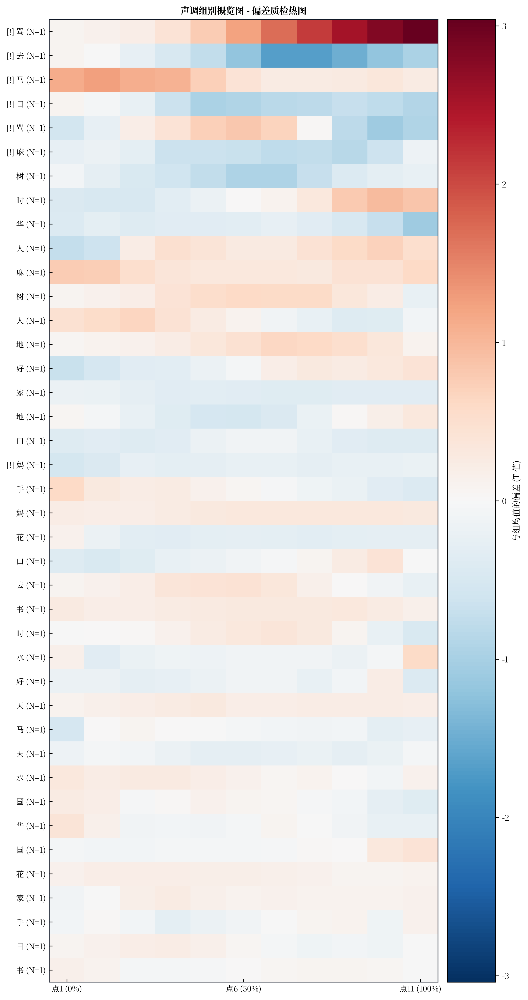

- **从这张图里能读出什么？**
  - 看最顶上第一行 **`[!] 骂 (N=1)`**：前半截还是浅色，越往右越变成发黑的深红色（偏高近 `+3` 度），正是上一张图抓出来的那个尾巴没降下去的 `骂`！
  - 第二行 **`[!] 去 (N=1)`**：中间几格呈蓝色，说明这个字中段往下掉的速度比别的去声字更快。
  - 而从第七行往下整整三十多行，全是一片干净柔和的浅米白色——说明剩下三十多个字全都稳稳当当，你只需要花一分钟回听最顶上带 `[!]` 的那几行就够了！

---

### （三）元音与共振峰类图表（实测图 13～18）

#### 11. 元音 F1–F2 舌位空间图：为什么坐标数字是反着标的？（实测图 13 & 14）

- **什么时候用？** 研究单元音格局、鼻化元音或方言韵母音值时必画的核心图，用来把抽象的赫兹频率变成直观的**“口腔舌头高低前后位置图”**。
- **新手第一关：为什么横轴和纵轴的数字都是反着标的？**
  - 请在脑海里**想象一个人面朝左边站着**：他的嘴唇在左边（前），嗓子眼舌根在右边（后），上颚在上面（高），下巴在底下（低）。
  - 语音学发现：**第一共振峰 `F1` 数值越小，嘴张得越小、舌位越高；第二共振峰 `F2` 数值越大，舌头越往前伸。**
  - 所以软件故意把横轴 `F2` 设成**往左变大**、纵轴 `F1` 设成**往上变小**——这样一反转，图面方向就与口腔真实舌位对应上了：**画出来的元音图，跟面朝左站着的人嘴里舌头的真实位置方向完全一模一样！**
    - **左上角**（如 `[i]`、`[ü]`）= **舌位又高又靠前**；
    - **右上角**（如 `[u]`、`[o]`）= **舌位又高又靠后（圆唇）**；
    - **最底下**（如 `[a]`）= **嘴巴张到最大、舌位压到最低**。
- **图上的圈、虚线框和缩写字母是什么意思？**
  - **彩色虚线椭圆圈（`Ellipse: 95% CI`）**：圈住同组元音落点的散布范围。圈越小说明每次发音舌位越准；两个圈如果叠在一起，说明这两个音听起来快分不清了。
  - **外围灰黑色大虚线框与左下角 `VSA = 4.18 SD²`**：把最边角几个极端元音连起来围成的“元音空间总面积”（Vowel Space Area）。面积越大，说明发音越清晰饱满、口腔打开得越充分（儿童语言发育、清晰言语或病理嗓音研究经常对比这个面积数字）。
  - **图例里的 `TL`（Trajectory Length）**：代表念这个韵母的过程中舌头一共滑动了多远——单韵母舌头基本不动所以 `TL` 很小，复韵母舌头大范围滑动所以 `TL` 较大。

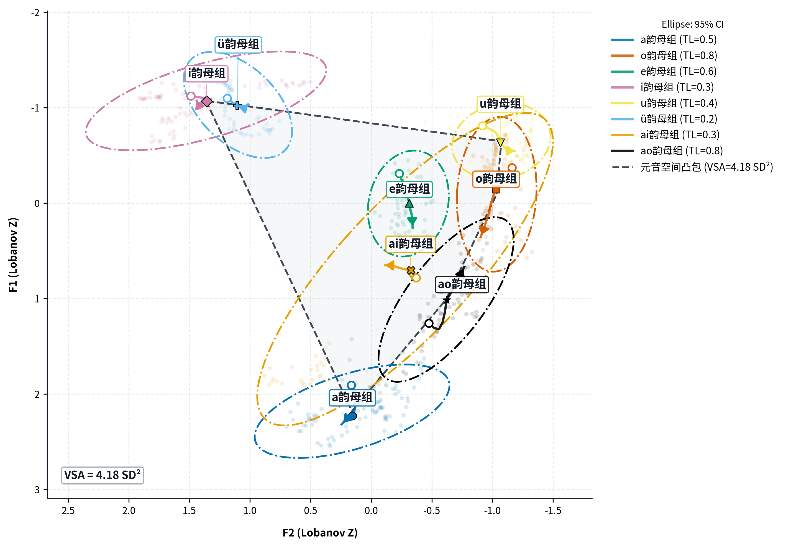

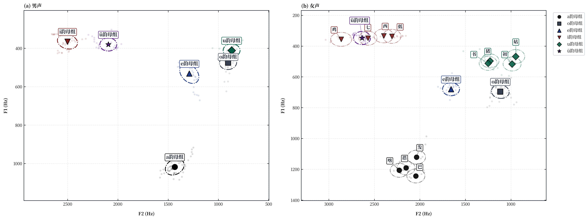

- **对照上面两张真实录音图能读出什么结论？**
  - 先看图 14（原始 Hz 男女分开画）：男声声道长，底下 `[a]` 的 `F1` 在 **1020 Hz** 左右，左上 `[i]` 的 `F2` 在 **2500 Hz**；女声声道短，共振频率整体放大，底下 `[a]`（巴、搭、发、喀）的 `F1` 去到了 **1120～1240 Hz**，左上「鸡」的 `F2` 高达 **2860 Hz**！
  - 再看图 13（经过 **Lobanov 归一化**消除男女声道长短差异后合并）：男声和女声清晰对齐在统一的 `Z` 分数坐标里，左上 `[i, ü]`、右上 `[u, o]`、中间偏上 `[e]`、最底下 `[a]` 围出典型的倒三角形元音空间（总面积 `VSA = 4.18 SD²`）！

---

#### 12. 复韵母舌位滑移矢量空间图（实测图 18）

- **什么时候用？** 想在元音舌位图上专门看 `ai`、`ei`、`ao`、`ou`、`ie`、`uo` 这些**复韵母（双元音）发音时舌头是从哪儿滑向哪儿的**。
- **怎么看？**
  - 每根实线一头是**空心小圆圈（代表韵母开头 20% 处的起点舌位）**，另一头是**实心箭头（代表韵母收尾 80% 处的终点方向）**。线越长（图例里 `TL` 数值越大），说明舌位跨度越大。

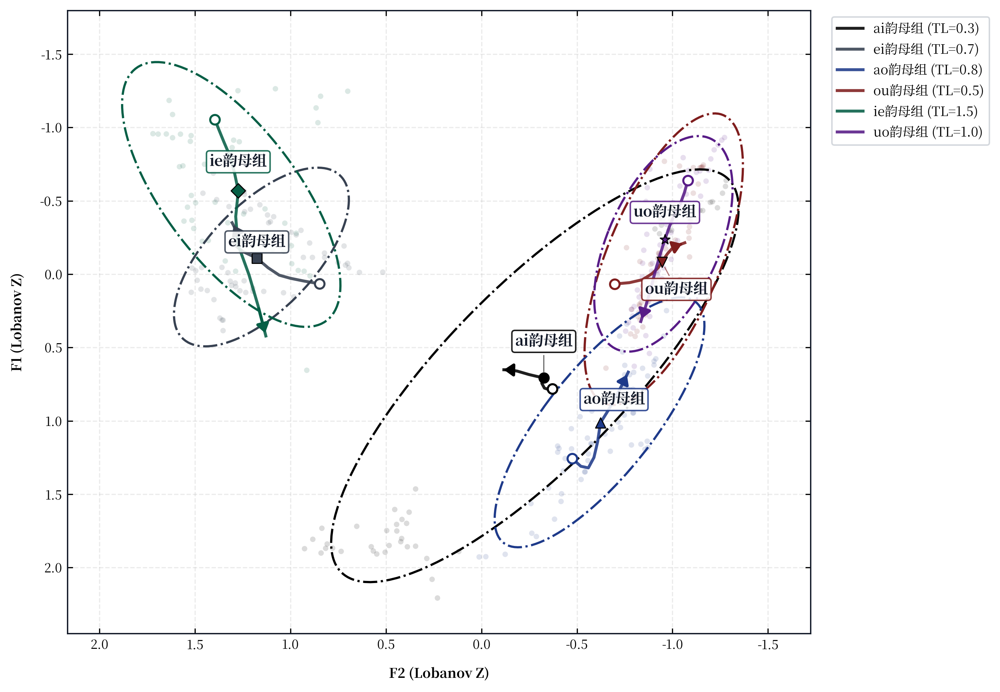

- **从这张图里能读出什么结论？**
  - 绿线 **`ie韵母组` 滑动距离最长（`TL=1.5`）**：空心圆从左上角极高的 `[i]` 区出发，箭头大幅往下滑向中低元音 `[e/ɛ]` 区。
  - 紫线 **`uo韵母组`（`TL=1.0`）**：从右上角高后圆唇 `[u]` 区一路往下开口滑向 `[o]` 区。
  - 蓝线 **`ao韵母组`（`TL=0.8`）** 则刚好反过来：空心圆从偏底下的低元音 `[ɑ]` 起步，箭头一路往右上角高后圆唇 `[u/o]` 区收拢，复韵母“开口变闭口”与“闭口变开口”的相反方向一目了然。

---

#### 13. 复韵母 F1 / F2 / F3 全程动态轨迹图（实测图 15）

- **什么时候用？** 上面的舌位空间图折叠了时间轴；如果你想仔细看复韵母**从第 0% 到第 100% 每一刻共振峰是怎么一步步拐弯过渡的**（比如看韵头占多长、韵腹稳态段在哪儿、有没有卷舌音拉低第三共振峰 `F3`），就用这张动态轨迹图。
- **怎么看？**
  - 横轴是音节从头到尾的**时间百分比（`0% ～ 100%`）**，纵轴是**频率（Hz）**。
  - 画面天然分成上、中、下三层：
    - **最底下的一簇虚线（方框点）** = **第一共振峰 `F1`**（越往上走代表嘴张得越大）；
    - **正中间变化最明显的一簇实线（圆点）** = **第二共振峰 `F2`**（越往上走代表舌头越往前推，越往下掉代表舌头越往后缩或圆唇）；
    - **最顶上的一簇点划线（三角点）** = **第三共振峰 `F3`**（遇到儿化音或卷舌音 `r` 时，`F3` 会明显往下掉）。

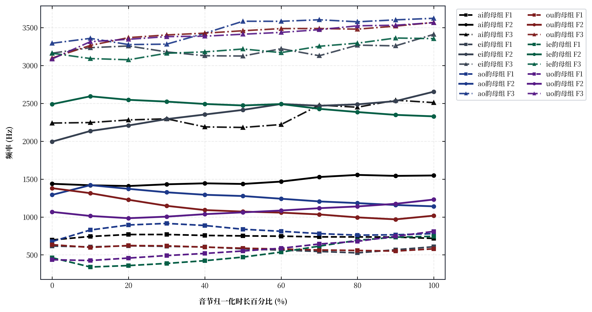

- **从这张图里能读出什么结论？**
  - 看中间实线圆点簇：深灰色的 **`ei韵母组 F2`** 从开头的 `2000 Hz` 一路稳步爬升到词尾的 `2650 Hz`（舌头不断往前高 `[i]` 推）；而深蓝色的 **`ao韵母组 F2`** 和暗红色的 **`ou韵母组 F2`** 则从 `1300～1400 Hz` 持续往低频 `1000 Hz` 滑落（舌头不断往后缩并拢圆嘴唇）。

---

#### 14. 六大单韵母二维时空核密度等高线图：看“单韵母到底纯不纯”（实测图 16）

- **什么时候用？** 名义上叫“单韵母”，发音时舌头真的从头到尾纹丝不动吗？这张图用“红早蓝晚”的等高线把所有采样点全画出来，专门检验单韵母的稳定性与隐含微动程（比如汉语普通话里著名的 `o` 和 `e` 动程现象）。
- **“红早蓝晚”怎么看？**
  - 形状像地理课的等高线地图：圈越密的地方样本越集中。
  - 看右边竖着的颜色尺：**偏红色代表音节刚开头（`0%` 早段）**，**偏蓝色代表音节快收尾（`100%` 晚段）**。
  - 如果一个韵母红圈和蓝圈完全叠在同一个小圆团里，说明它从头到尾舌头稳如泰山；如果**一头红、另一头拖出长长的蓝尾巴**，说明念这个单韵母时舌头其实悄悄滑动了！

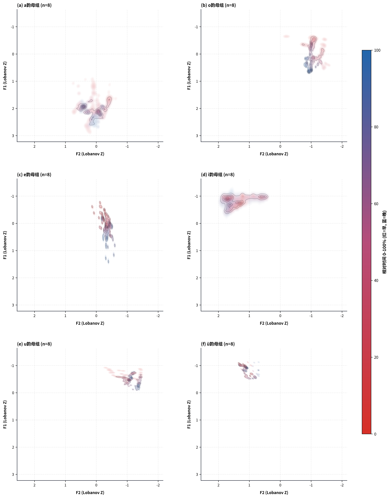

- **从这张图里能读出什么核心结论？**
  - 看 `(d) i韵母组` 和 `(f) ü韵母组`：红蓝等高线紧紧缩在左上角一小团，从头到尾几乎不走样，是纯粹稳定的高元音。
  - 再看右上角 **`(b) o韵母组`（玻、坡、摸、播）** 和中间 **`(c) e韵母组`（歌、科、喝、车）**：两个图都呈现非常明显的**“上面偏红、底下拖着蓝色尾巴”**！这直接用真实声学数据印证了普通话语音学的一个经典事实：普通话唇音后的单韵母 `o` 实际发音带有明显的圆唇过渡（接近 `[uo]`），而单韵母 `e` 也有从高往半低滑移的动程（常记作 `[ɤ]` 或 `[ɯʌ]`）！

---

#### 15. 元音对立与合并度（Pillai 值）矩阵图：给“两个音混没混同”打分（实测图 17）

- **什么时候用？** 肉眼看元音图觉得两个椭圆圈贴得很近（比如方言里的前后鼻音韵腹、或者儿化韵合流、外语学习者分不清 `/iː/` 和 `/ɪ/`），审稿人往往会问：“你说它们快合并了，有没有客观数字证明？”——导出这张 **Pillai 矩阵图** 就能直接给出定量指标！
- **别被“Pillai”这个洋名字吓到，像看视力表一样简单：**
  - 这是左右并排的两张矩阵子图：左图 `(a)` 看 **元音对立重叠度（Pillai Score：`0` = 合并，`1` = 分离）**，右图 `(b)` 看两个元音中心点的**声学欧氏距离**（数值越大中心相距越远）。
  - 只记一句话就够了：**左图 Pillai 分数永远在 `0` 到 `1` 之间——越接近 `0`（颜色越浅米黄），说明两个音越高度重叠或趋于合并；越接近 `1`（颜色越深藏蓝），说明两个音分得越彻底！**
    - 通常 **小于 `0.20`**：说明两个音大面积重叠，日常读音已经高度趋同或合并；
    - **大于 `0.70`**：说明两个音楚河汉界，离得非常远。

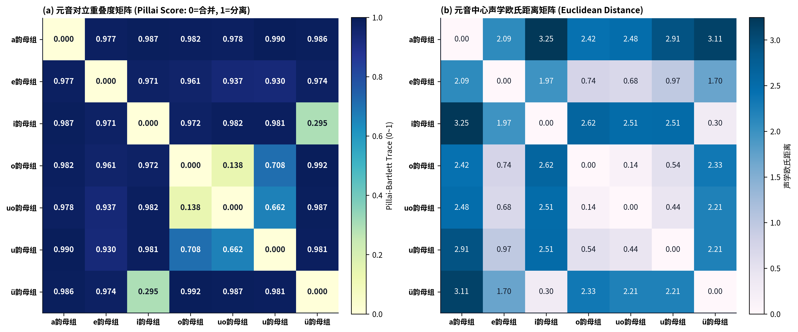

- **从这张真实录音矩阵里能读出什么结论？**
  - 找到左图 `(a)` 里的 **`o韵母组` × `uo韵母组`** 交叉格：数字只有 **`0.138`**（呈浅米黄色，右图 `(b)` 对应中心距离仅 `0.14`）。这用具体数值证明：在这批录音里，唇音后的 `o`（玻、坡、摸）与复韵母 `uo` 在声学空间里高度重叠，实际音值几乎合一。
  - 再看 **`i韵母组` × `ü韵母组`**：分数是 **`0.295`**，因为它们舌头高低前后都在左上角，只靠圆不圆嘴唇区分，所以距离较近。
  - 而看 **`a韵母组` × `u韵母组`**：分数高达 **`0.990`**（几乎满分 1.0），因为一个在最底下张大嘴、一个在右上角撅圆嘴，完全没有任何重叠！

---

### （四）Toolkit 工具箱内置脚本生成的进阶专题图表（实测图 19～21）

除了主界面自带的常规图表，把 `.teproj` 工程放进独立工具箱 **`Toolkit → 自定义脚本`** 页签，不用自己写一行代码，直接点现成的内置脚本就能跑出下面三张发声态、辅音摩擦与自动修点专题图（工具箱操作详见下一册 `04`）：

#### 16. 嗓音发声态多维对比箱线图：量化“气声、清亮嗓与气泡音”（实测图 19）

- **什么时候用？** 研究声调伴随的发声态（比如上声低谷的气泡音/嘎裂声、吴语清浊音的气声差异、民族语的紧喉音或松喉音）时直接运行内置脚本生成。
- **六个小格里的指标用大白话怎么理解？**
  1. **`H1-H2 谐波差 (dB)`**：看声门漏气程度——**数值越大越偏柔和气声**，数值越小（甚至负数）说明声带夹得越紧（偏紧喉）。
  2. **`CPP 倒谱峰值突出度 (dB)`** 与 **`HNR 谐噪比 (dB)`**：这两项都是给**“嗓音有多清亮规律”**打分的——**数值越高，说明声带振动越整齐清亮**；数值越低（尤其是 `HNR` 掉到 0 以下），说明声音里夹杂了明显的粗糙气泡音或摩擦气息声。
  3. **`Jitter 基频微扰 (%)`** 与 **`Shimmer 振幅微扰 (%)`**：看相邻两次声带振动之间的抖动幅度——**数值越小越平稳**，数值飙高说明声带进入了忽快忽慢、忽大忽小的不规则状态（常见于气泡音或急降调收尾）。
  4. **`H1-A3 频谱倾斜 (dB)`**：辅助看高频能量衰减快慢，越大声音越柔和暗淡，越小越清脆明亮。

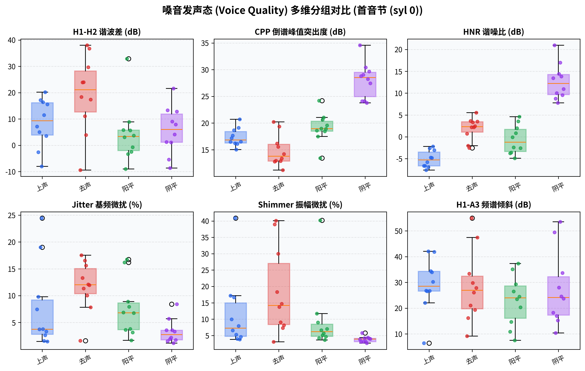

- **从这张真实录音图里能读出什么结论？**
  - **阴平最清亮平稳**：它的 `CPP`（中位数约 `28 dB`）和 `HNR`（约 `12 dB`）全场最高，而抖动指标 `Jitter`（约 `3%`）和 `Shimmer`（约 `4%`）全场最低——因为高平调声带绷得最匀称稳定。
  - **上声气泡音被精准抓出**：看右上角 `HNR 谐噪比`，**上声组掉到了全场最低（约 `-5 dB`）**！这直接为“普通话单字上声降入低谷时普遍伴随非周期性气泡音”提供了客观声学证据。
  - **去声跨度最大**：去声在瞬间从最高音砸向最低音的过程中，气流和振幅剧烈变化，因此 `H1-H2` 和 `Shimmer` 箱体拉得最长。

---

#### 17. 擦音 / 塞擦音频谱四阶矩分析图：给辅音“尖不尖、闷不闷”算分（实测图 20）

- **什么时候用？** 前面的共振峰图是测元音的；如果你想研究**字头辅音**（特别是平翘舌 `z/c/s` vs `zh/ch/sh`、舌面音 `j/q/x`，或者方言尖团音分混），用这个内置脚本提取字头摩擦段的噪音特征最合适。
- **怎么看？重点盯住 `COG（频谱重心）` 就行：**
  - **右图柱状图（`COG 频谱重心 Hz`）**：把辅音摩擦声想象成一串高低混杂的沙沙声，**`COG` 就是这团沙沙声的“平均音高重心”**——发音部位越靠前、嘴唇越扁平（如 `s`、`x`），声音越尖细刺耳，**`COG` 赫兹数就越高**；发音部位越靠后、或者叠加上撅嘴圆唇（如卷舌 `sh`、圆唇 `u` 前辅音），前口腔共鸣腔变长，声音越低沉发闷，**`COG` 赫兹数就越低**。
  - **左图散点图（`COG vs 偏度 Skewness`）**：横轴是重心高低，纵轴“偏度”辅助看能量尾巴往哪边偏（重心越低的后音，往往偏度正值越大，形成左上到右下的漂亮斜带；菱形大块是每组的中心点）。

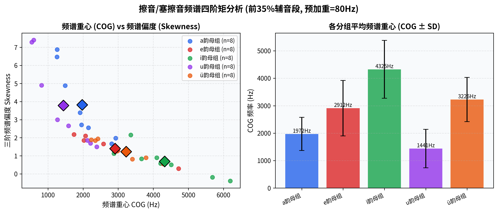

- **从这张真实录音图里能读出什么结论？**
  - 哪怕只是提取韵母词表前 35% 的字头辅音段，发音部位和圆唇效应也分得清清楚楚：包含「鸡、七、西」舌面擦音/塞擦音的 **`i韵母组` 频谱重心冲到了最高（平均 `4325 Hz`）**，听感最清脆尖锐；而带有强烈圆唇动作、拉长了口腔前部通道的 **`u韵母组`（「猪、书、初、姑」）重心一下子降到了 `1441 Hz`**，声音明显低沉浑厚！

---

#### 18. 基频八度跳变自动诊断与调域重算预览图（实测图 21）

- **什么时候用？** 手头刚导进来几百个词，不想挨个点开找哪里出现了倍频/半频跳点时，先跑一遍这个内置清洗脚本，它会自动扫描全工程并生成修前修后对比图与一键重算补丁。
- **左右两栏怎么看？**
  - **左图（清洗前）**：灰细线是平滑正常的词条，**红点实线**是脚本自动揪出来的“相邻两点跳变幅度偏大”的可疑词条。
  - **右图（预期清洗后）**：脚本根据每位发音人自己真实的正常音高范围，自动算出建议收窄的基频上下限，并用**绿点实线**画出压平突变尖峰后的预期走势供你核对。

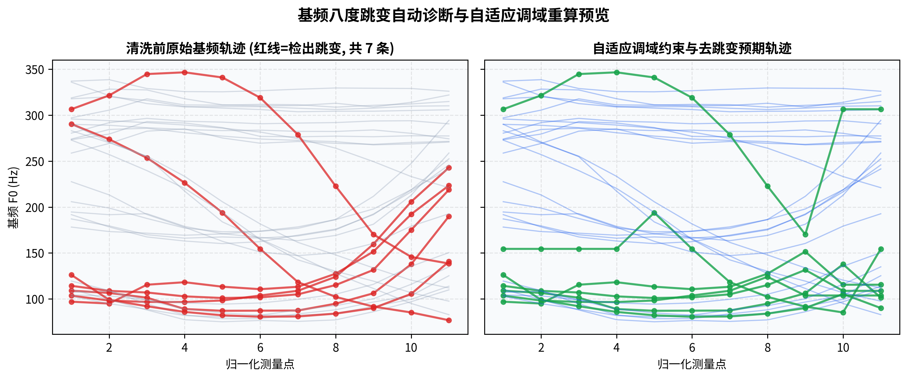

---

## 五、写论文时的选图速查表（一表对号入座）

不知道自己的论文该放哪几张图？直接按你的研究主题照着下面挑就行：

| 你的论文研究什么问题？ | 推荐导出的主力图表组合 | 记得配套导出的表格 |
| :--- | :--- | :--- |
| **方言 / 民族语单字声调系统描写** | `01/02` 单字调五度折线图 + `07` 核密度热图（证明无未拆分的条件变调）+ `09` 物理时长图（尤其有入声短调时必放） | `.xlsx`（取五度 T 值均值与毫秒时长） |
| **双字组连读变调与协同发音研究** | `06` 16 组合连读变调全景网 + `05` 重点变调组折线对比图 + `10` 前后字调类效应时间进程图 | `.xlsx` + 图表右下角 `导出数据 (.csv)` |
| **单元音与复韵母格局描写** | `13` Lobanov 元音舌位空间图（含 `VSA` 面积）+ `18` 复韵母滑移空间图 + `15` F1-F3 动态轨迹图 | `.xlsx`（取 F1/F2 原始 Hz 与 Lobanov 值） |
| **方言韵母合并 / 二语元音偏误对比** | `13` 元音舌位空间图（看椭圆重叠）+ `17` Pillai 合并度矩阵图（给出 0～1 定量合并分数）+ `16` 时空核密度图 | 图表右下角 `导出数据 (.csv)` |
| **上声气泡音 / 清浊发声态 / 擦音研究** | 常规声调或元音图 + Toolkit 内置脚本导出的 `19` 嗓音发声态箱线图 或 `20` 擦音频谱四阶矩图 | 脚本同步输出的逐词声学指标统计表 |

如需了解独立工具箱 `Toolkit` 的音频批量拆合、高级字表 AI 打标、命令行一键批处理以及**可直接填空套用的论文“研究方法”写作模板**，请继续阅读下一册 [04 工具箱预处理与批处理附录](./04_工具箱预处理与批处理附录.md)。
