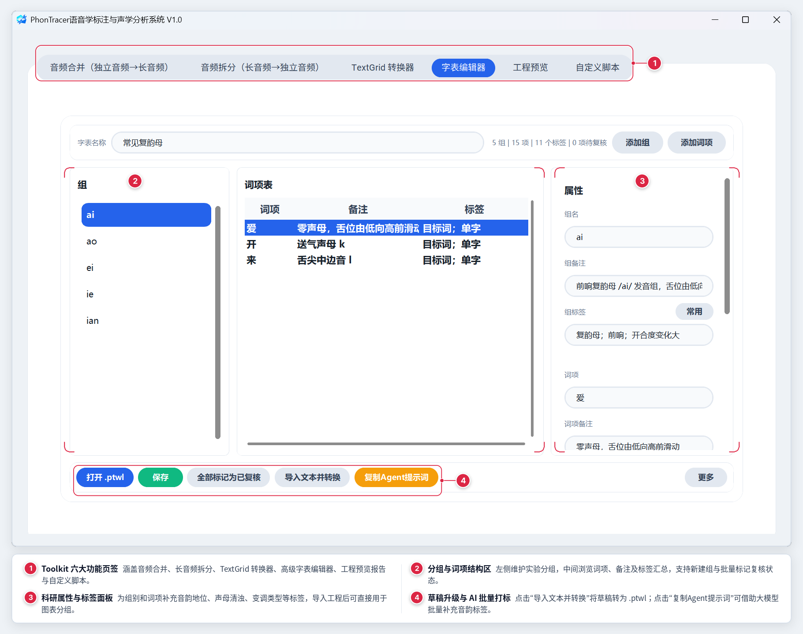
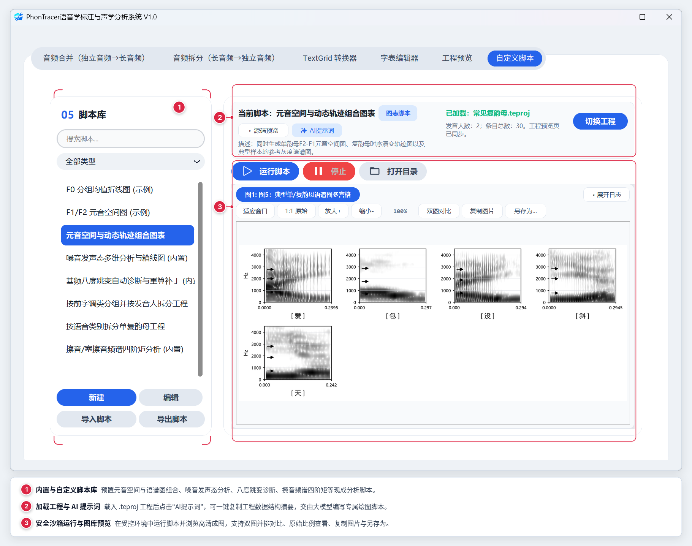
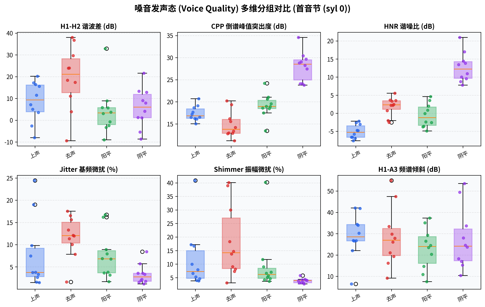
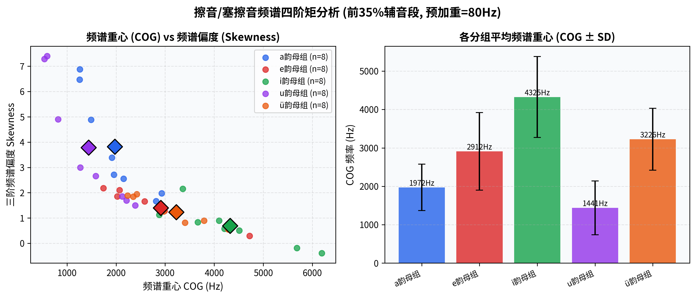
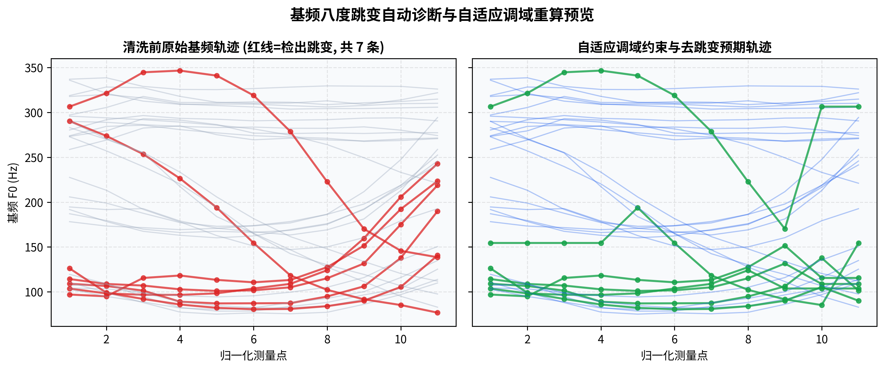

# 04 工具箱预处理与批处理附录

分册导航：[00 快速上手与实验全景导航](./00_快速上手与实验全景导航.md) ｜ [01 实验材料准备与导入指南](./01_实验材料准备与导入指南.md) ｜ [02 选区精修与疑难语音处理实战](./02_选区精修与疑难语音处理实战.md) ｜ [03 数据导出与声学图表解读指南](./03_数据导出与声学图表解读指南.md) ｜ [04 工具箱预处理与批处理附录（本篇）](./04_工具箱预处理与批处理附录.md) ｜ [05 常见问题解答](./05_常见问题解答_QA.md)

在主程序之外，PhonTracer 套件还提供独立工具箱 **Toolkit** 与命令行工具 **PhonTracerCLI**，用于解决音频批量拆合、高级字表音韵打标、研究方法报告生成、自定义组合绘图以及多发音人自动化批处理等进阶需求。文末附有学术论文“研究方法”章节的规范写作模板与归档核对清单。

## 一、Toolkit 独立工具箱六大功能指南

打开 **Toolkit** 后，顶部导航栏依次提供六个功能页签，涵盖实验前材料整理与实验后扩展分析：

### 1. `音频合并（独立音频→长音频）`

当手头语料为数十上百个零散的单字或单词 `.wav` 文件，希望将其整合为单条连续音频统一管理时，可使用该页签：

- **自动插入标准静音间隔**：按文件顺序批量拼接音频，并在相邻词条之间插入设定长度的静音段（如 `0.5s`），同时可导出对应的词条顺序清单。
- **保持原采样率无损输出**：当待合并的音频具有相同采样率（例如均为 `24 kHz` 或 `44.1 kHz`）时，系统严格保持原始采样率直接拼接，不会强制重采样改变音频采样基准；若混入不同采样率文件，则自动对齐至最高输入采样率并给出提示。

### 2. `音频拆分（长音频→独立音频）`

当现场采集了整段连续朗读的长录音，需要先将其切分为按序号与词名命名的独立 `.wav` 语料库时，可使用该页签：

- **支持多格式字表与无字表纯拆音**：既可载入 `.ptwl`、`.csv` 或草稿 `.txt` 字表按词条名称输出文件（如 `001_首都.wav`），也可不加载字表，仅根据静音停顿切分为按序号排列的独立音频片段。
- **段数不一致显式告警与多余片段保留**：若因发音人中途清嗓或重复朗读导致实际切出的语音段数与字表词条数不一致，系统会明确弹出告警提示，并将超出词表数量的音频片段完整保留为带有 **`_extra_`** 标识的文件（如 `033_extra_01.wav`），不会静默截断或丢弃末尾词条，便于研究者快速核查对齐位置。

### 3. `TextGrid 转换器`

用于在标准 Praat `.TextGrid` 标注文件与 PhonTracer 词表及工程结构之间进行转换：

- **层结构预览**：载入 `.TextGrid` 后自动列出全部标注层的名称、区间数量与文本示例，便于准确选择目标词条层与核心音段层。
- **挂载辅助字表**：支持在导入既有时间边界的同时关联 `.ptwl` 或 `.txt` 字表，为仅有拼音或编号的旧标注批量补充汉字词名与实验分组信息。

### 4. `字表编辑器`（管理 `.ptwl` 高级字表与 AI 批量打标）

当实验需要为词条附加音韵地位、声母清浊或变调条件等多维科研属性时，可在 **`字表编辑器`** 中进行可视化编辑：



对照图中序号，界面分为顶部页签栏（**①**）、中部分组与词项管理区（**②**）、右侧属性面板（**③**）与底部操作栏（**④**）：

- **三栏协同管理（②、③）**：左栏管理实验分组，中栏展示当前组内的词项、备注及标签汇总，右栏编辑选中组或词项的详细备注与分号分隔的多维标签（如 `复韵母; 前响; 开合度变化大`）。保存为 `.ptwl` 导入主程序后，这些标签可直接在图表工作台中作为配色或分面依据。
- **草稿升级与 AI 辅助补充标签（④）**：
  - 点击 **`导入文本并转换`**，可将普通 `.txt` 或 `.csv` 草稿直接升级为结构化 `.ptwl` 高级字表。
  - 点击橙色 **`复制Agent提示词`** 按钮，系统会将当前词表结构与 `.ptwl` 字段规范一并复制到剪贴板。将其粘贴至大语言模型并说明需要补充的语言学属性（例如要求补充《广韵》摄、等、呼、声调及声母清浊标签），即可快速完成大批量调查字的音韵属性建库，人工抽检确认后点击 **`全部标记为已复核`** 并 **`保存`** 即可。

### 5. `工程预览`（进度核查与导出研究方法报告）

载入 `.teproj` 工程文件后，无需打开声谱图界面即可查看工程内各发音人的词条总数、有效条数、已忽略条数与警告统计，并支持一键导出 **《研究方法与统计摘要报告》**（支持 Markdown 与 Excel 归档格式）。报告自动汇总以下信息：

1. 软件版本与底层声学分析配置；
2. 每位发音人实际使用的基频范围、共振峰分析上限、采样点数及单条目独立覆盖记录；
3. 被标记为“忽略”的排除词条清单及具体排除原因汇总；
4. 各实验组的声学描述统计量（样本量、均值、标准差、时长）与组间单因素方差分析（ANOVA）摘要；
5. 工程文件的 SHA-256 校验指纹，便于论文审稿与数据归档溯源。

### 6. `自定义脚本`（内置进阶分析脚本与 AI 协作绘图沙箱）

当实验需要超越常规预设的专题分析或复合排版图表时，可使用 **`自定义脚本`** 页签中的受控 Python 沙箱（仅开放 `numpy`、`scipy`、`matplotlib` 等科学计算绘图库，隔离外部系统读写以确保安全）：



- **内置语音学专项脚本库（①）**：加载 `.teproj` 工程后，可在左侧脚本库中直接选用多款预置分析工具，包括：
  - **`元音空间与动态轨迹组合图表`**：如图 8 右侧预览区所示，可同时生成单韵母元音空间图、复韵母动态轨迹图，以及自动拼接典型例词（如 `[爱] [包] [没] [斜] [天]`）的多宫格参考灰阶宽带语谱图并标注共振峰位置；
  - **`嗓音发声态多维分析与箱线图 (内置)`**：面向气声、嘎裂声、紧喉音等发声态研究，自动提取谐波差与微扰指标并绘制对比箱线图；
  - **`基频八度跳变自动诊断与重算补丁 (内置)`**：扫描全工程疑似倍频或半频跳变词条并输出诊断修正结果；
  - **`擦音/塞擦音频谱四阶矩分析 (内置)`**：自动计算辅音摩擦段的频谱重心、标准差、偏度与峰度；
  - **工程拆分脚本**：支持按前字调类、发音人或单复韵母类别将综合工程自动拆分为子工程。
- **借助 `AI提示词` 定制专属脚本（②、③）**：若不熟悉编程但希望定制特定版式的图表，加载工程后点击 **`AI提示词`** 按钮（**②**），系统会自动生成包含当前工程组名、标签字段与 `ctx` 接口说明的结构化提示词。将其连同你的绘图需求发送给大语言模型，把返回的 `def run(ctx):` 代码新建保存到左侧列表并点击 **`运行脚本`**（**③**），即可在右侧预览区查看高清成图，并支持 **`双图对比`**、**`1:1 原始`** 查看、**`复制图片`** 与 **`另存为...`**。

以下为使用真实人声 `.teproj` 工程直接运行三款内置脚本生成的实测图表（详细逐项读图方法见上一册 [03 数据导出与声学图表解读指南](./03_数据导出与声学图表解读指南.md) 第四节第 16～18 项）：



> **快速读法**：`CPP` 与 `HNR` 越高代表嗓音越清亮规整（如图中阴平最高），`HNR` 掉入负值代表夹杂明显气泡音（如图中上声低谷段低至 `-5 dB`），`H1-H2` 越大越偏柔和气声。



> **快速读法**：盯住右图柱高 `COG（频谱重心）`——辅音摩擦声越尖细靠前（如含舌面音「鸡、七、西」的 `i` 组达 `4325 Hz`）重心越高；带撅嘴圆唇拉长前腔（如 `u` 组降至 `1441 Hz`）重心越低沉。



> **快速读法**：左图红线标出相邻采样点跳变偏大的可疑词条，右图绿线预览按该发音人真实音域收窄上下限重算后的平滑走势。

## 二、PhonTracerCLI 命令行批处理速查

在需要批量处理多位发音人语料，或由 AI 编程助手自动执行全套管线时，可在终端调用项目目录下的 **`cli.py`**（或打包版中的 **`PhonTracerCLI`**）。

### 1. 查看指令手册与自动化指南

```bash
# 进入交互式命令行控制台
python cli.py

# 查看预处理工具类命令说明或完整命令字典
python cli.py "help tools"
python cli.py "help all"

# 输出面向自动化脚本与 AI 代理的单行 JSON 操作指南
python cli.py --json "agent_guide"
```

### 2. 常用预处理与单步指令示例

```bash
# 1. 将草稿 .txt 字表转换为标准 .ptwl 高级字表
python cli.py 'tool_wordlist_convert "draft_wordlist.txt" "standard.ptwl" title="双字调实验"'

# 2. 按字表将长录音拆分为独立短音频（保持原采样率；段数不符时显式告警并保留 extra_* 文件）
python cli.py 'tool_split "男1.wav" "standard.ptwl" "./male_split"'

# 3. 无字表纯拆音（仅按静音停顿切分长音频）
python cli.py 'tool_split "interview.wav" "./blind_split"'

# 4. 将目录内的同采样率短音频按 0.5 秒静音间隔原采样率无损合并
python cli.py 'tool_merge "./merged_out.wav" 0.5 "./male_split"'
```

### 3. 使用 `--script-file` 与 `export_bundle` 一键跑通全流程

对于包含多位发音人的声调或双字组变调项目，推荐将建库、参数探测、自动修复警告与打包导出写入同一份 UTF-8 文本脚本（例如 `pipeline.txt`）：

```text
# 文件名：pipeline.txt
tool_wordlist_convert "draft_wordlist.txt" "standard.ptwl" title="双字调实验"
tool_split "男1.wav" "standard.ptwl" "./male_split"

add_speaker "F01_女1" gender=female --switch
load_long "女1.wav"
apply_wordlist "standard.ptwl"
detect_f0 recommended

add_speaker "M01_男1" gender=male --switch
load_batch "./male_split"
apply_wordlist "standard.ptwl" fuzzy
detect_f0 recommended

fix_warnings --apply scope=all
stats by=group scope=integrated
export_bundle "./deliverables" scope=integrated format=png
```

随后在终端执行一条命令即可完成全部处理并保存工程：

```bash
python cli.py --project experiment.teproj --script-file pipeline.txt
```

其中 **`export_bundle`** 会自动识别工程特征并一次性输出全套归档文件至目标目录，包括：`.teproj` 工程包、`.ptwl` 字表、Praat `.Collection` 集合、`acoustic_data.xlsx` 统计表、`acoustic_points.txt`、`acoustic_stats.json`、常规声调/质控图表、针对双字调自动适配的专项图表（`tone_sandhi` 连读变调图、`tone_effect_time` 调类效应时程图、`duration` 音节时长图）以及 `研究方法报告.md`，无需在跑批后逐项补导。

## 三、附录：学术论文“研究方法”写作模板与核对清单

在撰写期刊论文或学位论文的方法章节时，建议明确交代软件版本、底层算法、关键声学参数、人工复核与剔除标准以及归一化方法（具体数值可直接对照 `工程预览` 导出的研究方法报告填写）。

### 1. 论文“研究方法”参考段落模板

> 本研究使用语音声学分析软件 **PhonTracer (v1.0.0)** 进行音段边界标注、声学参数提取与轨迹复核。软件底层基于 **Parselmouth** 调用 **Praat** 声学分析算法提取 `[基频 F0 / 第一、第二共振峰 F1、F2]`。实验将 `[连续朗读录音与调查字表 / Praat TextGrid 标注]` 导入软件后，以宽带语谱图上规则声门脉冲与清晰共振峰条带的起止位置作为有效承载段判据，逐条完成边界核对与声学轨迹检验。
>
> 基频分析参数根据发音人音域分别设定：男性发音人基频下限（pitch floor）为 `[数值]` Hz、上限（pitch ceiling）为 `[数值]` Hz；女性发音人基频下限为 `[数值]` Hz、上限为 `[数值]` Hz，清浊音判定阈值（voicing threshold）设为 `[数值]`。（*若含共振峰分析可补充：共振峰提取采用 Praat Burg 算法，最大搜索上限男性设为 `[数值]` Hz、女性设为 `[数值]` Hz，追踪共振峰数量为 `[5]` 个，分析窗长 `[0.025]` s，预加重 `[50]` Hz。*）
>
> 针对局部辅音除阻微扰或个别帧倍频/半频跳变，结合单条目独立参数重算与手动散点剔除工具予以修正；对于存在严重环境噪声、重度非周期性嘎裂声或误读而无法提取可靠轨迹的条目（共排除 `[数量]` 条，占总样本的 `[比例]%`），按预设标准予以剔除，不纳入统计汇总。每个目标音节按时长等距抽取 `[11]` 个归一化采样点（单元音稳态实验可表述为提取元音中段稳态均值），并同步记录音节物理时长（ms）。跨发音人对比时，原始基频 Hz 值按五度值公式换算为 `0～5` 度 **T 值**（*元音实验可表述为采用 Lobanov z-score 进行声道归一化*）。声学图表与汇总数据由 PhonTracer 导出，后续统计检验在 `[R / SPSS / JASP]` 中完成。

### 2. 软件与底层算法参考文献格式

如需在脚注或参考文献中列出所用工具，可参考以下规范格式（请按目标期刊体例微调）：

- **PhonTracer**：`KasumiKitsune. (2026). PhonTracer (Version 1.0.0) [Computer software]. GitHub. https://github.com/KasumiKitsune/PhonTracer`
- **Praat**：`Boersma, P., & Weenink, D. (2024). Praat: Doing phonetics by computer [Computer program]. https://www.praat.org/`
- **Parselmouth**：`Jadoul, Y., Thompson, B., & de Boer, B. (2018). Introducing Parselmouth: A Python interface to Praat. Journal of Phonetics, 71, 1–15. https://doi.org/10.1016/j.wocn.2018.07.001`

### 3. 投稿与数据归档前核对清单

- **参数记录完整**：正文已分别交代男、女发音人的基频上下限或共振峰搜索上限及采样点提取方式。
- **剔除标准透明**：正文汇报的有效样本数、排除词条数及剔除原因与 `工程预览` 导出的研究方法报告一致。
- **质检警告清零**：图表工作台 `数据质检与异常排查` 模式下的红色实线警告轨迹已全部核查清零，琥珀色统计偏离轨迹已回听确认无误读混入。
- **图表与源数据对应**：插入正文的图表已选用匹配的出版预设（如中文期刊规范或国际期刊规范矢量图），并同步导出了对应的 `.csv` 绘图统计表备查。
- **开放科学备份与隐私脱敏**：已妥善留存 `.teproj` 工程包、`.ptwl` 字表、`.xlsx` 数据表及 `.Collection` 文件；如需上传至公开数据仓库，已提前将发音人姓名替换为匿名编号（如 `M01`、`F01`）。
