# PhonTracer v1.0.0 完整使用手册（合订本）

> 本合订本汇总 00～05 六册完整使用指南，涵盖实验材料准备、声谱选区精修、数据导出、21 类声学图表解读及工具箱进阶功能。


---

# 00 快速上手与实验全景导航

本手册面向使用 **PhonTracer (v1.0.0)** 开展声调、连读变调、元音格局及语音学实验的师生与研究人员编写。全套手册共分六册，围绕实验流程中最核心的问题展开：**实验前需要准备哪些输入材料、在软件中如何操作与精修、最终可以导出哪些数据与图表，以及如何结合语音学规范处理常见疑难发音与解读图表**。


## 一、软件定位与三个程序入口

PhonTracer 将语音声学实验中的“导入录音与字表 → 自动切分并提取基频（F0）或共振峰（F1/F2） → 声谱图可视化人工复核 → 导出统计数据表、出版级图表与 Praat 互通文件”整合为一套连贯的桌面工作流。

安装或解压软件后，可根据实验阶段选用以下三个程序入口：

1. **`PhonTracer`（主桌面程序）**：日常实验分析的主要界面。完成音频与字表导入、音段边界调整、异常轨迹点修整、多发音人管理，以及导出 Excel 表格、声学图表和 Praat 文件，均在此窗口中进行。
2. **`Toolkit`（独立工具箱）**：实验前后的配套辅助程序（可从系统菜单直接启动，也可在主程序顶部的“关于”窗口中点击打开），包含六个功能页签：
   - **`音频合并（独立音频→长音频）`**：将多个独立的单字或单词录音按顺序插入静音间隔，无损拼接为单条长音频。
   - **`音频拆分（长音频→独立音频）`**：根据字表或静音停顿，将整条长录音批量切分为独立命名的 `.wav` 文件。
   - **`TextGrid 转换器`**：在 Praat `.TextGrid` 标注文件与 PhonTracer 词表及工程结构之间进行转换，便于复用既有标注成果。
   - **`字表编辑器`**：可视化管理分组字表，支持将普通文本草稿转换为包含组标签、词项备注与自定义科研字段的 `.ptwl` 高级字表。
   - **`工程预览`**：快速查看 `.teproj` 工程内各发音人的词条统计与复核进度，并导出包含参数记录与方差分析摘要的研究方法报告。
   - **`自定义脚本`**：在受控环境中运行内置进阶语音学分析脚本，或结合大语言模型提示词生成定制化组合图表。
3. **`PhonTracerCLI`（命令行工作台）**：适用于大样本语料批量处理、脚本化流水线执行，或交由 AI 编程工具自动调用（详见 [04 工具箱预处理与批处理附录](./04_工具箱预处理与批处理附录.md)）。

## 二、「输入 → 操作 → 输出」实验路线速查表

在开始操作前，可对照手头已有的实验材料选择对应的处理路径：

| 手头已有的输入材料 | 推荐导入与操作路线 | 可导出的实验成果 | 对应详细章节 |
| :--- | :--- | :--- | :--- |
| **单条连续朗读的长录音（`.wav`）+ 调查字表**（最常见的声调与元音实验场景） | 主界面选 **`单条长音频`** → 点击 **`导入长音频`** 与 **`导入字表`** → 在 **`段落编辑器`** 核对词段与单字分界 → 主画布复核选区 | Excel 统计数据表（含均值、等分点、五度 T 值、原始 Hz、时长）、出版级图表、`.TextGrid`、`.Collection`、`.teproj` 工程包 | [01 实验材料准备与导入指南](./01_实验材料准备与导入指南.md)<br>[02 选区精修与疑难语音处理实战](./02_选区精修与疑难语音处理实战.md) |
| **已按词切分好的多个独立 `.wav` 文件**（文件名含字词，或另附字表） | 主界面选 **`多条独立音频`** → 批量拖入或选择音频 → 点击 **`文件名提取`** 或 **`导入字表`** 配对 → 复核选区后导出 | 同上，支持按字表分组自动计算各调类或元音的均值与离散指标 | [01 实验材料准备与导入指南](./01_实验材料准备与导入指南.md)<br>[03 数据导出与声学图表解读指南](./03_数据导出与声学图表解读指南.md) |
| **仅有长录音，希望先拆分为按词命名的独立 `.wav` 归档** | 打开 **`Toolkit`** → 使用 **`音频拆分（长音频→独立音频）`** 批量切分保存 → 按需导入主界面做声学分析 | 命名规范的分词 `.wav` 音频库，以及后续声学表格与图表 | [04 工具箱预处理与批处理附录](./04_工具箱预处理与批处理附录.md) |
| **已在 Praat 或强制对齐工具中完成的 `.TextGrid` 标注** | 在主界面或通过 **`Toolkit`** 的 **`TextGrid 转换器`** 载入音频与现有时间边界 → 直接复核曲线并导出 | 保留原标注时间轴的声学采样点数据表、统计图表与 `.Collection` 集合 | [01 实验材料准备与导入指南](./01_实验材料准备与导入指南.md)<br>[04 工具箱预处理与批处理附录](./04_工具箱预处理与批处理附录.md) |
| **男、女多位发音人朗读同一份调查字表** | 左侧开启 **`统一字表`** → 点击 **`+`** 逐位添加发音人并导入录音 → 按发音人分别点击 **`检测`** 适配参数 → 导出时勾选归一化整合 | 多发音人 T 值或 Lobanov 归一化整合总表、跨发音人对比图表、完整 `.teproj` 工程包 | [01 实验材料准备与导入指南](./01_实验材料准备与导入指南.md)<br>[03 数据导出与声学图表解读指南](./03_数据导出与声学图表解读指南.md) |
| **大批量发音人语料需自动化初筛与打包输出** | 使用 **`PhonTracerCLI`** 执行批处理脚本与 **`export_bundle`** → 如需精修再回主界面仅复核带 `⚠` 的词条 | 全套数据表、常规与双字调专项图表、质控图、Praat 文件及研究方法报告 | [04 工具箱预处理与批处理附录](./04_工具箱预处理与批处理附录.md) |

## 三、主界面分区导览

启动 `PhonTracer` 主程序后，界面从左至右依次划分为**左侧控制栏**、**中间声谱精修区**与**右侧目录及预览区**三个部分：

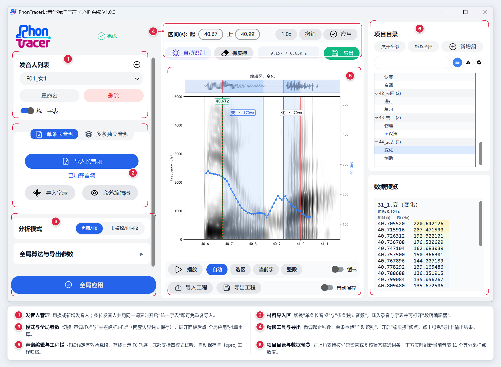

### 1. 左侧控制栏（管理发音人、材料导入与分析参数）

- **① 发音人管理区**：用于切换当前发音人，或通过 **`+`** 新增、**`重命名`**、**`删除`** 发音人。当多位发音人使用相同的调查字表时，开启 **`统一字表`** 开关即可共享同一套分组与词条列表，无需逐人重复导入。
- **② 材料导入区**：上方可切换 **`单条长音频`** 与 **`多条独立音频`** 两种工作流。在长音频模式下，依次通过 **`导入长音频`** 与 **`导入字表`** 载入实验材料，并可随时点击 **`段落编辑器`** 调整整段录音的词段切分。
- **③ 分析模式与全局参数区**：
  - 支持在 **`声调/F0`** 与 **`共振峰/F1-F2`** 两种模式间切换。软件在后台为两种模式**独立保存各自的音段边界与修点状态**，切换模式进行元音稳态段调整时，不会覆盖此前已确定好的声调承载段边界。
  - 点击展开 **`全局算法与导出参数`** 面板，可配置采样等分点数、基频上下限或共振峰分析上限（均配有智能估算范围的 **`检测`** 按钮）；修改全局参数后，点击底部 **`全局应用`** 即可对当前发音人的全部词条重新提取数据。

### 2. 中间声谱精修区（核对边界、修整轨迹、试听与存档）

- **④ 精确区间与精修工具栏**：
  - 上排显示当前音节的起止时间（秒），支持手动输入数值微调，右侧配有播放倍速切换（默认 **`1.0x`**，可放慢语速辅助辨听边界）、**`撤销`** 与 **`应用`** 按钮。
  - 下排提供针对当前词条重算的 **`自动识别`**、用于抹除局部异常散点的 **`橡皮擦`**（在共振峰模式下显示为 **`剔除点`**）、光标位置时间读数，以及用于输出各类成果的绿色 **`导出`** 按钮。
- **⑤ 声谱图画布、试听栏与工程栏**：
  - 画布上方为局部波形预览条，下方为宽带声谱图。图中的**红色竖线**代表当前音节的有效起止边界，顶部胶囊实时标明字名与有效时长（如 `变 · 170ms`、`化 · 70ms`），声谱图上叠加绘制**蓝色基频曲线**（声调模式）或**橙色 F1、绿色 F2 散点**（共振峰模式）。
  - 底部第一排为试听控制栏，支持 **`自动`**、**`选区`**、**`当前字`**、**`整段`** 四种回放范围及 **`循环`** 播放；底部第二排为工程管理栏，提供 **`导入工程`**、**`导出工程`**（保存为 `.teproj` 文件）以及防止意外退出的 **`自动保存`** 开关。

### 3. 右侧目录及预览区（异常筛查与采样数值预览）

- **⑥ 项目目录与数据预览**：
  - 上半部分 **`项目目录`** 以分组树形式列出全部词条，支持展开、折叠、新增组与关键词检索。右上角提供三个状态筛选按钮：**全部词条**、**`▲` 仅显示异常警告词条**、**`✔` 按复核状态筛选**。词条旁若出现黄色 **`⚠`** 图标及短说明（如 `疑似噪声`、`F2跳变`），表示该条存在声学缺口或跳变风险，建议优先检查；词条前若带有蓝色圆点 **`•`**，则代表该条已启用单条目独立参数或经过人工精修。
  - 下半部分 **`数据预览`** 实时列出当前选中音节的持续时长，以及默认 **11 个归一化等分采样点**对应的精确时间（s）与频率数值（Hz），调整边界或擦除异常点后数值会立即同步更新。

## 四、五分钟标准实验流程演练

以常见的“单条双字调录音（`.wav`）配合一份分组字表（`.txt`）”为例，完成一次标准分析只需以下七步：

1. **建立发音人**：打开 `PhonTracer`，在左侧 **`发音人列表`** 中点击 **`重命名`** 设定发音人编号（如 `F01_女1`），并在导入区选择 **`单条长音频`**。
2. **导入音频与字表**：依次点击 **`导入长音频`** 选择 `.wav` 录音文件，点击 **`导入字表`** 选择对应的 `.txt` 或 `.ptwl` 字表。
3. **核对宏观切分**：打开 **`段落编辑器`**，确认右下角显示的检测区段数量与字表词条总数一致，抽听几个区段核对双字分界无误后，点击 **`确认并应用`**。
4. **匹配发音人参数**：在左侧选择 **`声调/F0`**（或 **`共振峰/F1-F2`**），展开 **`全局算法与导出参数`** 点击 **`检测`**，选用推荐范围后点击底部 **`全局应用`**。
5. **定位待查词条**：点击右侧 **`项目目录`** 右上角的 **`▲`** 按钮，筛选出带有黄色 **`⚠`** 提示的词条逐一查看。
6. **微调选区与修点**：在中间声谱图上左右拖动**红色边界线**避开清辅音干扰或词末气息滑落；对个别倍频跳点，开启 **`橡皮擦`** 左键涂抹剔除，再次点击 **`橡皮擦`** 应用重采样（具体判断准则详见 [02 选区精修与疑难语音处理实战](./02_选区精修与疑难语音处理实战.md)）。
7. **导出结果与保存工程**：点击中间工具栏绿色的 **`导出`** 按钮，按需输出 `.xlsx` 统计表格、论文图表或 Praat `.Collection` 文件；最后点击底部 **`导出工程`** 将当前完整状态保存为 `.teproj` 工程归档。

---

# 01 实验材料准备与导入指南


录音质量与字表组织方式直接影响自动切分与基频、共振峰提取的准确度。本篇介绍实验录音的采集规范、三种字表输入格式的编写方法、三类材料导入流程（含长音频 `段落编辑器` 的详细操作），以及多发音人工程的管理方法。

## 一、实验录音采集建议

在语音实验室或田野调查现场录制实验样本时，注意以下四个环节可以显著减少后续人工修正的工作量：

1. **控制环境低频底噪**：录音时尽量关闭空调、风扇、冰箱压缩机等持续低频噪声源，并避开临街车流与电流声。持续的低频背景声会叠加在声谱图底部的基频区，容易干扰低调值音节（如上声、阳平起点或轻声）的基频追踪。
2. **保持合适话筒距离以防喷麦**：建议将麦克风置于发音人嘴部**侧前方 10～15 cm** 处（偏离正前方约 30°～45° 角），并配合防风海绵罩使用。避免正对麦克风近距离直吹，否则在发 `p、t、k、c、ch、q` 等送气塞音、塞擦音时，强气流冲击振膜会在低频区产生爆破杂音，遮蔽紧随其后的元音起始共振峰。
3. **选用无损格式并统一采样率**：录音文件应保存为 **WAV 无损单声道（Mono）** 格式，避免使用 MP3、AAC 或社交软件语音等有损压缩格式（高频压缩会影响共振峰与擦音测量）。采样率采用 **16 kHz、24 kHz 或 44.1 kHz** 均可满足常规声调与元音分析需要；建议同一实验项目的所有发音人保持一致的采样率与量化精度（如统一采用 24 kHz 或 44.1 kHz、16-bit）。
4. **把握长音频朗读停顿节奏**：若采用单条长录音连续朗读整份字表，请引导发音人在**词与词之间保持约 0.4～0.8 秒的自然静音停顿**，既便于软件自动识别词界，又能避免跨词协同发音粘连。对于双音节或多音节词内部（例如“首都”“体贴”第二字清塞音声母成阻时的短暂闭塞静音），发音人按日常自然语速正常连读即可，软件已针对词内短暂停顿做了自适应防误切处理。

## 二、字表准备方法（支持三种格式）

PhonTracer 原生兼容纯文本 `.txt`、表格 `.csv` 以及结构化高级字表 `.ptwl`。研究者可以直接导入日常整理的实验草稿，无需预先手动清理注释或编号。

### 1. 普通文本与科研草稿（`.txt`）

除最基础的“一行组名、下方逐行列出词条”写法外，词表解析器还支持直接读取带有注释、序号和分隔符的调查草稿，自动过滤非词条信息：

- **自动忽略注释**：支持行首或行尾的 `//`、`#` 单行注释，以及跨行的 `/* ... */` 块注释。
- **自动跳过标题横幅与分隔线**：如 `=== 双字调调查字表 ===` 或 `--------` 等装饰分隔行不会误判为词条。
- **识别多种分组头格式**：兼容 `【组名】`、`[组名]`、`(组名)`、`（组名）`、`一、组名` 以及末尾带冒号的 `组名：` 等常见标题写法。
- **自动剥离行内编号与列表符**：自动去除词条前的 `1.`、`01)`、`(1)`、`①`、`- `、`* `、`• ` 等前缀符号。
- **支持同行多词与括号备注**：同一行可用斜杠 `/` 或 `／` 分隔多个并列词条（如 `买书 / 买房`）；词条后紧跟括号的 `词条(备注)` 写法会自动保留备注说明，不会将括号文字计入音节数。

以下是一份可直接导入软件的 `.txt` 字表示例：

```text
=== 普通话双字组声调调查字表（节选） ===
// 录音批次：2026秋季  采样率：24kHz
# 说明：每词自然朗读一遍，词间停顿约半秒

/* 第一部分：上声连读变调组 */
【31_上阴】
1. 首都(注意后字清塞音闭塞段) / 买书
2. 老师

(32_上阳)
① 买房
② 语言  # 零声母连读对照

43_去上：
- 物理
- 汉语
• ma4-ma0(拼音或音标词条示例)
```

> **多音节拆分规则说明**：
> - **汉字词条**：默认按**一个汉字对应一个音节**自动切分（例如 `首都` 自动识别为 2 个音节，括号内的备注不计入音节数）。
> - **拼音、国际音标（IPA）或外文词条**：请使用**半角连字符 `-`** 显式标明音节分界（如 `ma4-ma0`、`ba-na-na`），软件将严格按连字符数量拆分为对应音节。

### 2. 逗号分隔表格（`.csv`）

若实验词表平时在 Excel 中整理维护，可直接另存为 **UTF-8 编码的 `.csv` 文件**导入。表格中可按列包含组名、词条与备注信息，例如：

```csv
组别,词条,备注
11_阴阴,飞机,双音节阴平组
11_阴阴,开车,双音节阴平组
31_上阴,首都,半上变调观察项
```

### 3. 高级字表（`.ptwl`）

当实验需要按照声母清浊、古音调类、韵摄开合或词频等级等多个维度对同一批词条进行交叉分组绘图时，推荐使用 PhonTracer 专用的 **`.ptwl` 高级字表**：

- **多维科研元数据**：支持记录组备注、**组标签**（以分号分隔，如 `目标组; 半上变调`）、词项备注、**词项标签**及自定义属性字段。
- **快速转换生成**：打开独立工具箱 **`Toolkit`** 的 **`字表编辑器`** 页签，点击底部 **`导入文本并转换`** 即可将现有 `.txt` 或 `.csv` 草稿转换为 `.ptwl` 格式，并可配合 AI 提示词批量补充音韵属性标签（详见 [04 工具箱预处理与批处理附录](./04_工具箱预处理与批处理附录.md)）。
- **全流程贯穿**：`.ptwl` 中的所有标签与备注在导入后会随 `.teproj` 工程全程保存，后续在声学图表工作台中可直接按标签重新分组配色（详见 [03 数据导出与声学图表解读指南](./03_数据导出与声学图表解读指南.md)）。

## 三、三种材料导入工作流详解

根据手头实验材料的组织形式，可在主界面左侧导入区选择对应的导入方式：

### 路线一：`单条长音频` + 字表（配合 `段落编辑器` 核对切分）

适用于“一条连续朗读的长 `.wav` 录音配合一份调查字表”的标准流程：

1. 在主界面左侧导入区顶部选择 **`单条长音频`**。
2. 点击 **`导入长音频`** 载入录音文件，随后点击 **`导入字表`** 选择准备好的 `.txt`、`.csv` 或 `.ptwl` 字表。
3. 软件会自动完成语音端点检测与词条对齐。如需检查切分结果或修正词数偏差，点击 **`段落编辑器`** 打开可视化切分窗口：

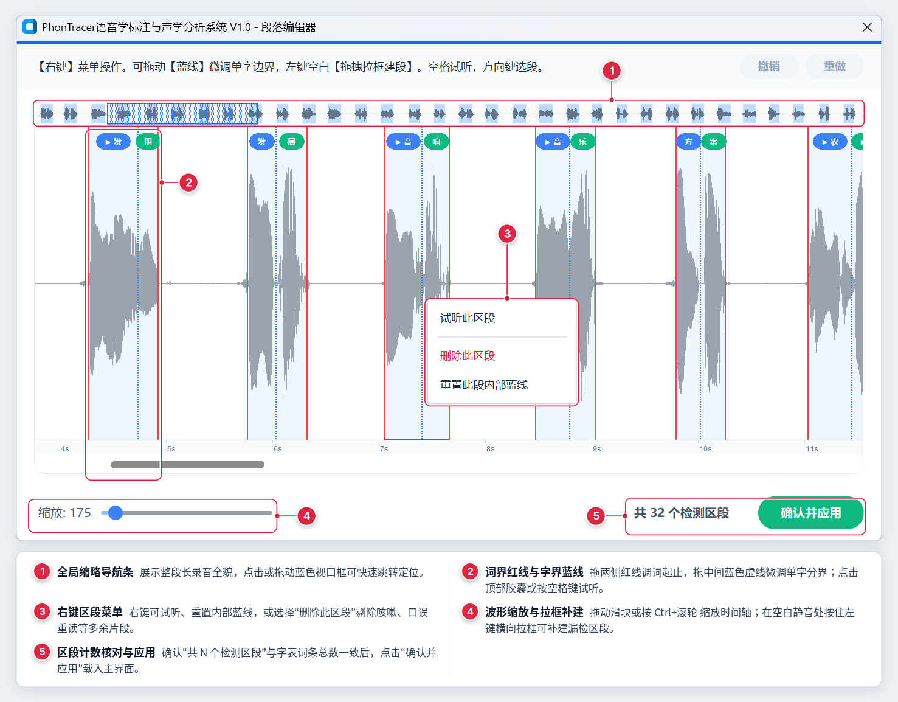

在 **`段落编辑器`** 中，可对照图中序号完成以下核查操作：

- **① 全局缩略导航条**：位于窗口顶部，展示整条长音频的全貌包络。点击或拖动蓝色视口框，即可在数分钟的长录音中快速跳转至任意区段。
- **② 词边界红线与单字分界蓝线**：
  - 主波形中每个浅蓝区段代表一个词条，拖动左右两侧的**红色实线**可调整整词的起止时间；
  - 双音节或多音节词内部自动生成**蓝色虚线**作为单字初切分界，左右拖动**蓝色虚线**即可微调字间切分位置；
  - 点击区段上方的蓝/绿字头胶囊（如 `▶ 发`、`明`），或直接按键盘**空格键**即可试听当前区段，按键盘**左右方向键（`←` / `→`）**可依次切换前后区段。
- **③ 右键快捷操作菜单**：在任意区段上点击鼠标右键，可选择 **`试听此区段`**、**`重置此段内部蓝线`**，或点击 **`删除此区段`**。当发音人在朗读中途出现咳嗽、清嗓或口误重读，导致检出段数多于字表词数时，只需右键删除作废的那一段，后续词条名称便会自动顺延对齐。
- **④ 波形缩放与漏检补建**：拖动左下角 **`缩放`** 滑块（或按住 **`Ctrl + 鼠标滚轮`**）可放大或缩小时间轴视野，直接滚动鼠标滚轮可左右平移波形；若个别轻读词条未被自动检出，在空白波形处按住**鼠标左键横向拖拽拉框**，即可手动新建区段。
- **⑤ 区段计数核对与应用**：确认右下角提示的 **`共 N 个检测区段`** 与字表总词数一致后，点击绿色 **`确认并应用`** 按钮，切分结果即载入主界面（注：若后续再次进入段落编辑器仅微调了某几个词段，未改动词段中已做过的橡皮擦精修数据会自动保留，不会被重置清空）。

### 路线二：`多条独立音频` 批量导入

适用于录音已预先切分为单个字词 `.wav` 小文件的场景：

1. 在主界面左侧导入区顶部切换至 **`多条独立音频`**。
2. 点击 **`选择多个音频文件`**（或直接从系统文件夹框选多个 `.wav` 拖入窗口）。
3. 选择词条命名与分组匹配方式：
   - **直接使用文件名命名**：若音频文件名本身已包含字词（如 `01_吃饭.wav`、`02_电脑.wav`），点击 **`文件名提取`** 即可自动解析词条名与音节数。
   - **关联外部字表与分组**：点击 **`导入字表`** 选入字表文件，在弹窗中可选择**模糊匹配**（根据文件名自动匹配字表中的对应词条并挂载分组与标签）或**顺序匹配**（适用于文件名为 `001.wav`、`002.wav` 等纯编号且与字表顺序一致的情形）。

> **提示**：若目前只有整段长录音，但需要先生成按词命名的独立 `.wav` 语料文件再开展分析，可先使用 **`Toolkit`** 中的 **`音频拆分（长音频→独立音频）`** 功能完成切分（详见 [04 工具箱预处理与批处理附录](./04_工具箱预处理与批处理附录.md)）。

### 路线三：导入已有 Praat `TextGrid` 标注

若前期已在 Praat 中完成手工标注，或使用 Montreal Forced Aligner（MFA）等强制对齐工具生成了 `.TextGrid` 文件，可直接导入复用现有时间边界，无需重新切分：

- **图形界面转换与导入**：在主界面导入对应音频后载入 TextGrid，或打开 **`Toolkit`** 的 **`TextGrid 转换器`** 页签，预览标注层结构并指定词条层（Item tier）与核心承载段层（Core tier），还可同时挂载辅助字表补充调类分组信息，一键转换为 `.teproj` 工程后在主界面打开。
- **批量命令行导入**：若需一次性配对大量独立音频与同名 `.TextGrid` 文件，也可在 `PhonTracerCLI` 中使用 `apply_textgrid` 或 `batch_textgrid_import` 指令批量完成（详见 [04 工具箱预处理与批处理附录](./04_工具箱预处理与批处理附录.md)）。

## 四、多发音人管理与性别参数适配

在对比多位发音人或跨性别样本的实验设计中，建议将同一课题的所有发音人纳入**同一个 `.teproj` 工程**中统一管理：

1. **启用 `统一字表` 共享词表结构**：在首位发音人名下导入字表后，打开左侧 `发音人列表` 下方的 **`统一字表`** 开关。此后点击 **`+`** 新增发音人并重命名（例如按性别与序号命名为 `F01_女1`、`M01_男1`），新发音人会自动沿用相同的分组、词条顺序及 `.ptwl` 标签，只需为其导入对应录音即可。若个别发音人存在漏读或增补词条，可临时关闭该开关独立调整字表。
2. **按发音人分别执行参数 `检测`**：
   - 成年男性、女性与儿童在声带振动基频及声道长度上存在显著生理差异（例如成年男性常见基频约 70～250 Hz、共振峰搜索上限约 4500～5000 Hz；成年女性常见基频约 120～420 Hz、共振峰搜索上限约 5200～5500 Hz）。
   - 若直接沿用男声参数分析女声录音，高频声调容易被上限截断或误判为半频；反之若用女声参数分析男声，则容易在低频区混入倍频跳变或发生共振峰错位。
   - 因此，每新增并导入一位发音人的音频后，均建议展开左侧 **`全局算法与导出参数`** 面板，点击基频范围或共振峰分析上限旁的 **`检测`** 按钮，选用适合该发音人的推荐范围并点击 **`全局应用`**（各发音人的参数配置彼此隔离保存，互不影响）。

完成材料导入与参数初配后，请继续阅读下一篇 [02 选区精修与疑难语音处理实战](./02_选区精修与疑难语音处理实战.md)，了解声谱图选区边界的语音学判定准则与疑难发音处理方法。

---

# 02 选区精修与疑难语音处理实战


自动切分与算法追踪能够快速完成大部分常规音节的初筛，但自然语音中不可避免地存在辅音气流扰动、八度跳变、嘎裂声（气泡音）及元音共振峰聚拢等现象。本篇将实验语音学的常见声学判据与 PhonTracer 的界面操作相结合，通过真实双字词例**“首都”（`shǒu dū`）**，详细说明如何确定音节边界、何时使用橡皮擦修整散点、如何规范处理嘎裂声以及如何校正共振峰追踪偏差。

## 一、选区边界与等分采样点的关系

在调整任何边界之前，需要先明确软件提取声学数值的基本逻辑：

在主界面声谱图中，每个音节左右两条**红色竖线**之间的浅蓝底色区域，即为参与声学测量的**有效承载段**。选区上方的胶囊标签实时显示该音节的字名与持续毫秒数（例如图 3 中的 `首 · 219ms`、`都 · 210ms`）。

PhonTracer 默认采用实验语音学通用的**时长归一化等距采样法**：无论某个音节实际持续 `150ms` 还是 `300ms`，系统都会在左右两条红线限定的时间窗内**等距抽取 `11` 个采样点**（对应 `0%、10%、20% … 100%` 共 11 个相对时间点；若研究需要改为 9 点或 21 点，可在左侧 `全局算法与导出参数` → `等分点 (N)` 中修改）。

由此可见，左右红线的位置直接决定了采样点的质量与音长数据的准确性：

- **左红线偏左**：若将字头清辅音摩擦噪声或除阻瞬态扰动框入其内，会导致第 1、2 个采样点数值异常偏高或偏低，失真反映声调起点。
- **右红线偏右**：若将词末收音时声门松弛产生的气息滑落段框入其内，会导致第 10、11 个采样点无故骤降，影响平调或升调终点的判断。
- **音长与内部点位连锁偏移**：起止边界过宽或过窄不仅改变音节物理时长（Duration）统计结果，还会使中间第 3～9 个等分采样点在真实语流中的相对位置整体偏移。

因此，人工复核的首要原则是**将左右红线准确限定在声学结构清晰、周期稳定的目标承载段起止位置**。

## 二、如何确定选区边界：声谱图判读准则

下面以普通话双字组“首都”（`shǒu dū`，上声 + 阴平，连读时前字变为半上低降调）为例，说明定界时观察声谱图的具体标准：

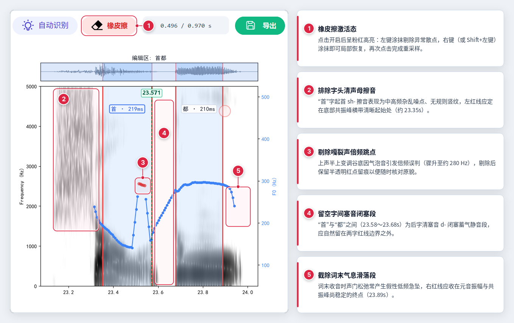

### 1. 声谱图判读的三个基本视觉特征

在宽带声谱图（Spectrogram）上核对边界时，主要观察以下三项声学线索：

1. **深色水平能量带（共振峰条带）**：横贯声谱图中下部的数条深灰色至黑色粗横带，对应元音发音时的声道共鸣频率（由下至上依次为 F1、F2、F3）。水平横带清晰连贯，表明元音腔体已经稳定形成。
2. **规则竖直细纹（声门脉冲）**：垂直方向紧密均匀排列的细竖线，每一条竖纹对应声带的一次开合振动。**出现规则竖纹代表声带处于周期性浊音振动状态**；无规则竖纹而呈雾状噪点或空白，则代表清辅音段或静音段。
3. **叠加的声学轨迹点**：在 `声调/F0` 模式下显示为**蓝色圆点连线**（基频曲线，对应右轴 Hz 标尺）；在 `共振峰/F1-F2` 模式下显示为**橙色 F1 与绿色 F2 散点**（对应左轴频率标尺）。

### 2. 字头边界：清声母与响音声母的切分原则

不同发音方法声母的声学表现差异明显，定左红线时可参照以下准则：

- **清擦音（`f, s, sh, x, h`）与送气塞音、塞擦音（`p, t, k, c, ch, q`）——排除在左红线之外**
  此类声母发音时声带不振动，声谱图上表现为中高频区域的无周期灰黑噪点带（如图 3 标注 **②** 所示，`23.15～23.33s` 区间为“首”字的清卷舌擦音声母 `sh-`）。左红线应定在**摩擦或送气乱纹结束、底部第一与第二共振峰深色横带及规则声门竖纹同时清晰起始的位置**（如图 3 中约 `23.35s` 处）。
- **不送气清塞音、塞擦音（`b, d, g, z, j`）——定在除阻瞬音后的首个规则元音脉冲处**
  此类声母除阻段较短，在声谱图上表现为一条细窄的垂直爆破线，随后元音迅速起振。左红线紧贴除阻线之后、首个稳定声门脉冲出现处即可。
- **鼻音声母（`m, n`）与边音（`l`）——识别“能量台阶”，按声调承载段定义取舍**
  浊响音声母发音时声带已开始振动，但鼻腔或舌侧分流使其中高频能量明显偏弱，声谱图颜色较浅；进入主要元音瞬间，总振幅陡增且共振峰横带骤然加深，形成清晰的**频谱不连续面（能量台阶）**。在声调与元音实验惯例中，若以主要元音及韵尾作为声调承载段（TBU），通常将左红线定在该能量台阶即主要元音起始处。在自动切分阶段，也可配合左侧参数面板中的 `能量落差`、`排除声母` 与 `开启边缘静音裁切` 辅助定位。

### 3. 词中双字交界：塞音闭塞段留空与共享红线操作

双音节词内部的字间过渡主要有两种情形：

- **字间夹有清辅音（闭塞段自然留空）**：如图 3 标注 **④** 所示，“首”与“都”之间的 `23.58～23.68s` 区间为后字清塞音声母 `d-` 的**持阻闭塞段**。此时口腔闭合蓄气，上方波形接近水平直线，声谱图呈空白静音态。前字“首”的右红线应收在声带脉冲结束处（约 `23.57s`），后字“都”的左红线起于 `d-` 除阻后元音起振处（约 `23.68s`），中间约 `100ms` 的闭塞静音段应保留在两字红线之外，不应计入任一音节时长。
- **元音连读或浊辅音平滑过渡（共享同一条红线）**：遇到零声母连读（如“西安”“语言”）或浊声母连读且前后音节紧密相接时，前字终点与后字起点可能重合为同一条红色竖线。针对重合红线，软件支持三种拖拽手势：
  - **按住鼠标左键向左拖动**：单独前移**前字终点**（后字起点保持原位，在两字间拉开间隙）；
  - **按住鼠标左键向右拖动**：单独后移**后字起点**（前字终点保持原位，在两字间拉开间隙）；
  - **按住键盘 `Shift` 键同时左右拖动**：**同步平移共享边界**，使前字终点与后字起点保持无缝贴合共同移动。

### 4. 字尾边界：截除末尾气息滑落，保留稳定鼻韵尾

- **截除词末气息滑落段**：单念词或句末音节收尾时，声门逐渐松弛打开，气流减弱常使最后二三十毫秒产生非目标性的低频急坠。如图 3 标注 **⑤** 所示，“都”字在右红线 `23.89s` 之内保持平稳的高平调（约 `265 Hz`），而 `23.89s` 之外波形振幅明显衰减，基频出现急剧下折。将右红线定在元音能量与共振峰尚稳定的终点（`23.89s`），即可避免末尾气息滑落拉低第 10、11 采样点。
- **保留稳定鼻音韵尾（`-n, -ng`）**：汉语鼻音韵尾属于韵母声调承载段的有机组成部分，承载着声调后半程的升降走势。只要鼻韵尾区间内的声门竖纹规则连续、基频轨迹平稳延伸，右红线就应将其完整包含在内。

### 5. 视图缩放与试听核验配合操作

在声谱图上确定边界时，建议结合视觉观察与听感复核：

- **缩放与平移**：鼠标悬停在画布上滚动**滚轮**可无级缩放时间轴，便于放大观察单根声门脉冲；非橡皮擦状态下按住**鼠标右键左右拖动**可平滑移动视野。
- **多范围试听与慢放**：利用底部播放栏切换 **`当前字`**、**`整段`** 或 **`选区`**（在画布上拖拽选定局部时间窗试听）模式，检查切分后的单字听感是否混入擦音噪音或误切元音主体；遇到短促音节，可点击顶部 **`1.0x`** 切换慢速回放仔细辨听。调整后可点击顶部 **`撤销`** 回退，确认无误后点击 **`应用`** 更新采样结果。

## 三、辅音微扰、八度跳变与橡皮擦的使用规范

当音节起止边界已经定准，但曲线局部仍有个别异常散点时，强行收缩红线会损失真实的音节时长。此时应使用工具栏中的 **`橡皮擦`**（图 3 标注 **①**）进行局部点位剔除。

### 1. 适用橡皮擦的两类典型情况

- **辅音声学微扰（弯头与翘尾）**：塞音、塞擦音除阻刚进入元音最初的 `10～30ms` 内，跨声门气压差急剧变化往往使起始基频短暂偏高（清声母后常见“弯头”），这属于辅音空气动力学带来的伴随微扰，而非声调音系目标。若直接右移左红线会过度削减元音时长，可保持红线在元音起点不动，仅用橡皮擦剔除起首 `1～2` 个受微扰顶高的散点。
- **局部帧八度跳变（倍频或半频误判）**：如图 3 标注 **③** 所示，“首”字前半程基频已平稳降至约 `140 Hz`，但在 `23.50～23.56s` 处突然有数个孤立点跃升至约 `280 Hz`（恰为真实基频的两倍），随后又回到低频。这类短时突跳是算法局部误抓第二谐波造成的倍频错误，适合直接用橡皮擦剔除。

### 2. 橡皮擦四步操作流程

1. **开启工具**：点击画布上方工具栏的 **`橡皮擦`** 按钮（共振峰模式下按钮文字显示为 **`剔除点`**），按钮呈粉红色高亮，鼠标光标变为圆形擦除刷。
2. **左键涂抹剔除**：按住**鼠标左键**划过需要剔除的异常点。被剔除的点不会完全消失，而是转为**半透明红色圆点留痕**（见图 3 标注 **③**），便于随时对照原始提取位置。
3. **右键局部恢复**：若误擦了相邻的正常点，无需重头撤销，直接在画布上按住**鼠标右键涂抹**（或按住 **`Shift + 左键`** 涂抹）红点区域，即可将其恢复为有效采样点。
4. **退出并应用重采样**：再次点击工具栏 **`橡皮擦`** 按钮（或在画布右键菜单中点击 **`退出橡皮擦并应用`**），系统即刻排除红点并重新计算等分点，右侧 `数据预览` 面板同步更新。

### 3. 不宜使用橡皮擦强行修补的三种情形

橡皮擦仅用于局部孤点修整；若出现系统性偏差，应优先调整声学提取参数而非逐点擦除：

| 观察到的异常表现 | 产生原因 | 规范调整方法 |
| :--- | :--- | :--- |
| **整条曲线大段翻倍（300～500 Hz）或折半（60～80 Hz）** | 当前 `F0 范围 (Hz)` 上下限偏离该发音人的实际音域 | 点击左侧 `F0 范围 (Hz)` 旁的 **`检测`** 按钮，选用系统估算的推荐范围重新提取 |
| **同一发音人大量低调词条在谷底普遍断线** | 基频下限设置偏高，或 `浊音阈值` 偏严过滤了弱周期信号 | 通过 **`检测`** 换用较宽的保守范围，或适度下调 `浊音阈值` 后重新识别 |
| **切换新发音人后出现大面积跳点** | 沿用了上一位不同性别发音人的基频或共振峰参数 | 先点击 **`检测`** 匹配当前发音人参数范围，再点击左下角 **`全局应用`** 刷新 |

## 四、遇到嘎裂声（气泡音）的判断与分级处理

在普通话上声（214）、上声半上变调（21，如图 3“首都”的前字）、全降调末尾以及部分方言低调中，基频常降至发音人生理音域底限，声带呈松弛厚重的不规则振动，形成**嘎裂声（Creaky Voice，亦称气泡音）**。

### 1. 如何在声谱图与听感上识别嘎裂声

- **声谱图特征**：原本细密均匀的底部声门脉冲竖纹，在低音段**突然变得稀疏，且相邻竖纹间距宽窄不一或呈成对交替排列**（如图 3“首”字 `23.48～23.56s` 底部竖纹明显变疏）。
- **听感特征**：单独回放该字（或调慢倍速细听）时，可听到明显的低沉颗粒感或断续脉冲音质。

由于常规基频提取算法依赖相邻周期的规律性，遇到嘎裂声时通常会产生三类现象：① 判定为非周期信号而直接断线；② 将双周期交替振动算作单周期，导致基频骤降一半（半频误判）；③ 转向追踪能量更规整的第二谐波，导致基频跃升一倍（如图 3 标注 **③** 的倍频跳点）。

### 2. 嘎裂声四步分级处理规范

针对不同程度的嘎裂声，建议遵循实验语音学数据清洗规范按以下四级方式处理：

1. **轻度嘎裂伴随孤立倍频/半频点——使用橡皮擦剔除伪点**
   若音节主体走势清晰，仅谷底个别帧因谐波误抓跳至倍频或半频（如图 3“首”字后半段的 280 Hz 跳点），使用 **`橡皮擦`** 将孤立假点抹除即可恢复真实的低降曲线。
2. **周期尚规则但低于全局下限被截断——使用“单条目参数隔离”局部重算**
   若放大声谱图观察到底部竖纹虽宽但仍具规律周期（例如女声上声谷底真实降至 `80 Hz`，而女声全局下限设为 `120 Hz` 导致低谷被截断），**请勿直接修改参数后点击左下角的 `全局应用`**，否则过低的全局下限容易在其他高音词条中引入环境低频杂音。
   正确做法是：在右侧选中当前词条 → 在左侧临时调低 `F0 范围 (Hz)` 下限（例如女声下探至 `75～90 Hz`，男声下探至 `50～65 Hz`） → **点击中间工具栏的 `自动识别` 按钮**。此时软件仅对当前词条独立保存并应用该参数，右侧目录中该词条前会亮起**蓝色圆点 `•`**（右键点击该词条选择 **`属性`** 可随时核查各参数是来自单条覆盖还是全局设置），完全不影响同发音人的其他词条。
3. **局部完全非周期嘎裂——保留自然缺口并确认复核状态**
   若声谱图竖纹已彻底紊乱、物理上不存在规则基频周期，强行压低阈值抓取噪点反而会引入失真数值。对于中间短暂的几帧缺失，保持自然缺口即可；若项目目录因此显示黄色 **`⚠`** 提示，人工核查确认无误后，可在右侧目录**右键点击该词条选择忽略警告**。
4. **全音节严重非周期或录音受损——标记“忽略此项”并记录排除原因**
   若某词条因全程重度嘎裂、发音人咳嗽、笑场或严重喷麦导致无法提取可靠轨迹，切勿人为拼凑曲线，也不必删除原始音频破坏词表对齐：
   - 在右侧 **`项目目录`** 右键点击该词条，选择 **`忽略此项（不参与导出）`**；
   - 再次右键点击该词条，选择 **`填写忽略原因...`**，如实记录客观声学原因（例如：`上声强嘎裂无规则声门周期` 或 `发音人清嗓干扰`）。
   被设为忽略的词条在导出 Excel 统计表与绘制分组图表时会自动排除；同时在导出研究方法报告时，系统会自动统计排除样本数及具体原因明细，便于在论文“数据处理与剔除标准”章节中如实陈述。

## 五、共振峰（F1/F2）模式的核验与参数调优

在主界面左侧将分析模式切换为 **`共振峰/F1-F2`** 后，即可对元音舌位与复韵母动态轨迹进行核验（同样以“首都”为例，见图 4）：

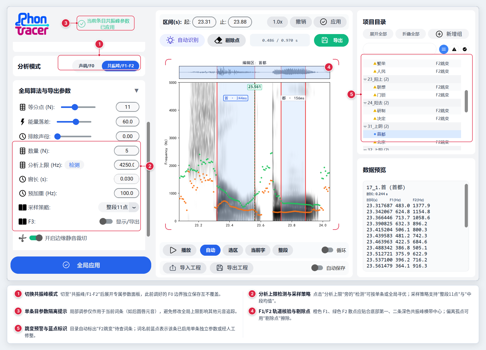

### 1. 散点轨道与声谱图横带的对应核查

切换至共振峰模式后（图 4 标注 **①**），声谱图上叠加两条彩色散点轨迹（如需同时考察卷舌元音 `er` 或儿化韵的第三共振峰变化，可开启左侧 **`F3: 显示/导出`** 开关）：

- **橙色散点（`F1`，第一共振峰）**：与舌位高低（开口度）呈负相关——低元音（如 `[a]`）开口大、F1 数值高；高元音（如 `[i]、[u]`）开口小、F1 数值低。
- **绿色散点（`F2`，第二共振峰）**：与舌位前后及圆唇度相关——前展唇元音（如 `[i]`）F2 高；后圆唇元音（如 `[u]、[o]`）F2 低，向 F1 靠拢。

核验共振峰提取是否准确的核心标准是（图 4 标注 **④**）：**橙色 F1 与绿色 F2 散点应分别贴合在声谱图底部第一条、第二条深色水平共振峰能量带的中心位置**。若绿色散点中途越过第二条深色带跳至第三条能量带上，右侧项目目录会自动标出 **`⚠ F2跳变`** 提示（图 4 标注 **⑤**）。

### 2. 利用 `分析上限 (Hz)` 智能检测解决后元音跳变

Praat Burg 共振峰算法中的 **`分析上限 (Hz)`** 并非画图显示上限，而是指定在 `0 Hz ～ 分析上限` 的频率区间内固定搜寻指定数量（默认 `5` 个）的共振峰。常规情况下，成年男声多设在 `4500～5000 Hz`，成年女声多设在 `5200～5500 Hz`。

但在后高圆唇元音（如“首都”中的 `ou`、`u`）里，F1 与 F2 均集中在 `300～1000 Hz` 的低频窄带内；若沿用较高的全局分析上限，算法容易将紧邻的 F1、F2 合并为一个峰，转而将第三共振峰误判为 F2，从而引发 `F2跳变`。

遇到此类情况时，可按以下步骤精准修正（见图 4 标注 **②、③**）：

1. 在右侧选中存在跳变的词条，点击左侧 `分析上限 (Hz)` 旁的 **`检测`** 按钮；
2. 在弹出提示中选择**仅针对当前选中条目估算**（若刚导入新发音人尚未定基调，则可选择全局评估）；
3. 系统会自动评估并应用适合该词条的最佳上限（如图 4 左上角提示 `✓ 当前条目共振峰参数已应用`，针对“首都”单独应用了 `4250.0 Hz`，右侧词条前同步标出蓝点 `•`），绿色 F2 散点随即回到第二条共振峰横带中心；若首尾仍有少量偏离孤点，再点击上方工具栏的 **`剔除点`** 涂抹擦除即可。

### 3. 共振峰采样策略选择：`中段均值` 与 `整段11点`

在左侧共振峰参数面板底部（图 4 标注 **②**），请根据实验目标选择对应的 **`采样策略`**：

- **`中段均值`**：适用于**单元音稳态分析**（如测量方言基础元音格局图），系统提取元音核心稳态段的平均值，有效减少前后辅音协同发音过渡段的干扰。
- **`整段11点`**：适用于**复韵母（双元音、三元音）及元音动态滑移轨迹分析**（如 `ai, ei, ao, ou, ia, uo` 等），完整保留从韵头、韵腹到韵尾的连续共振峰演变过程。

## 六、导出前复核自检步骤

完成全部词条修整后，建议在正式导出前执行以下四项例行检查：

1. **筛查未处理警告**：点击右侧 `项目目录` 右上角的 **`▲`** 异常筛选按钮，确认所有带 `⚠` 的词条均已修正边界、擦除跳点、局部调参或按规范标记忽略并填写原因。
2. **抽检首尾边界一致性**：随机抽查若干清擦音声母词条与句末词条，确认清辅音噪声段和词末气息滑落段均未混入选区。
3. **核对分析模式与采样策略**：确认当前处于准备导出的目标模式（`声调/F0` 或 `共振峰/F1-F2`），且等分点数或共振峰采样策略符合实验设计。
4. **保存 `.teproj` 工程包**：确认底部 **`自动保存`** 已开启，并点击 **`导出工程`** 保存一份完整的 `.teproj` 工程备份，以便后续随时追溯核查。

接下来请阅读 [03 数据导出与声学图表解读指南](./03_数据导出与声学图表解读指南.md)，了解各类统计表格与出版图表的导出方法及声学读图要点。

---

# 03 数据导出与声学图表解读指南


把红线起止边界调准、跳歪的散点擦干净之后，就可以把结果导出来写论文或做汇报了。这一篇用最直白的话讲清楚两件事：**点哪个按钮导出什么文件**，以及 **PhonTracer 导出的 21 张真实声学图表每一张到底该怎么看、能从图里读出什么结论**。

---

## 一、先分清：导出的六种文件各有什么用？

主界面上有两个名字很像的按钮，新手最容易点混：
- **中间工具栏右侧绿色的 `导出` 按钮**：用来输出做统计和写论文的最终成果（Excel 表格、论文配图、Praat 文件）。
- **中间底部栏的 `导出工程` 按钮**：用来把你当前的标注进度存成 `.teproj` 工程包，下次打开接着标。

具体六种文件按下面的需求挑就行：

| 你接下来想做什么？ | 该选哪种格式？ | 文件里装了什么？ |
| :--- | :--- | :--- |
| **放进 Excel、R、SPSS、JASP 做统计检验** | **Excel 表格 (`.xlsx`)** | 每个词条等距抽取的采样点数值、音节时长（毫秒）、各组平均值与标准差。声调模式同时给原始 `Hz` 和 `0～5 度 T 值`；共振峰模式同时给原始 `Hz` 和归一化数值。 |
| **直接插进论文正文、学位论文或组会 PPT** | **声学图表 (`.pdf` / `.svg` / `.png`) + 源数据 (`.csv`)** | 排好版的声调五度图、连读变调图、热力图、雨云图、元音舌位图、质检排查图等；点右下角 `导出数据` 还能把画这张图用的均值和误差表存成 `.csv` 备查。 |
| **把修平的音高/共振峰曲线原样带进 Praat** | **Praat 工程集合 (`.Collection`)** | 把音频、切好的时间边界，**连同你在软件里用橡皮擦修干净的曲线**一起打包。直接拖进 Praat 打开，看到的曲线就是修好后的样子，不会重新冒出跳点。 |
| **只把切好的字音时间边界传给别人跑脚本** | **TextGrid 标注 (`.TextGrid`)** | 只存每个词和有效韵母段的起止时间点，**不存**你擦掉修平的音高点。适合配合外部 Praat 脚本提取别的声学指标。 |
| **用 Python 或 MATLAB 自己读纯数字** | **纯文本表 (`.txt`)** | 用制表符隔开的纯数字采样表，体积最小，方便写代码批量读取。 |
| **今天没标完想关机，或者留底备份整个实验** | **PhonTracer 工程包 (`.teproj`)** | 点主界面底部的 **`导出工程`** 生成。完整保留录音、红线位置、橡皮擦记录、单条独立参数和忽略词条原因，也可放进 `Toolkit` 工具箱直接生成研究方法报告或跑进阶画图脚本。 |

---

## 二、两步完成导出操作

点击中间工具栏右侧的绿色 **`导出`** 按钮，软件会分两步引导你导出（如果工程里只有 1 位发音人，会自动跳过第一步）：

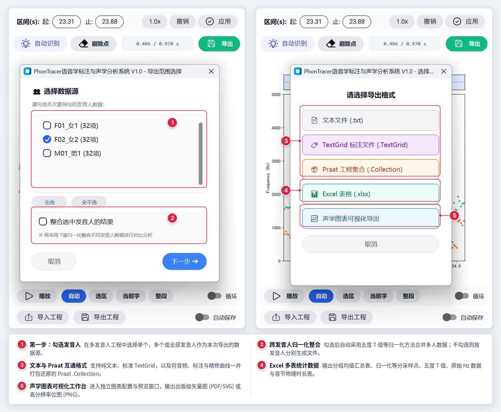

### 第一步：选哪些发音人？要不要合并在一起算？（图 5 左）

1. **勾选发音人（①）**：想导谁就勾谁，可以用 **`全选`** / **`全不选`** 一键切换（比如先只勾全部男声导出一份，再勾全部女声导出一份）。
2. **要不要勾选 `整合选中发音人的结果`（②）？**
   - **不勾选（一人一份）**：软件会给每位发音人单独生成各自的表格或图表，适合看每个人自己的声调或元音系统。
   - **勾选（多人合并算总平均）**：男生嗓门低、女生嗓门高，不能把原始赫兹（Hz）直接混在一起硬求平均。勾选这一项后，软件会先把每个人的音高换算成统一的 **`0～5` 度相对高低（五度 T 值）**，或者把共振峰换算成消除声道长短差异的 **Lobanov 相对值**，再合并算出科学的多人总平均线。

### 第二步：挑你需要的导出格式（图 5 右）

- 想回 Praat 看修好的曲线，选 **`Praat 工程集合 (.Collection)`**（如果只想单独导某一个例词，直接在主界面右侧目录里**右键点那个词**也能单独导出 `.Collection`）。
- 想拿去做统计分析，点 **`Excel 表格 (.xlsx)`（④）**。
- 想画图看结果或做最后的数据检查，点最下面的 **`声学图表可视化导出`（⑤）**。

---

## 三、声学图表工作台怎么选版式和格式？

点开 **`声学图表可视化导出`** 后，就会看到左栏选参、右侧实时预览的图表工作台：

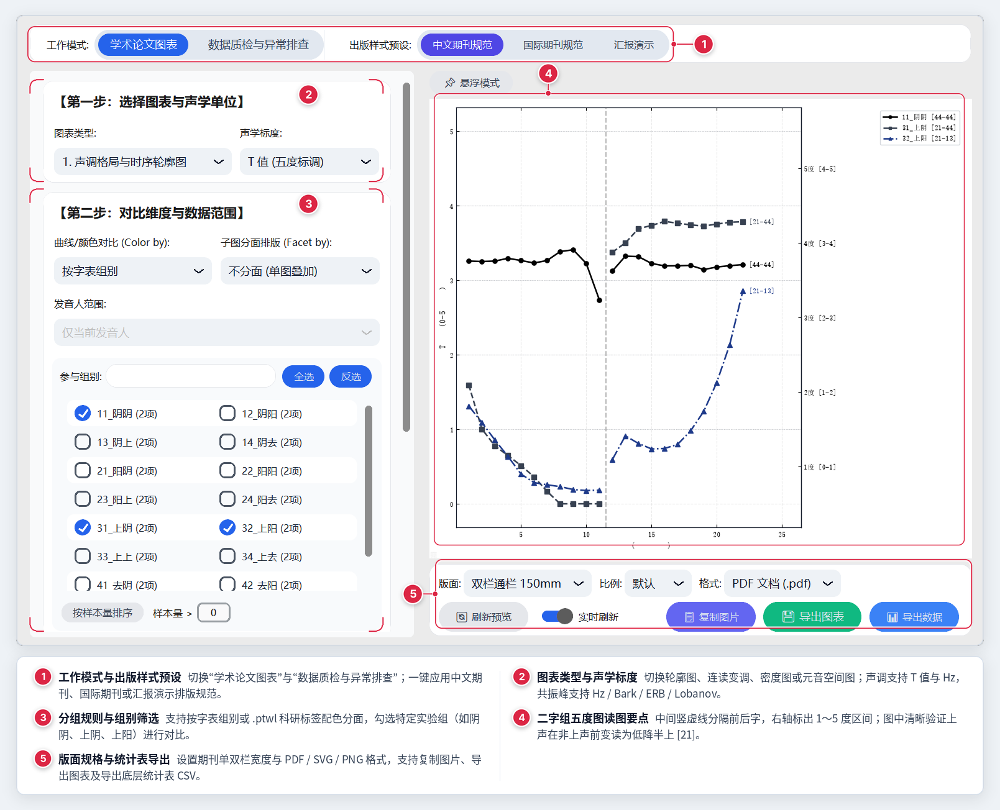

操作时顺着左上往左下看三个地方就够了：

1. **先选顶部的 `工作模式` 和 `出版样式预设`（①）**：
   - **`工作模式`**：定稿前先切到 **`数据质检与异常排查`** 抓漏网的错点；检查干净后再切回 **`学术论文图表`** 正式出图。
   - **三套现成的 `出版样式预设`**（不用自己调字号和粗细）：
     - **`中文期刊规范`**：适合投《中国语文》《方言》《民族语文》或写中文学位论文。四周有完整方框，除了颜色不同，还同时用“实线/虚线”和“圆点/方框/三角”把不同调类区分开——就算打印店印成纯黑白，每根线也分得清清楚楚。默认去掉图顶大标题（方便你在 Word 图片正下方敲“图 1 ……”）。
     - **`国际期刊规范`**：适合投英文期刊。自动去掉顶部和右侧多余的框线，采用对色盲读者友好的清爽配色，并在图例里注明阴影误差带的含义。
     - **`汇报演示`**：适合放进组会 PPT、课堂讲义或答辩幻灯片。自动变成 `16:9` 宽屏比例，把线条加粗、字号放大，并保留顶部大标题，后排听众也能看清。
2. **再选 `图表类型`、`声学标度` 和 `参与组别`（②、③）**：
   - 如果实验组别很多（比如双字连读有 16 种组合），可以在 **`参与组别`** 里只勾你想对比的那三四组，图面会清爽很多。
3. **最后在右下角保存图片或源数据（⑤）**：
   - **投论文优先选 `.pdf` 或 `.svg` 矢量图**（在文档里放大多少倍文字和线条都不会发虚）；做 PPT 或日常交流选高清 `.png` 或直接点 **`复制图片`**。
   - 别忘了顺手点一下右下角的 **`导出数据`**：它会把图上每条线算出来的平均值、标准差存成 `.csv` 表格，写论文正文要报具体数字时直接抄就行。

---

## 四、手把手教你读懂每一类声学图表（配 21 张真实录音实测图）

下面所有的图表，全部是用真实普通话人声录音工程（`普通话单字与双字调.teproj`、`普通话双字组16种声调实验.teproj` 和 `韵母.teproj`）在 PhonTracer 里直接导出的。我们把它们分成**声调与连读变调、数据质检排查、元音与共振峰、工具箱进阶脚本**四大类，逐张讲透怎么看。

---

### （一）声调与连读变调类图表（实测图 01～10）

#### 1. 单字调五度折线图 & 三套排版样式对比（实测图 01～03）

- **什么时候用？** 最基础、最核心的声调图，用来展示一个方言或语言里有几个单字调、每个调具体的升降走势和五度调值（如 `[55]`、`[24]`）。
- **横纵轴和线条怎么看？**
  - **横轴（`1～11`）**：因为每个人读每个字的快慢不一样，软件把每个字的韵母等分成 11 个时间点（第 1 点是字头，第 6 点是正中间，第 11 点是字尾），这样长短不同的字就能对齐在一起求平均了。
  - **左纵轴（`T 值 0～5`）与右纵轴（`1度～5度`）**：把录音的赫兹换算成 `0～5` 的相对音高分数，右边直接标好了传统方言调查的五度标尺——落在 `4～5` 之间就是 **5 度（高音）**，落在 `0～1` 之间就是 **1 度（低音）**。
  - **半透明阴影带（如果有开启）**：代表同组不同字之间的波动范围。阴影越窄，说明大家读得越整齐；阴影突然变宽，说明这一段有人读高有人读低。

下面三张图画的是**完全同一份真实单字调录音（1 男 1 女共 40 个字）**，只是切换了三种预设外观：

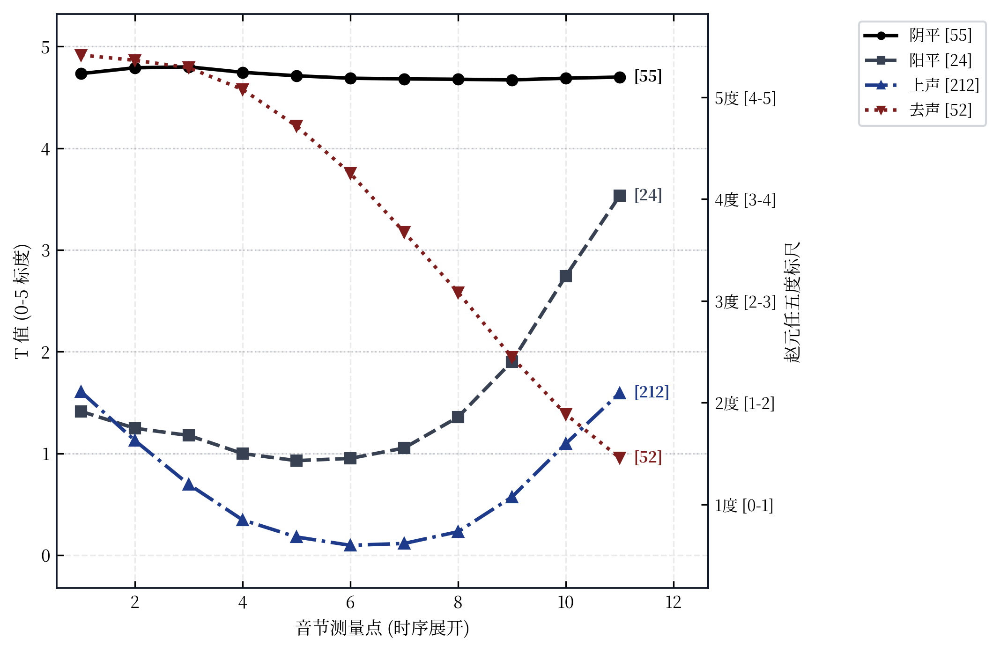

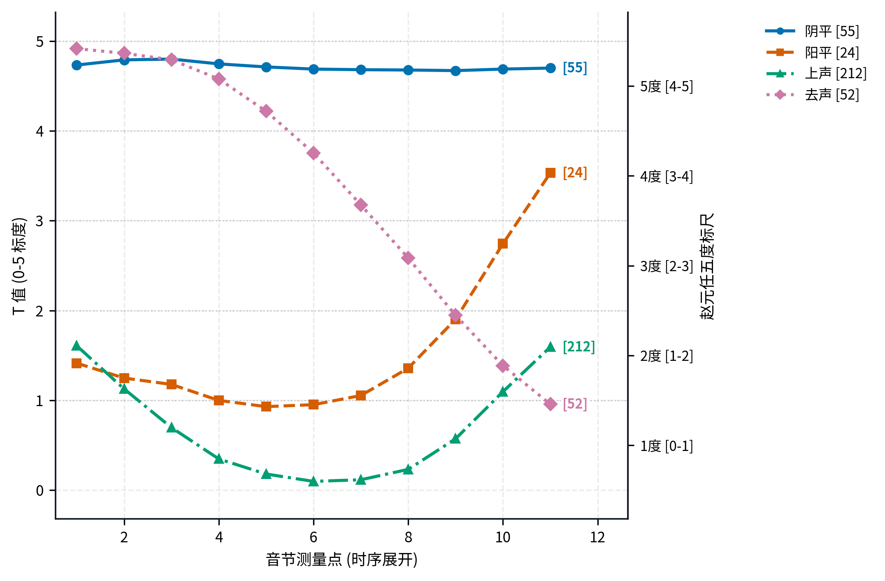

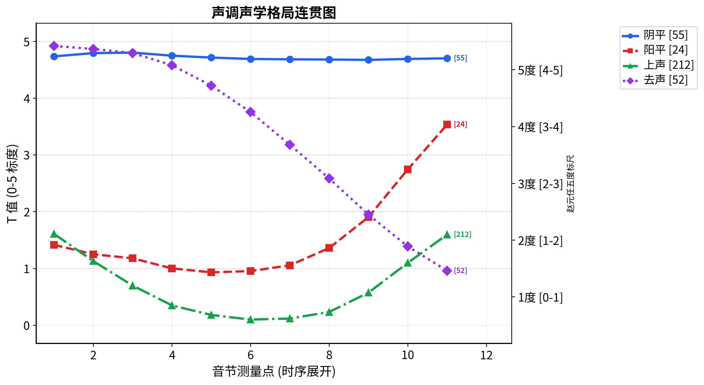

- **从这组真实录音图里能读出什么结论？**
  - **阴平（`[55]`）**：从第 1 点到第 11 点一直稳稳平走在 `4.7` 左右（对应右轴 `5度`），是典型的高平调。
  - **阳平（`[24]`）**：前一半在 `1～1.5`（`2度`）略微蓄势，后一半快速往上爬升到 `3.5`（`4度`），是中升调。
  - **上声（`[212]`）**：单字念的时候从 `2度` 往下降进 `0.1` 的最低谷（`1度`），在字尾又重新挑起来回到 `2度`，清楚呈现先降后升的曲折调。
  - **去声（`[52]`）**：从接近 `5` 的最高处一路干脆利落地往下滑到 `1` 附近，是全降调。

---

#### 2. 单字调原始赫兹（Hz）男女分面对比图（实测图 04）

- **什么时候用？** 想查看每位发音人**最原始的物理音高高低（每秒声带振动多少次）**，或者向审稿人、读者直观解释“为什么男女合并画图前一定要做五度 T 值换算”。
- **怎么看？** 纵轴不再是 `0～5` 的分数，而是真实的物理频率 **赫兹（Hz）**；左右两格分别画男声和女声。

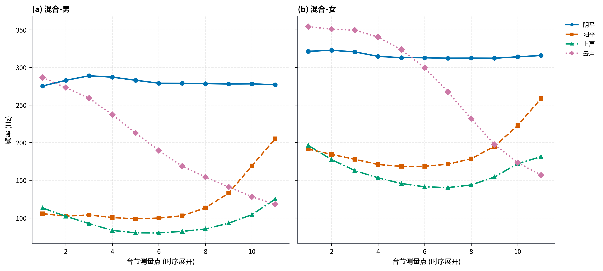

- **从这张图里能读出什么？**
  - 看左图 `(a) 混合-男`：男声最低音降到 **80 Hz** 左右，阴平高音在 **280 Hz** 左右。
  - 看右图 `(b) 混合-女`：女声天生声带短薄，哪怕压到上声最低谷也有 **140 Hz**，阴平在 **315 Hz**，去声开头更是冲到 **355 Hz**！
  - 你看：女生的中低音（180 Hz）甚至比男生的中音还要高。如果不换算成上面的五度 T 值就把男女赫兹混在一起算平均，算出来的数字既不像男声也不像女声——但各自单独看，左右两张图的“平、升、曲折、降”形状其实一模一样！

---

#### 3. 二字组重点连读变调五度折线图（实测图 05）

- **什么时候用？** 研究两个字连着读时声调怎么变化（比如普通话“你好”前一个字变成阳平，“首都”前一个字变成半上）。当实验组合很多（比如 16 种）时，只挑你最关心的 4～6 组画在一张图里对比最清楚。
- **怎么看？**
  - 横轴变成 **`1～22` 共 22 个点**：左边 **`1～11` 点是第一个字（前字）**，右边 **`12～22` 点是第二个字（后字）**。
  - 图正中间那条**竖直灰色虚线**就是前后两个字的分界线。前字末尾和后字开头之间故意断开了一小格，表示跨过了字界。

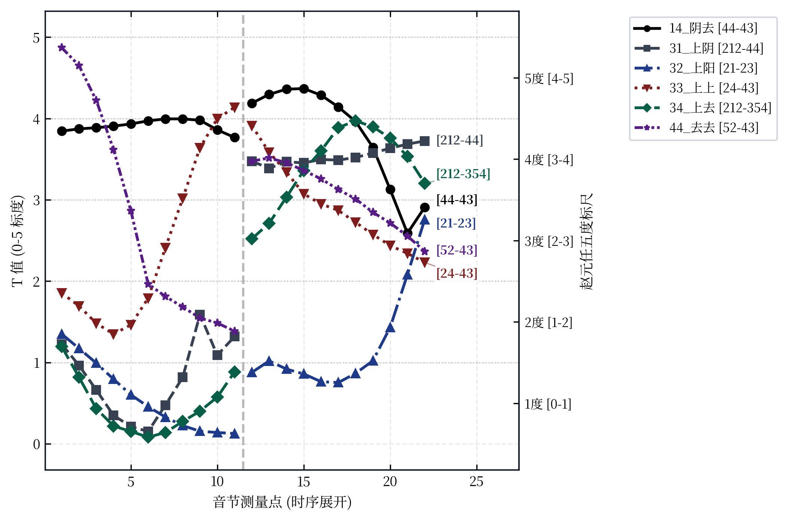

- **从这张图里能读出什么结论？**
  - 重点看前字都是上声的四条线（`31_上阴`、`32_上阳`、`33_上上`、`34_上去`）：
  - 在中间竖虚线左边（前字区间），只有深红色点线 **`33_上上 [24-43]`** 一路往上爬到了 `4` 度以上——直观证明了**“两个上声相连，前一个上声变成阳平”**！
  - 而另外三条（**`31_上阴`**、**`32_上阳`**、**`34_上去`**）在前字区间全都往下沉在 `0～1.5` 的低谷里，把单字调末尾原本往上翘的尾巴省掉了——这就是普通话日常说话最常见的**“上声在非上声前只读低降的半上 `[21]`”**。

---

#### 4. 双字组 16 种声调组合（4×4）连读变调全景网（实测图 06）

- **什么时候用？** 普通话四声两两组合一共有 `4 × 4 = 16` 种。如果把 16 根折线全塞进上面同一张框里，线条会缠成一团毛线根本没法看；选 **`连读变调与协同发音图`**，软件就会自动帮你按“前字是哪一调”拆成清爽的四个小格子。
- **怎么看？**
  - 四个小格分别装：**`(a) 前字为阴平`**、**`(b) 前字为阳平`**、**`(c) 前字为上声`**、**`(d) 前字为去声`**。
  - 每个小格里面有 4 根线，代表后面分别接阴平、阳平、上声、去声四种后字。
  - 看图秘诀：**先看每个小格左半边（前字）4 根线有没有拧成一股绳**——如果拧成一股绳，说明不管后面接什么字，前字都不变调；如果有一根线单独劈叉跑开了，那就是发生了连读变调！

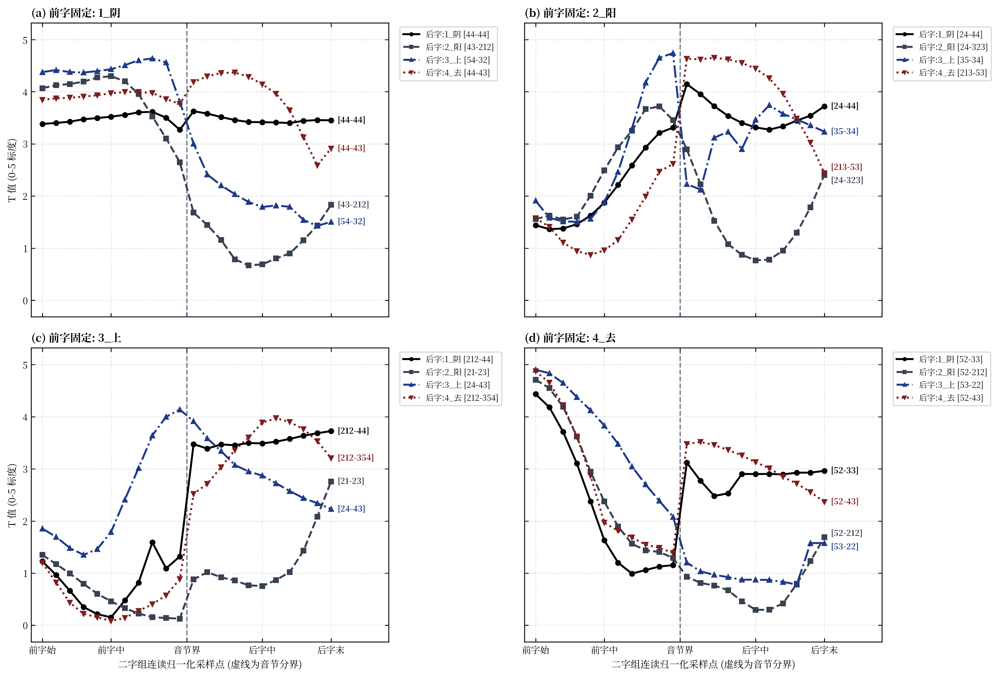

- **从这张图里能读出什么结论？**
  - 看 `(a)`、`(b)`、`(d)` 三个格子：左半边的前字 4 根线全都整齐地贴在一起（阴平全平在上面、阳平全往上爬、去声全往下掉，其中 `(d)` 里 `44_去去` 前字降得稍浅一点）。
  - 唯独看左下角 **`(c) 前字为上声`**：3 根线乖乖趴在底下，只有 **`33_上上`** 一根线大幅往上扬起！整套 16 种组合里哪里不变调、哪里变调，一张图全交待清楚了。

---

#### 5. 时序核密度热图：检查同组读音齐不齐（实测图 07）

- **什么时候用？** 折线图只画了一条“平均线”，万一你把两种完全不同的读法误分到了同一组（比如调查方言时，古全浊字读低升 `[13]`、古清音字读高升 `[35]`，混在同一个“阳平组”里硬求平均，就会画出一条谁也没读过的 `[24]` 假平均线！），用这张热图一眼就能验出来。
- **怎么看？**
  - 想象组里每一个字的音高线都是一支半透明的水彩笔，几十个字叠着涂过去：**颜色越红越深的地方，说明越多的字都从这条道上走过**；浅黄和留白的地方说明几乎没有字往那儿走。
  - **健康的图**：每个小格里只有**一条紧实的深红橙色主干道**。
  - **需要警惕的图**：如果某一个格子里**上下裂成了两条平行的深红带，中间反而发白**，说明这一组里混进了两种不同读法（比如条件变调或文白异读），应该回字表把它们拆成两组再统计。

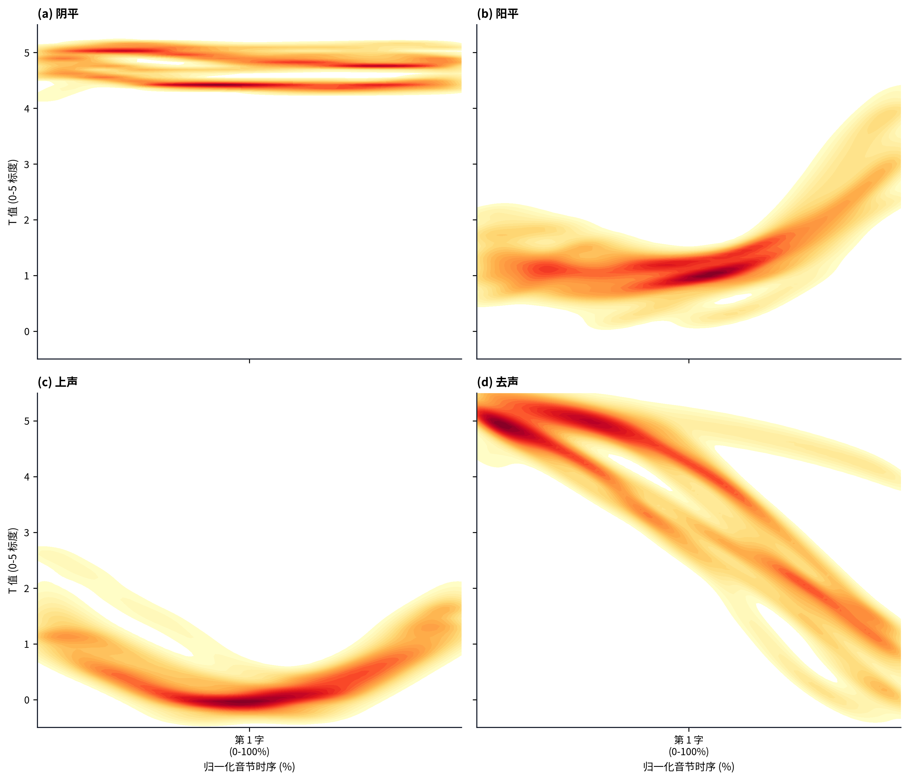

- **从这张图里能读出什么结论？**
  - `(a) 阴平`、`(b) 阳平`、`(c) 上声` 全都是结结实实的单条深红带，说明男女发音人的读法高度统一，算平均线完全放心。
  - `(d) 去声` 开头紧聚在左上角 `5` 度深红区，往右下角降落时像扇子一样稍微散开，说明大家起调都很高，只是每个人收尾降到底的深浅略有自然差别。

---

#### 6. 声调统计分布雨云图：把分布、中位数和每个字全摊开看（实测图 08）

- **什么时候用？** 想对比不同调类在整体音高（或斜率、拐点）上的集中程度和离散跨度，比传统干巴巴的柱状图信息量丰富得多。
- **为什么叫“雨云图”？怎么看？**
  - 它把三种图拼在了一起，像“一朵云下面正在下雨”：
  - **右边的彩色鼓包（“云朵”）**：看数据集中在哪儿——鼓包最凸出的高度，就是字数最扎堆的音高位置；如果鼓出两个包（双峰），说明组里有两拨不同读法。
  - **中间的小方框（箱线图）**：方框正中间的黑横线是**中位数**（排在最中间那个字的数值），上下框边包住了最核心一半（50%）的样本。
  - **左边散落的小圆点（“雨滴”）**：每一个小圆点就是**一个真实的录音字**！总共有几个字、有没有哪一个字孤零零掉队跑远了，数一数圆点全看得到。

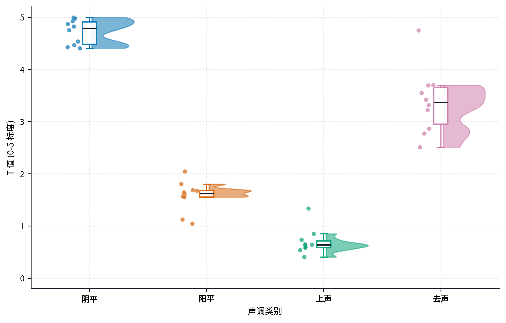

- **从这张图里能读出什么结论？**
  - 阴平整体高悬在 `4.4～5.0` 之间；上声整字平均音高最低（集中在 `0.6` 附近，箱子极扁说明非常稳定）；去声因为从最高处滑到最低处，不同字的整字均值跨度最宽（箱体最长），上方还有一个单独偏高的点（正是后面质检图抓出来的那个没降到底的去声字）。

---

#### 7. 音节物理时长（毫秒）堆叠对比图（实测图 09）

- **什么时候用？** 前面的五度折线图为了对齐形状，把长音和短音都拉成了同样宽的 11 个点——音长信息被抹平了。但研究**入声短调、轻声变短、焦点重音变长，或者单念跟连读的语速差别**时，必须看这张真实毫秒时长图。
- **怎么看？**
  - 纵轴单位是 **`毫秒 (ms)`**（`1000 ms = 1 秒`）。
  - 单字组只有一整根柱子；双字连读组会自动画成**上下两截叠在一起的柱子**：底下纯色一截是**前字时长**，上面带斜纹一截是**后字时长**，柱顶标出的数字是两个字加起来的总时长，工字形的黑竖线代表组内长短波动范围（标准差）。

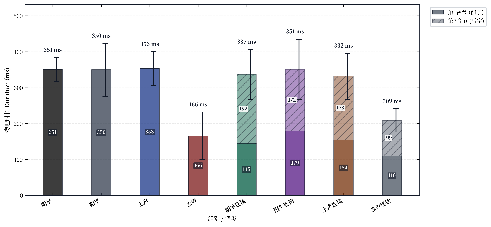

- **从这张图里能读出什么结论？**
  - **单字念的时候**：上声因为要先降后升拐个弯，耗时最长（平均 **`353 ms`**），阴平（`351 ms`）和阳平（`350 ms`）紧随其后；而**去声从高往下猛一砸就收音，干脆短促，平均只有 `166 ms`**，不到上声的一半长！
  - **一旦变成两个字连着读**：每个字的平均时长立刻压缩到 **`99～192 ms`**，读完整个双音节词的总时间（`332～351 ms`），居然跟慢慢单念一个字的时间差不多长——这就是连读语流里的音节压缩现象。

---

#### 8. 二字组前后字调类效应时间进程图：谁在控制当前这一刻的音高？（实测图 10）

- **什么时候用？** 这张图名字听着像高深统计，其实意思特别好懂——两个字连着读的时候，人的声带是有惯性的，也会提前做准备。这张图就是用来回答：**在从头到尾的 22 个时间点上，每一刻的音高到底主要听“前字”的，还是听“后字”的？**
- **三条线怎么看？**
  - 纵轴（`0.0～1.0`）可以直白理解成**“话语权占比”**（统计上叫方差解释率 $\eta^2$）：越接近 `1.0`，说明这一刻的音高几乎全由它说了算；越接近 `0`，说明它说了不算。
  - **蓝色实线（`前字调类`）**：前字原本是什么声调说了算的比例。
  - **橙色虚线（`后字调类`）**：后字是什么声调说了算的比例。
  - **绿色点划线（`交互项/残差`）**：需要“前字和后字凑在一起看”才能解释的部分（比如只有“上声 + 上声”凑成一对才触发的特殊变调）。

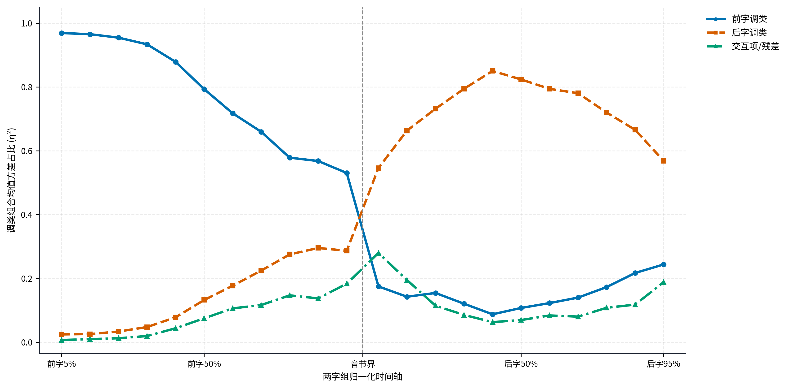

- **从这张图里能读出什么结论？**
  1. 词刚开头时（`前字5%`），蓝线高达 **`0.97`**，橙线接近 `0`——刚开始当然完全由前字自己的声调说了算。
  2. 还没跨过中间音节界（在前字后半段），**橙色虚线就已经提前抬头爬升到了 `0.30`**——说明嘴里还在念前一个字的后半截，声带已经在提前为衔接后一个字的高低做准备了（语音学上叫“逆向预期协同发音”）。
  3. **刚跨过正中间的 `音节界` 虚线**：蓝线和橙线精准完成“交接班”，后字橙线迅速冲上 **`0.85`** 主导音高；同时你会发现蓝线在后字开头还留着 `0.18` 左右的尾巴没立刻归零——这就是前一个字留下的声带惯性（“顺向滞后影响”）。
  4. 看底下的**绿色点划线**：正好在 `音节界` 交界处鼓起一个明显的山峰（**`0.28`**），正好对应上声连读变调在两字交界处产生的剧烈变化！

---

### （二）数据质检与异常排查类图表（实测图 11～12）

定稿导表之前，切到工作台顶部的 **`数据质检与异常排查`** 模式看这两张图，能在十秒钟内把整批录音里漏修的错点抓出来。

#### 9. 组内单样本原始曲线叠置排查图（实测图 11）

- **什么时候用？** 想按声调分组，把组里几十个字的原始曲线全叠在一起照妖镜式检查，看看有没有哪一个字跑偏了。
- **图上的颜色怎么看？（重点分清灰线、红线和琥珀色虚线）**
  - **浅灰色细线**：表现乖巧正常的绝大多数样本，退在背景里不抢眼。
  - **黑色虚线**：这一组的中心基准走势（中位数）。
  - **醒目的红色实线 + 小红框标签**：软件自动抓出来的离群或带声学警告的样本，并且贴心地把 **`发音人 : 汉字 #词条编号`** 直接印在红线旁边，不用你去表格里大海捞针！
  - *（补充说明：如果在软件界面里遇到**红色实线**与**琥珀色虚线**同时存在的情况——红色实线代表八度跳变或切分报错等硬伤，必须回主界面修到 **0 项**；而琥珀色虚线只是温和提醒这个字比同组平均偏高或偏低了一些，只要回听录音确认发音人确实这么念、蓝点也没抓错，就是正常的嗓音波动，直接保留即可，千万别为了图好看去人为改数据。）*

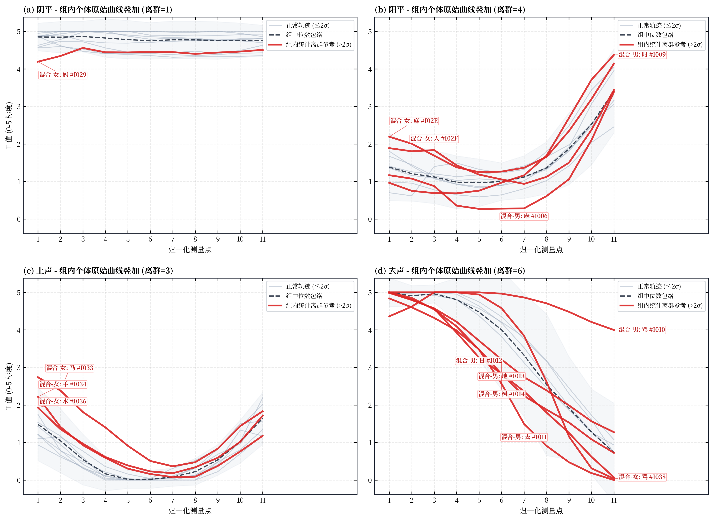

- **从这张图里怎么抓异常？**
  - 一眼扫过去，右下角 **`(d) 去声`** 最显眼：正常去声字全都从左上角 `5` 度一路斜冲到右下角 `1` 度，偏偏有一根红线 **`混合-男: 骂 #I010`** 到了后半截还高高挂在 `4` 度下不来！记下 `#I010` 这个编号，回主界面右侧目录点开它一听一查，马上就能确认是发音人没读到位还是右红线切早了。

---

#### 10. 词条级逐行偏差排序热力图：几百个词十秒扫完（实测图 12）

- **什么时候用？** 如果你的实验有两三百个词，叠在线图里还是嫌密，就用这张“体检排行榜”——软件会自动按每个词跟同组平均值的偏离大小从上往下排好队，**最可疑的词全部置顶排在最上面几行，并打上 `[!]` 标记**。
- **红白蓝三种颜色怎么看？**
  - **每一横行**就是一个具体的字，从左到右 11 小格对应第 `1～11` 号采样点。
  - **浅米白色（接近 `0`）**：跟同组大家读的平均值几乎一模一样，完全正常。
  - **深红色（`+1 ～ +3`）**：在这一段比同组平均值明显**偏高**。
  - **深蓝色（`-1 ～ -3`）**：在这一段比同组平均值明显**偏低**。

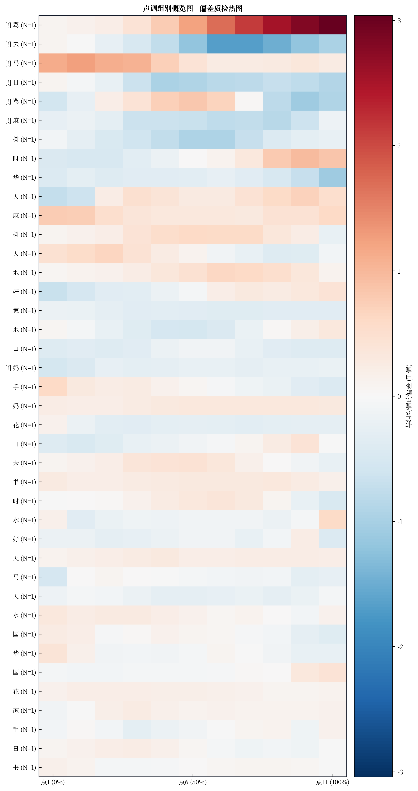

- **从这张图里能读出什么？**
  - 看最顶上第一行 **`[!] 骂 (N=1)`**：前半截还是浅色，越往右越变成发黑的深红色（偏高近 `+3` 度），正是上一张图抓出来的那个尾巴没降下去的 `骂`！
  - 第二行 **`[!] 去 (N=1)`**：中间几格呈蓝色，说明这个字中段往下掉的速度比别的去声字更快。
  - 而从第七行往下整整三十多行，全是一片干净柔和的浅米白色——说明剩下三十多个字全都稳稳当当，你只需要花一分钟回听最顶上带 `[!]` 的那几行就够了！

---

### （三）元音与共振峰类图表（实测图 13～18）

#### 11. 元音 F1–F2 舌位空间图：为什么坐标数字是反着标的？（实测图 13 & 14）

- **什么时候用？** 研究单元音格局、鼻化元音或方言韵母音值时必画的核心图，用来把抽象的赫兹频率变成直观的**“口腔舌头高低前后位置图”**。
- **新手第一关：为什么横轴和纵轴的数字都是反着标的？**
  - 请在脑海里**想象一个人面朝左边站着**：他的嘴唇在左边（前），嗓子眼舌根在右边（后），上颚在上面（高），下巴在底下（低）。
  - 语音学发现：**第一共振峰 `F1` 数值越小，嘴张得越小、舌位越高；第二共振峰 `F2` 数值越大，舌头越往前伸。**
  - 所以软件故意把横轴 `F2` 设成**往左变大**、纵轴 `F1` 设成**往上变小**——这样一反转，图面方向就与口腔真实舌位对应上了：**画出来的元音图，跟面朝左站着的人嘴里舌头的真实位置方向完全一模一样！**
    - **左上角**（如 `[i]`、`[ü]`）= **舌位又高又靠前**；
    - **右上角**（如 `[u]`、`[o]`）= **舌位又高又靠后（圆唇）**；
    - **最底下**（如 `[a]`）= **嘴巴张到最大、舌位压到最低**。
- **图上的圈、虚线框和缩写字母是什么意思？**
  - **彩色虚线椭圆圈（`Ellipse: 95% CI`）**：圈住同组元音落点的散布范围。圈越小说明每次发音舌位越准；两个圈如果叠在一起，说明这两个音听起来快分不清了。
  - **外围灰黑色大虚线框与左下角 `VSA = 4.18 SD²`**：把最边角几个极端元音连起来围成的“元音空间总面积”（Vowel Space Area）。面积越大，说明发音越清晰饱满、口腔打开得越充分（儿童语言发育、清晰言语或病理嗓音研究经常对比这个面积数字）。
  - **图例里的 `TL`（Trajectory Length）**：代表念这个韵母的过程中舌头一共滑动了多远——单韵母舌头基本不动所以 `TL` 很小，复韵母舌头大范围滑动所以 `TL` 较大。

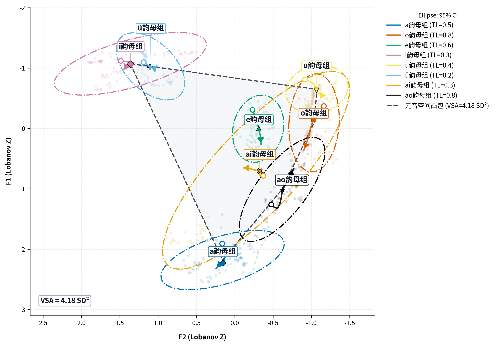

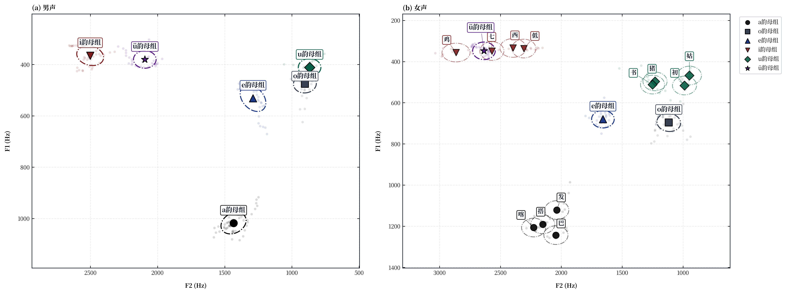

- **对照上面两张真实录音图能读出什么结论？**
  - 先看图 14（原始 Hz 男女分开画）：男声声道长，底下 `[a]` 的 `F1` 在 **1020 Hz** 左右，左上 `[i]` 的 `F2` 在 **2500 Hz**；女声声道短，共振频率整体放大，底下 `[a]`（巴、搭、发、喀）的 `F1` 去到了 **1120～1240 Hz**，左上「鸡」的 `F2` 高达 **2860 Hz**！
  - 再看图 13（经过 **Lobanov 归一化**消除男女声道长短差异后合并）：男声和女声清晰对齐在统一的 `Z` 分数坐标里，左上 `[i, ü]`、右上 `[u, o]`、中间偏上 `[e]`、最底下 `[a]` 围出典型的倒三角形元音空间（总面积 `VSA = 4.18 SD²`）！

---

#### 12. 复韵母舌位滑移矢量空间图（实测图 18）

- **什么时候用？** 想在元音舌位图上专门看 `ai`、`ei`、`ao`、`ou`、`ie`、`uo` 这些**复韵母（双元音）发音时舌头是从哪儿滑向哪儿的**。
- **怎么看？**
  - 每根实线一头是**空心小圆圈（代表韵母开头 20% 处的起点舌位）**，另一头是**实心箭头（代表韵母收尾 80% 处的终点方向）**。线越长（图例里 `TL` 数值越大），说明舌位跨度越大。

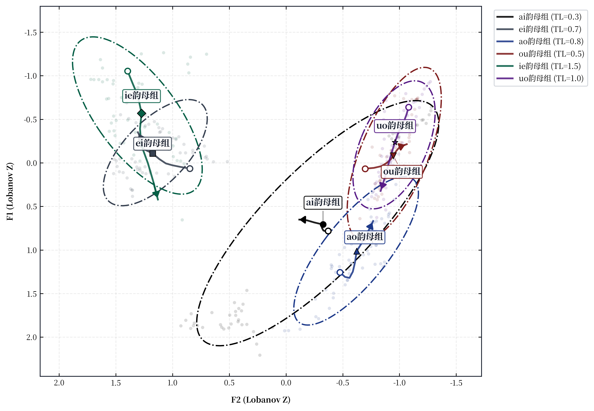

- **从这张图里能读出什么结论？**
  - 绿线 **`ie韵母组` 滑动距离最长（`TL=1.5`）**：空心圆从左上角极高的 `[i]` 区出发，箭头大幅往下滑向中低元音 `[e/ɛ]` 区。
  - 紫线 **`uo韵母组`（`TL=1.0`）**：从右上角高后圆唇 `[u]` 区一路往下开口滑向 `[o]` 区。
  - 蓝线 **`ao韵母组`（`TL=0.8`）** 则刚好反过来：空心圆从偏底下的低元音 `[ɑ]` 起步，箭头一路往右上角高后圆唇 `[u/o]` 区收拢，复韵母“开口变闭口”与“闭口变开口”的相反方向一目了然。

---

#### 13. 复韵母 F1 / F2 / F3 全程动态轨迹图（实测图 15）

- **什么时候用？** 上面的舌位空间图折叠了时间轴；如果你想仔细看复韵母**从第 0% 到第 100% 每一刻共振峰是怎么一步步拐弯过渡的**（比如看韵头占多长、韵腹稳态段在哪儿、有没有卷舌音拉低第三共振峰 `F3`），就用这张动态轨迹图。
- **怎么看？**
  - 横轴是音节从头到尾的**时间百分比（`0% ～ 100%`）**，纵轴是**频率（Hz）**。
  - 画面天然分成上、中、下三层：
    - **最底下的一簇虚线（方框点）** = **第一共振峰 `F1`**（越往上走代表嘴张得越大）；
    - **正中间变化最明显的一簇实线（圆点）** = **第二共振峰 `F2`**（越往上走代表舌头越往前推，越往下掉代表舌头越往后缩或圆唇）；
    - **最顶上的一簇点划线（三角点）** = **第三共振峰 `F3`**（遇到儿化音或卷舌音 `r` 时，`F3` 会明显往下掉）。

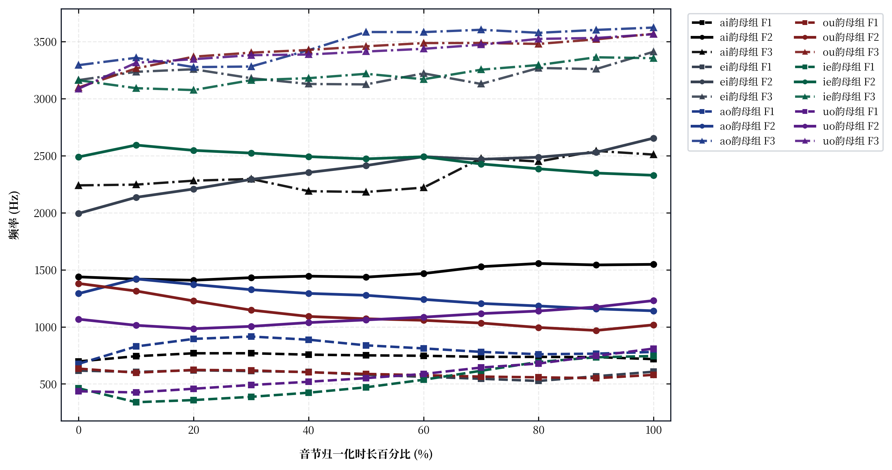

- **从这张图里能读出什么结论？**
  - 看中间实线圆点簇：深灰色的 **`ei韵母组 F2`** 从开头的 `2000 Hz` 一路稳步爬升到词尾的 `2650 Hz`（舌头不断往前高 `[i]` 推）；而深蓝色的 **`ao韵母组 F2`** 和暗红色的 **`ou韵母组 F2`** 则从 `1300～1400 Hz` 持续往低频 `1000 Hz` 滑落（舌头不断往后缩并拢圆嘴唇）。

---

#### 14. 六大单韵母二维时空核密度等高线图：看“单韵母到底纯不纯”（实测图 16）

- **什么时候用？** 名义上叫“单韵母”，发音时舌头真的从头到尾纹丝不动吗？这张图用“红早蓝晚”的等高线把所有采样点全画出来，专门检验单韵母的稳定性与隐含微动程（比如汉语普通话里著名的 `o` 和 `e` 动程现象）。
- **“红早蓝晚”怎么看？**
  - 形状像地理课的等高线地图：圈越密的地方样本越集中。
  - 看右边竖着的颜色尺：**偏红色代表音节刚开头（`0%` 早段）**，**偏蓝色代表音节快收尾（`100%` 晚段）**。
  - 如果一个韵母红圈和蓝圈完全叠在同一个小圆团里，说明它从头到尾舌头稳如泰山；如果**一头红、另一头拖出长长的蓝尾巴**，说明念这个单韵母时舌头其实悄悄滑动了！

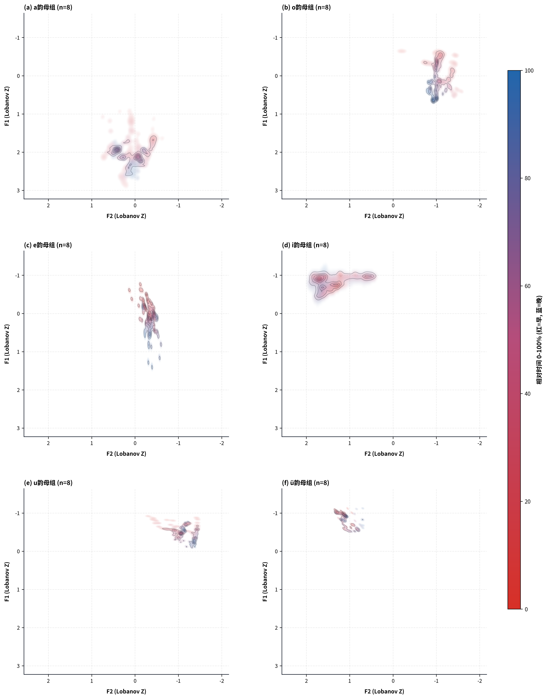

- **从这张图里能读出什么核心结论？**
  - 看 `(d) i韵母组` 和 `(f) ü韵母组`：红蓝等高线紧紧缩在左上角一小团，从头到尾几乎不走样，是纯粹稳定的高元音。
  - 再看右上角 **`(b) o韵母组`（玻、坡、摸、播）** 和中间 **`(c) e韵母组`（歌、科、喝、车）**：两个图都呈现非常明显的**“上面偏红、底下拖着蓝色尾巴”**！这直接用真实声学数据印证了普通话语音学的一个经典事实：普通话唇音后的单韵母 `o` 实际发音带有明显的圆唇过渡（接近 `[uo]`），而单韵母 `e` 也有从高往半低滑移的动程（常记作 `[ɤ]` 或 `[ɯʌ]`）！

---

#### 15. 元音对立与合并度（Pillai 值）矩阵图：给“两个音混没混同”打分（实测图 17）

- **什么时候用？** 肉眼看元音图觉得两个椭圆圈贴得很近（比如方言里的前后鼻音韵腹、或者儿化韵合流、外语学习者分不清 `/iː/` 和 `/ɪ/`），审稿人往往会问：“你说它们快合并了，有没有客观数字证明？”——导出这张 **Pillai 矩阵图** 就能直接给出定量指标！
- **别被“Pillai”这个洋名字吓到，像看视力表一样简单：**
  - 这是左右并排的两张矩阵子图：左图 `(a)` 看 **元音对立重叠度（Pillai Score：`0` = 合并，`1` = 分离）**，右图 `(b)` 看两个元音中心点的**声学欧氏距离**（数值越大中心相距越远）。
  - 只记一句话就够了：**左图 Pillai 分数永远在 `0` 到 `1` 之间——越接近 `0`（颜色越浅米黄），说明两个音越高度重叠或趋于合并；越接近 `1`（颜色越深藏蓝），说明两个音分得越彻底！**
    - 通常 **小于 `0.20`**：说明两个音大面积重叠，日常读音已经高度趋同或合并；
    - **大于 `0.70`**：说明两个音楚河汉界，离得非常远。

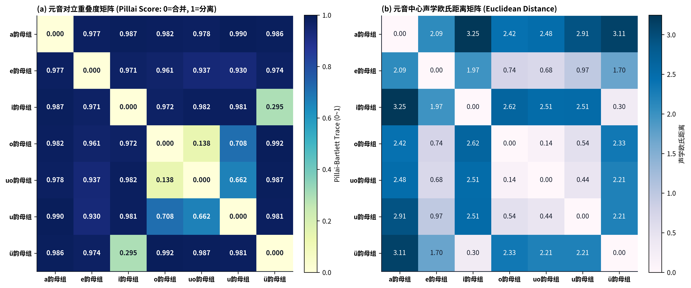

- **从这张真实录音矩阵里能读出什么结论？**
  - 找到左图 `(a)` 里的 **`o韵母组` × `uo韵母组`** 交叉格：数字只有 **`0.138`**（呈浅米黄色，右图 `(b)` 对应中心距离仅 `0.14`）。这用具体数值证明：在这批录音里，唇音后的 `o`（玻、坡、摸）与复韵母 `uo` 在声学空间里高度重叠，实际音值几乎合一。
  - 再看 **`i韵母组` × `ü韵母组`**：分数是 **`0.295`**，因为它们舌头高低前后都在左上角，只靠圆不圆嘴唇区分，所以距离较近。
  - 而看 **`a韵母组` × `u韵母组`**：分数高达 **`0.990`**（几乎满分 1.0），因为一个在最底下张大嘴、一个在右上角撅圆嘴，完全没有任何重叠！

---

### （四）Toolkit 工具箱内置脚本生成的进阶专题图表（实测图 19～21）

除了主界面自带的常规图表，把 `.teproj` 工程放进独立工具箱 **`Toolkit → 自定义脚本`** 页签，不用自己写一行代码，直接点现成的内置脚本就能跑出下面三张发声态、辅音摩擦与自动修点专题图（工具箱操作详见下一册 `04`）：

#### 16. 嗓音发声态多维对比箱线图：量化“气声、清亮嗓与气泡音”（实测图 19）

- **什么时候用？** 研究声调伴随的发声态（比如上声低谷的气泡音/嘎裂声、吴语清浊音的气声差异、民族语的紧喉音或松喉音）时直接运行内置脚本生成。
- **六个小格里的指标用大白话怎么理解？**
  1. **`H1-H2 谐波差 (dB)`**：看声门漏气程度——**数值越大越偏柔和气声**，数值越小（甚至负数）说明声带夹得越紧（偏紧喉）。
  2. **`CPP 倒谱峰值突出度 (dB)`** 与 **`HNR 谐噪比 (dB)`**：这两项都是给**“嗓音有多清亮规律”**打分的——**数值越高，说明声带振动越整齐清亮**；数值越低（尤其是 `HNR` 掉到 0 以下），说明声音里夹杂了明显的粗糙气泡音或摩擦气息声。
  3. **`Jitter 基频微扰 (%)`** 与 **`Shimmer 振幅微扰 (%)`**：看相邻两次声带振动之间的抖动幅度——**数值越小越平稳**，数值飙高说明声带进入了忽快忽慢、忽大忽小的不规则状态（常见于气泡音或急降调收尾）。
  4. **`H1-A3 频谱倾斜 (dB)`**：辅助看高频能量衰减快慢，越大声音越柔和暗淡，越小越清脆明亮。

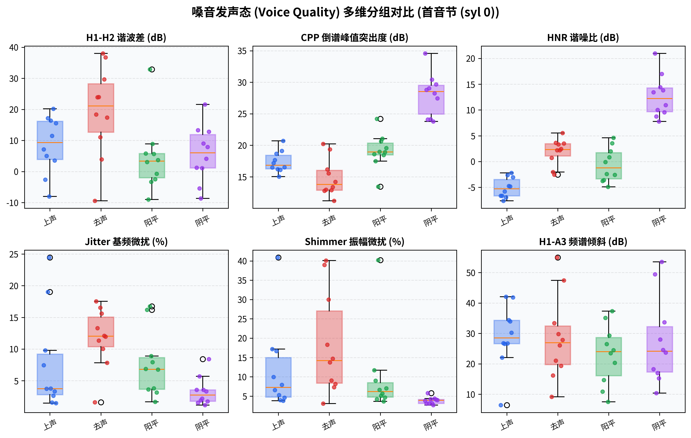

- **从这张真实录音图里能读出什么结论？**
  - **阴平最清亮平稳**：它的 `CPP`（中位数约 `28 dB`）和 `HNR`（约 `12 dB`）全场最高，而抖动指标 `Jitter`（约 `3%`）和 `Shimmer`（约 `4%`）全场最低——因为高平调声带绷得最匀称稳定。
  - **上声气泡音被精准抓出**：看右上角 `HNR 谐噪比`，**上声组掉到了全场最低（约 `-5 dB`）**！这直接为“普通话单字上声降入低谷时普遍伴随非周期性气泡音”提供了客观声学证据。
  - **去声跨度最大**：去声在瞬间从最高音砸向最低音的过程中，气流和振幅剧烈变化，因此 `H1-H2` 和 `Shimmer` 箱体拉得最长。

---

#### 17. 擦音 / 塞擦音频谱四阶矩分析图：给辅音“尖不尖、闷不闷”算分（实测图 20）

- **什么时候用？** 前面的共振峰图是测元音的；如果你想研究**字头辅音**（特别是平翘舌 `z/c/s` vs `zh/ch/sh`、舌面音 `j/q/x`，或者方言尖团音分混），用这个内置脚本提取字头摩擦段的噪音特征最合适。
- **怎么看？重点盯住 `COG（频谱重心）` 就行：**
  - **右图柱状图（`COG 频谱重心 Hz`）**：把辅音摩擦声想象成一串高低混杂的沙沙声，**`COG` 就是这团沙沙声的“平均音高重心”**——发音部位越靠前、嘴唇越扁平（如 `s`、`x`），声音越尖细刺耳，**`COG` 赫兹数就越高**；发音部位越靠后、或者叠加上撅嘴圆唇（如卷舌 `sh`、圆唇 `u` 前辅音），前口腔共鸣腔变长，声音越低沉发闷，**`COG` 赫兹数就越低**。
  - **左图散点图（`COG vs 偏度 Skewness`）**：横轴是重心高低，纵轴“偏度”辅助看能量尾巴往哪边偏（重心越低的后音，往往偏度正值越大，形成左上到右下的漂亮斜带；菱形大块是每组的中心点）。

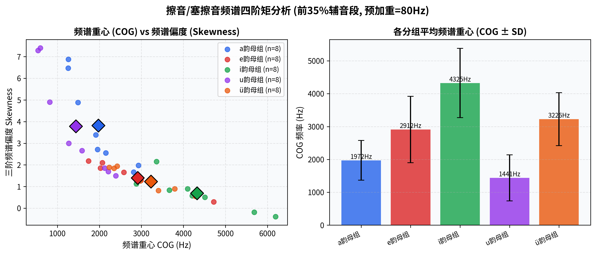

- **从这张真实录音图里能读出什么结论？**
  - 哪怕只是提取韵母词表前 35% 的字头辅音段，发音部位和圆唇效应也分得清清楚楚：包含「鸡、七、西」舌面擦音/塞擦音的 **`i韵母组` 频谱重心冲到了最高（平均 `4325 Hz`）**，听感最清脆尖锐；而带有强烈圆唇动作、拉长了口腔前部通道的 **`u韵母组`（「猪、书、初、姑」）重心一下子降到了 `1441 Hz`**，声音明显低沉浑厚！

---

#### 18. 基频八度跳变自动诊断与调域重算预览图（实测图 21）

- **什么时候用？** 手头刚导进来几百个词，不想挨个点开找哪里出现了倍频/半频跳点时，先跑一遍这个内置清洗脚本，它会自动扫描全工程并生成修前修后对比图与一键重算补丁。
- **左右两栏怎么看？**
  - **左图（清洗前）**：灰细线是平滑正常的词条，**红点实线**是脚本自动揪出来的“相邻两点跳变幅度偏大”的可疑词条。
  - **右图（预期清洗后）**：脚本根据每位发音人自己真实的正常音高范围，自动算出建议收窄的基频上下限，并用**绿点实线**画出压平突变尖峰后的预期走势供你核对。

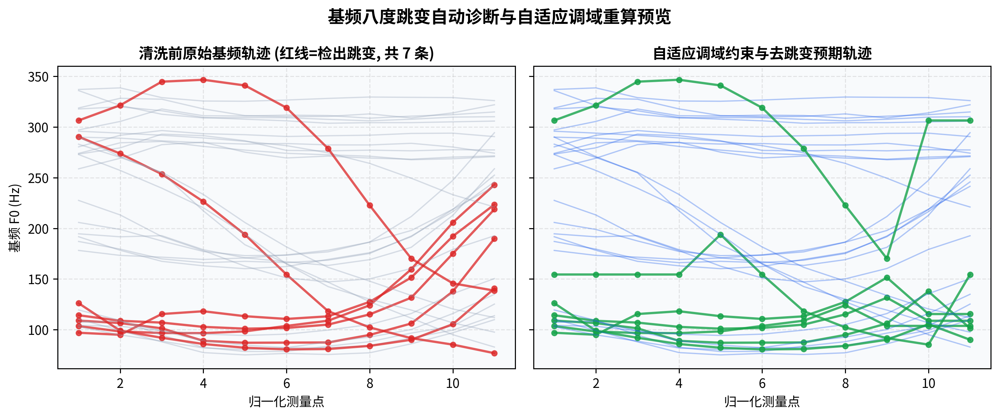

---

## 五、写论文时的选图速查表（一表对号入座）

不知道自己的论文该放哪几张图？直接按你的研究主题照着下面挑就行：

| 你的论文研究什么问题？ | 推荐导出的主力图表组合 | 记得配套导出的表格 |
| :--- | :--- | :--- |
| **方言 / 民族语单字声调系统描写** | `01/02` 单字调五度折线图 + `07` 核密度热图（证明无未拆分的条件变调）+ `09` 物理时长图（尤其有入声短调时必放） | `.xlsx`（取五度 T 值均值与毫秒时长） |
| **双字组连读变调与协同发音研究** | `06` 16 组合连读变调全景网 + `05` 重点变调组折线对比图 + `10` 前后字调类效应时间进程图 | `.xlsx` + 图表右下角 `导出数据 (.csv)` |
| **单元音与复韵母格局描写** | `13` Lobanov 元音舌位空间图（含 `VSA` 面积）+ `18` 复韵母滑移空间图 + `15` F1-F3 动态轨迹图 | `.xlsx`（取 F1/F2 原始 Hz 与 Lobanov 值） |
| **方言韵母合并 / 二语元音偏误对比** | `13` 元音舌位空间图（看椭圆重叠）+ `17` Pillai 合并度矩阵图（给出 0～1 定量合并分数）+ `16` 时空核密度图 | 图表右下角 `导出数据 (.csv)` |
| **上声气泡音 / 清浊发声态 / 擦音研究** | 常规声调或元音图 + Toolkit 内置脚本导出的 `19` 嗓音发声态箱线图 或 `20` 擦音频谱四阶矩图 | 脚本同步输出的逐词声学指标统计表 |

如需了解独立工具箱 `Toolkit` 的音频批量拆合、高级字表 AI 打标、命令行一键批处理以及**可直接填空套用的论文“研究方法”写作模板**，请继续阅读下一册 [04 工具箱预处理与批处理附录](./04_工具箱预处理与批处理附录.md)。

---

# 04 工具箱预处理与批处理附录


在主程序之外，PhonTracer 套件还提供独立工具箱 **Toolkit** 与命令行工具 **PhonTracerCLI**，用于解决音频批量拆合、高级字表音韵打标、研究方法报告生成、自定义组合绘图以及多发音人自动化批处理等进阶需求。文末附有学术论文“研究方法”章节的规范写作模板与归档核对清单。

## 一、Toolkit 独立工具箱六大功能指南

打开 **Toolkit** 后，顶部导航栏依次提供六个功能页签，涵盖实验前材料整理与实验后扩展分析：

### 1. `音频合并（独立音频→长音频）`

当手头语料为数十上百个零散的单字或单词 `.wav` 文件，希望将其整合为单条连续音频统一管理时，可使用该页签：

- **自动插入标准静音间隔**：按文件顺序批量拼接音频，并在相邻词条之间插入设定长度的静音段（如 `0.5s`），同时可导出对应的词条顺序清单。
- **保持原采样率无损输出**：当待合并的音频具有相同采样率（例如均为 `24 kHz` 或 `44.1 kHz`）时，系统严格保持原始采样率直接拼接，不会强制重采样改变音频采样基准；若混入不同采样率文件，则自动对齐至最高输入采样率并给出提示。

### 2. `音频拆分（长音频→独立音频）`

当现场采集了整段连续朗读的长录音，需要先将其切分为按序号与词名命名的独立 `.wav` 语料库时，可使用该页签：

- **支持多格式字表与无字表纯拆音**：既可载入 `.ptwl`、`.csv` 或草稿 `.txt` 字表按词条名称输出文件（如 `001_首都.wav`），也可不加载字表，仅根据静音停顿切分为按序号排列的独立音频片段。
- **段数不一致显式告警与多余片段保留**：若因发音人中途清嗓或重复朗读导致实际切出的语音段数与字表词条数不一致，系统会明确弹出告警提示，并将超出词表数量的音频片段完整保留为带有 **`_extra_`** 标识的文件（如 `033_extra_01.wav`），不会静默截断或丢弃末尾词条，便于研究者快速核查对齐位置。

### 3. `TextGrid 转换器`

用于在标准 Praat `.TextGrid` 标注文件与 PhonTracer 词表及工程结构之间进行转换：

- **层结构预览**：载入 `.TextGrid` 后自动列出全部标注层的名称、区间数量与文本示例，便于准确选择目标词条层与核心音段层。
- **挂载辅助字表**：支持在导入既有时间边界的同时关联 `.ptwl` 或 `.txt` 字表，为仅有拼音或编号的旧标注批量补充汉字词名与实验分组信息。

### 4. `字表编辑器`（管理 `.ptwl` 高级字表与 AI 批量打标）

当实验需要为词条附加音韵地位、声母清浊或变调条件等多维科研属性时，可在 **`字表编辑器`** 中进行可视化编辑：

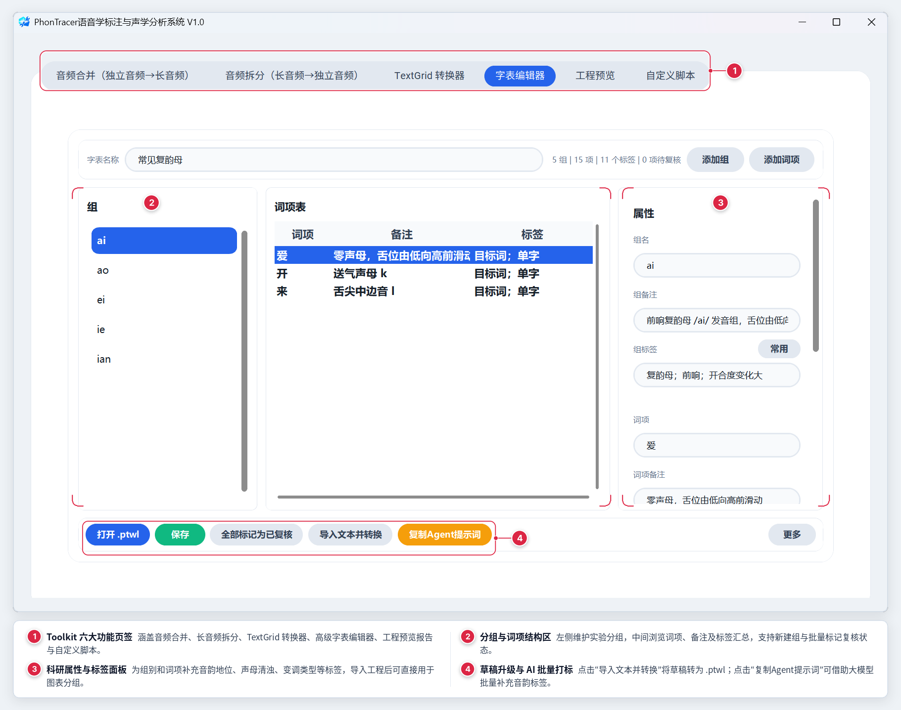

对照图中序号，界面分为顶部页签栏（**①**）、中部分组与词项管理区（**②**）、右侧属性面板（**③**）与底部操作栏（**④**）：

- **三栏协同管理（②、③）**：左栏管理实验分组，中栏展示当前组内的词项、备注及标签汇总，右栏编辑选中组或词项的详细备注与分号分隔的多维标签（如 `复韵母; 前响; 开合度变化大`）。保存为 `.ptwl` 导入主程序后，这些标签可直接在图表工作台中作为配色或分面依据。
- **草稿升级与 AI 辅助补充标签（④）**：
  - 点击 **`导入文本并转换`**，可将普通 `.txt` 或 `.csv` 草稿直接升级为结构化 `.ptwl` 高级字表。
  - 点击橙色 **`复制Agent提示词`** 按钮，系统会将当前词表结构与 `.ptwl` 字段规范一并复制到剪贴板。将其粘贴至大语言模型并说明需要补充的语言学属性（例如要求补充《广韵》摄、等、呼、声调及声母清浊标签），即可快速完成大批量调查字的音韵属性建库，人工抽检确认后点击 **`全部标记为已复核`** 并 **`保存`** 即可。

### 5. `工程预览`（进度核查与导出研究方法报告）

载入 `.teproj` 工程文件后，无需打开声谱图界面即可查看工程内各发音人的词条总数、有效条数、已忽略条数与警告统计，并支持一键导出 **《研究方法与统计摘要报告》**（支持 Markdown 与 Excel 归档格式）。报告自动汇总以下信息：

1. 软件版本与底层声学分析配置；
2. 每位发音人实际使用的基频范围、共振峰分析上限、采样点数及单条目独立覆盖记录；
3. 被标记为“忽略”的排除词条清单及具体排除原因汇总；
4. 各实验组的声学描述统计量（样本量、均值、标准差、时长）与组间单因素方差分析（ANOVA）摘要；
5. 工程文件的 SHA-256 校验指纹，便于论文审稿与数据归档溯源。

### 6. `自定义脚本`（内置进阶分析脚本与 AI 协作绘图沙箱）

当实验需要超越常规预设的专题分析或复合排版图表时，可使用 **`自定义脚本`** 页签中的受控 Python 沙箱（仅开放 `numpy`、`scipy`、`matplotlib` 等科学计算绘图库，隔离外部系统读写以确保安全）：

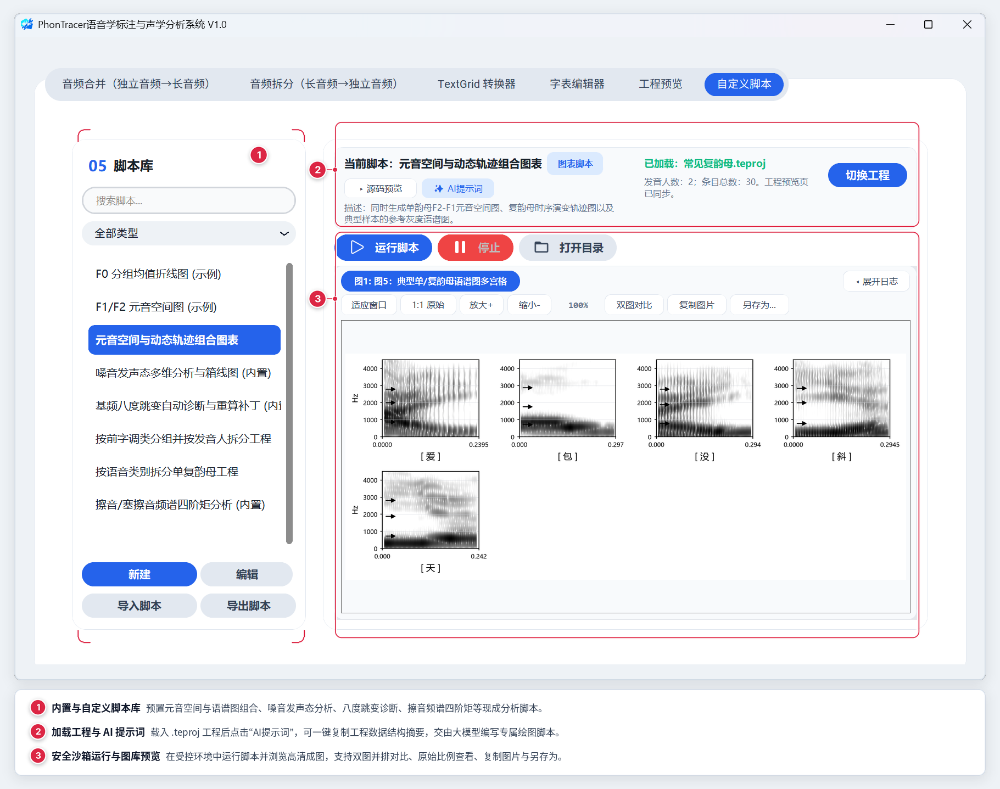

- **内置语音学专项脚本库（①）**：加载 `.teproj` 工程后，可在左侧脚本库中直接选用多款预置分析工具，包括：
  - **`元音空间与动态轨迹组合图表`**：如图 8 右侧预览区所示，可同时生成单韵母元音空间图、复韵母动态轨迹图，以及自动拼接典型例词（如 `[爱] [包] [没] [斜] [天]`）的多宫格参考灰阶宽带语谱图并标注共振峰位置；
  - **`嗓音发声态多维分析与箱线图 (内置)`**：面向气声、嘎裂声、紧喉音等发声态研究，自动提取谐波差与微扰指标并绘制对比箱线图；
  - **`基频八度跳变自动诊断与重算补丁 (内置)`**：扫描全工程疑似倍频或半频跳变词条并输出诊断修正结果；
  - **`擦音/塞擦音频谱四阶矩分析 (内置)`**：自动计算辅音摩擦段的频谱重心、标准差、偏度与峰度；
  - **工程拆分脚本**：支持按前字调类、发音人或单复韵母类别将综合工程自动拆分为子工程。
- **借助 `AI提示词` 定制专属脚本（②、③）**：若不熟悉编程但希望定制特定版式的图表，加载工程后点击 **`AI提示词`** 按钮（**②**），系统会自动生成包含当前工程组名、标签字段与 `ctx` 接口说明的结构化提示词。将其连同你的绘图需求发送给大语言模型，把返回的 `def run(ctx):` 代码新建保存到左侧列表并点击 **`运行脚本`**（**③**），即可在右侧预览区查看高清成图，并支持 **`双图对比`**、**`1:1 原始`** 查看、**`复制图片`** 与 **`另存为...`**。

以下为使用真实人声 `.teproj` 工程直接运行三款内置脚本生成的实测图表（详细逐项读图方法见上一册 [03 数据导出与声学图表解读指南](./03_数据导出与声学图表解读指南.md) 第四节第 16～18 项）：


> **快速读法**：`CPP` 与 `HNR` 越高代表嗓音越清亮规整（如图中阴平最高），`HNR` 掉入负值代表夹杂明显气泡音（如图中上声低谷段低至 `-5 dB`），`H1-H2` 越大越偏柔和气声。


> **快速读法**：盯住右图柱高 `COG（频谱重心）`——辅音摩擦声越尖细靠前（如含舌面音「鸡、七、西」的 `i` 组达 `4325 Hz`）重心越高；带撅嘴圆唇拉长前腔（如 `u` 组降至 `1441 Hz`）重心越低沉。


> **快速读法**：左图红线标出相邻采样点跳变偏大的可疑词条，右图绿线预览按该发音人真实音域收窄上下限重算后的平滑走势。

## 二、PhonTracerCLI 命令行批处理速查

在需要批量处理多位发音人语料，或由 AI 编程助手自动执行全套管线时，可在终端调用项目目录下的 **`cli.py`**（或打包版中的 **`PhonTracerCLI`**）。

### 1. 查看指令手册与自动化指南

```bash
# 进入交互式命令行控制台
python cli.py

# 查看预处理工具类命令说明或完整命令字典
python cli.py "help tools"
python cli.py "help all"

# 输出面向自动化脚本与 AI 代理的单行 JSON 操作指南
python cli.py --json "agent_guide"
```

### 2. 常用预处理与单步指令示例

```bash
# 1. 将草稿 .txt 字表转换为标准 .ptwl 高级字表
python cli.py 'tool_wordlist_convert "draft_wordlist.txt" "standard.ptwl" title="双字调实验"'

# 2. 按字表将长录音拆分为独立短音频（保持原采样率；段数不符时显式告警并保留 extra_* 文件）
python cli.py 'tool_split "男1.wav" "standard.ptwl" "./male_split"'

# 3. 无字表纯拆音（仅按静音停顿切分长音频）
python cli.py 'tool_split "interview.wav" "./blind_split"'

# 4. 将目录内的同采样率短音频按 0.5 秒静音间隔原采样率无损合并
python cli.py 'tool_merge "./merged_out.wav" 0.5 "./male_split"'
```

### 3. 使用 `--script-file` 与 `export_bundle` 一键跑通全流程

对于包含多位发音人的声调或双字组变调项目，推荐将建库、参数探测、自动修复警告与打包导出写入同一份 UTF-8 文本脚本（例如 `pipeline.txt`）：

```text
# 文件名：pipeline.txt
tool_wordlist_convert "draft_wordlist.txt" "standard.ptwl" title="双字调实验"
tool_split "男1.wav" "standard.ptwl" "./male_split"

add_speaker "F01_女1" gender=female --switch
load_long "女1.wav"
apply_wordlist "standard.ptwl"
detect_f0 recommended

add_speaker "M01_男1" gender=male --switch
load_batch "./male_split"
apply_wordlist "standard.ptwl" fuzzy
detect_f0 recommended

fix_warnings --apply scope=all
stats by=group scope=integrated
export_bundle "./deliverables" scope=integrated format=png
```

随后在终端执行一条命令即可完成全部处理并保存工程：

```bash
python cli.py --project experiment.teproj --script-file pipeline.txt
```

其中 **`export_bundle`** 会自动识别工程特征并一次性输出全套归档文件至目标目录，包括：`.teproj` 工程包、`.ptwl` 字表、Praat `.Collection` 集合、`acoustic_data.xlsx` 统计表、`acoustic_points.txt`、`acoustic_stats.json`、常规声调/质控图表、针对双字调自动适配的专项图表（`tone_sandhi` 连读变调图、`tone_effect_time` 调类效应时程图、`duration` 音节时长图）以及 `研究方法报告.md`，无需在跑批后逐项补导。

## 三、附录：学术论文“研究方法”写作模板与核对清单

在撰写期刊论文或学位论文的方法章节时，建议明确交代软件版本、底层算法、关键声学参数、人工复核与剔除标准以及归一化方法（具体数值可直接对照 `工程预览` 导出的研究方法报告填写）。

### 1. 论文“研究方法”参考段落模板

> 本研究使用语音声学分析软件 **PhonTracer (v1.0.0)** 进行音段边界标注、声学参数提取与轨迹复核。软件底层基于 **Parselmouth** 调用 **Praat** 声学分析算法提取 `[基频 F0 / 第一、第二共振峰 F1、F2]`。实验将 `[连续朗读录音与调查字表 / Praat TextGrid 标注]` 导入软件后，以宽带语谱图上规则声门脉冲与清晰共振峰条带的起止位置作为有效承载段判据，逐条完成边界核对与声学轨迹检验。
>
> 基频分析参数根据发音人音域分别设定：男性发音人基频下限（pitch floor）为 `[数值]` Hz、上限（pitch ceiling）为 `[数值]` Hz；女性发音人基频下限为 `[数值]` Hz、上限为 `[数值]` Hz，清浊音判定阈值（voicing threshold）设为 `[数值]`。（*若含共振峰分析可补充：共振峰提取采用 Praat Burg 算法，最大搜索上限男性设为 `[数值]` Hz、女性设为 `[数值]` Hz，追踪共振峰数量为 `[5]` 个，分析窗长 `[0.025]` s，预加重 `[50]` Hz。*）
>
> 针对局部辅音除阻微扰或个别帧倍频/半频跳变，结合单条目独立参数重算与手动散点剔除工具予以修正；对于存在严重环境噪声、重度非周期性嘎裂声或误读而无法提取可靠轨迹的条目（共排除 `[数量]` 条，占总样本的 `[比例]%`），按预设标准予以剔除，不纳入统计汇总。每个目标音节按时长等距抽取 `[11]` 个归一化采样点（单元音稳态实验可表述为提取元音中段稳态均值），并同步记录音节物理时长（ms）。跨发音人对比时，原始基频 Hz 值按五度值公式换算为 `0～5` 度 **T 值**（*元音实验可表述为采用 Lobanov z-score 进行声道归一化*）。声学图表与汇总数据由 PhonTracer 导出，后续统计检验在 `[R / SPSS / JASP]` 中完成。

### 2. 软件与底层算法参考文献格式

如需在脚注或参考文献中列出所用工具，可参考以下规范格式（请按目标期刊体例微调）：

- **PhonTracer**：`KasumiKitsune. (2026). PhonTracer (Version 1.0.0) [Computer software]. GitHub. https://github.com/KasumiKitsune/PhonTracer`
- **Praat**：`Boersma, P., & Weenink, D. (2024). Praat: Doing phonetics by computer [Computer program]. https://www.praat.org/`
- **Parselmouth**：`Jadoul, Y., Thompson, B., & de Boer, B. (2018). Introducing Parselmouth: A Python interface to Praat. Journal of Phonetics, 71, 1–15. https://doi.org/10.1016/j.wocn.2018.07.001`

### 3. 投稿与数据归档前核对清单

- **参数记录完整**：正文已分别交代男、女发音人的基频上下限或共振峰搜索上限及采样点提取方式。
- **剔除标准透明**：正文汇报的有效样本数、排除词条数及剔除原因与 `工程预览` 导出的研究方法报告一致。
- **质检警告清零**：图表工作台 `数据质检与异常排查` 模式下的红色实线警告轨迹已全部核查清零，琥珀色统计偏离轨迹已回听确认无误读混入。
- **图表与源数据对应**：插入正文的图表已选用匹配的出版预设（如中文期刊规范或国际期刊规范矢量图），并同步导出了对应的 `.csv` 绘图统计表备查。
- **开放科学备份与隐私脱敏**：已妥善留存 `.teproj` 工程包、`.ptwl` 字表、`.xlsx` 数据表及 `.Collection` 文件；如需上传至公开数据仓库，已提前将发音人姓名替换为匿名编号（如 `M01`、`F01`）。

---

# 05 常见问题解答（Q&A）


本篇汇总了初次开展语音学实验时最常遇到的实际疑问。每个问题均先给出**一句话核心结论**，再说明具体操作做法，方便随时检索查阅。

## 一、录音与字表导入问题

### Q1：录音时应该一口气录一条长音频，还是一个词存一个小音频？
**一句话回答：两种方式都支持；日常做声调或元音实验，录成一条长音频通常更省事。**

让发音人对着字表顺着往下读，词与词之间自然停顿约半秒，录成一条 `.wav` 长音频即可。导入软件后，系统会自动按静音停顿把每个词切开并对应到字表词条上。如果你手头已经是别人切好的几十个独立 `.wav` 小文件，直接切换到左侧的 **`多条独立音频`** 批量拖进去即可，不需要重新录音。

### Q2：我的字表草稿里带有序号、括号备注、`//` 注释和标题横线，需要先手动删干净吗？
**一句话回答：不需要，直接导入原草稿即可。**

软件会自动跳过 `//`、`#`、`/* */` 注释和 `=== 标题 ===` 分隔线，自动识别 `【组名】`、`(组名)`、`组名：` 等分组标题，也会自动去掉词条前面的 `1.`、`(1)`、`- ` 等编号符号。同一行用 `/` 隔开的多个词会自动拆开，`首都(注意发音)` 这类括号里的文字也会作为词条备注保留，不会算成多余的字。

### Q3：导入长音频和字表后，切出来的段数和字表词数对不上怎么办？
**一句话回答：点击左侧的 `段落编辑器`，删除多出来的废段，或在空白处拉框补上漏掉的段。**

录音时最常见的情况是发音人中途咳嗽了一下，或者读错重读了一遍，导致切出来的段数比字表多了几段。打开 **`段落编辑器`** 后，按空格键逐段试听；找到咳嗽或作废的那一段，**点击鼠标右键选择 `删除此区段`**，后面的词名就会自动对齐。反过来，如果某个词读得太轻没被框出来，在对应的波形上**按住鼠标左键横向拖动拉框**就能补建一段。确认右下角显示的区段数和字表总词数一致后，点击 **`确认并应用`** 即可。

### Q4：用工具箱把长录音拆成小音频时，如果段数和词数不一致，后面的词会被丢掉吗？
**一句话回答：不会丢掉任何录音片段；软件会给出明确提示，并把多余片段保存为带 `_extra_` 的文件。**

在 `Toolkit` 工具箱（或命令行 `tool_split`）中拆分长录音时，只要检测到的语音段数和字表词数不一致，软件都会发出告警。如果录音段数多于词表词数，超出的录音会以 `033_extra_01.wav` 这类名称完整保留在输出文件夹里，方便你回听排查是哪一处多读了一遍。

### Q5：同一个实验有男有女好几位发音人，怎么管理最方便？
**一句话回答：放在同一个工程里，打开左侧的 `统一字表` 开关即可。**

先为第一位发音人导入音频和字表，然后打开左上角的 **`统一字表`** 开关。之后每次点击 **`+`** 添加新发音人，软件都会自动套用同一份字表和分组结构，你只需要导入新发音人的录音并重新点一次参数 **`检测`** 即可。

## 二、选区边界与参数设置问题

### Q6：声谱图黑白灰一片，左右两条红线到底该停在什么位置？
**一句话回答：只需盯住声谱图下半部分“既有深色横条、又有细密竖线”的那一段，把红线卡在它的头和尾。**

声谱图底部的深色粗横条是元音的共鸣能量（共振峰），像梳子齿一样排列的细竖线是声带每一次振动留下的脉冲。
- **左红线（起点）**：如果字头是 `s、sh、f、h、p、t、k、c、ch、q` 等清辅音，开头会有一团灰黑色的杂乱雾状噪点（此时声带还没振动），左红线要越过这团乱纹，停在深色横条和规则细竖线刚刚清晰出现的地方。
- **右红线（终点）**：停在元音（含 `-n、-ng` 鼻音韵尾）能量稳定结束的地方；词末收音时常有一小截突然往下掉的气息滑落，应留在右红线外面。

### Q7：双字词中间没有停顿、两个字连在一起共享一条红线时，怎么调整边界？
**一句话回答：直接左拖改前字、右拖改后字；按住 `Shift` 键拖动则两字分界一起移动。**

- 如果两个字中间有 `b、d、g、p、t、k` 这类清塞音，中间会有一小段几乎变成直线的闭塞静音，把这段空白留在前字右红线和后字左红线之外即可。
- 如果两个字紧挨着共用一条红线：直接向左拖会单独收回前字终点，向右拖会单独推迟后字起点；**按住键盘 `Shift` 键再拖动**，两字的分界线就会贴合在一起同步左右移动。

### Q8：男声和女声可以用同一套参数吗？基频范围设多少合适？
**一句话回答：不能混用；每换一位发音人，点一下左侧参数面板里的 `检测` 按钮自动匹配即可。**

成年女性音高通常比男性高近一倍，声道也更短。如果拿男声参数去测女声，高音部分容易被截断或算成一半；拿女声参数去测男声，则容易在低音区出现翻倍跳点。你不需要死记硬背具体赫兹数，切换发音人后展开左侧 **`全局算法与导出参数`**，点击 **`检测`** 按钮并选用系统给出的“推荐范围”，再点左下角 **`全局应用`** 即可。

### Q9：我既要测声调（F0），又要测元音共振峰（F1/F2），切换模式会把之前调好的红线覆盖掉吗？
**一句话回答：不会；声调模式和共振峰模式的红线边界是分开独立保存的。**

声调实验通常需要把鼻音韵尾也包进红线里，而单元音共振峰实验往往只想框住元音最稳定的核心段。你在 **`声调/F0`** 模式下调好一套边界后，切换到 **`共振峰/F1-F2`** 模式重新收缩红线，原有的声调边界依然完好保留，随时切回来都在。

### Q10：为什么我为了修好某一个低音字改了左侧参数，结果其他原本正常的词反而出现乱点了？
**一句话回答：因为你点了左下角的 `全局应用`；只想单独重算当前这一个词时，请点中间工具栏的 `自动识别`。**

这是实验中最容易按错的一对按钮：
- **左下角蓝色的 `全局应用`**：用当前参数把这位发音人的**所有词条**全部重算一遍（适合刚导入新发音人时定整体基准）。
- **中间工具栏的 `自动识别`**：只把当前参数单独用在**正在查看的这一个词**上（词名前会出现一个蓝点 `•` 作标记），绝不会波及其他词条。

## 三、曲线跳点、橡皮擦与嘎裂声问题

### Q11：蓝色基频线在字头突然翘起一点，或者字尾突然掉下去一截，是读错了吗？
**一句话回答：不是读错，多半是辅音气流扰动或收尾泄气造成的正常生理现象。**

发塞音、塞擦音刚进入元音的最初二三十毫秒，口腔气流突然释放会让声带瞬间振得偏快，使基频开头往上翘（常称“弯头”）；读到词末准备停顿时，声门松开泄气又会让末尾掉下去一截。词末泄气段直接把右红线往回拉一点排除即可；字头弯头如果只有一两个点翘起、不想切短元音时长，用 **`橡皮擦`** 把开头那一两个翘点抹掉即可。

### Q12：什么时候该用“橡皮擦”，什么时候不该用？擦多了怎么恢复？
**一句话回答：只有个别孤立点跳歪时才用橡皮擦；如果大半条线都错了，应该调参数而不是硬擦。**

- **怎么擦与怎么恢复**：点击上方 **`橡皮擦`** 按钮（共振峰模式下叫 **`剔除点`**），**按住鼠标左键**涂抹异常点，被擦掉的点会变成半透明红点留痕；如果不小心擦到了正常点，直接**按住鼠标右键**（或 `Shift + 左键`）涂抹红点就能立刻恢复；修好后再次点击 **`橡皮擦`** 即可生效。
- **什么时候别硬擦**：如果整条线一半以上都翻倍跳高、或者十几个词同时断线，说明基频范围没设对，请先点左侧 **`检测`** 调整范围重算。

### Q13：读第三声（上声）或降调末尾时声音带“气泡音（嘎裂声）”，曲线断了或突然跳高一倍怎么办？
**一句话回答：跳高假点用橡皮擦抹掉；真低音被截断就单条调低下限点 `自动识别`；完全没规律的气泡音保持留空或排除即可。**

读低音时声带松弛厚重，容易发出颗粒感很强的气泡音（声谱图底部竖纹变得稀疏且宽窄不一），按轻重程度分三步处理即可：
1. **只有几个点突然往上蹿高一倍**：这是算法误抓了高一倍的谐波，直接用 **`橡皮擦`** 把蹿上去的那几个高点抹掉即可。
2. **声音虽低但竖纹还算均匀，只是整段低谷没画出来**：在左侧把 `F0 范围` 下限临时调低一点（如女声调到 `75～90 Hz`，男声调到 `50～65 Hz`），然后点中间工具栏的 **`自动识别`** 单独救回这一个词。
3. **整段全是杂乱气泡音、完全数不出均匀竖纹**：说明声带此时确实没有规则周期。若只有中间缺几帧，保持自然缺口即可；若整个字都碎得无法使用，按下一题的方法规范排除。

### Q14：如果某一个词因为剧烈嘎裂、笑场或咳嗽实在没法用，直接去文件夹删掉录音可以吗？
**一句话回答：不要删原始音频文件；在右侧目录里右键该词选择 `忽略此项（不参与导出）` 并填写原因即可。**

删文件容易打乱字表顺序且事后难以查证。直接在右侧 **`项目目录`** 右键点击该词，勾选 **`忽略此项（不参与导出）`**，再右键选择 **`填写忽略原因...`** 写明客观情况（如“强嘎裂无规则周期”或“发音人咳嗽”）。导出 Excel 和画图时会自动跳过它，同时研究方法报告里会自动帮你统计好“共剔除几条及原因”，写论文时直接引用即可。

### Q15：在共振峰模式下，很多含 `u、o、ou` 的词提示“F2跳变”、绿点跑到上面去了怎么调？
**一句话回答：选中该词，点击左侧 `分析上限 (Hz)` 旁边的 `检测` 按钮，选择“仅针对当前条目估算”即可。**

发 `u、o、ou` 这类后圆唇元音时，第一共振峰（橙点）和第二共振峰（绿点）都挤在低频区；如果沿用偏高的全局上限，软件容易把两条黑带当成一条，让绿点误跳到第三条黑带上。点击 **`检测`** 并选择只针对当前词条估算后，软件会自动为这个词单独降低搜索上限，绿点就会回到第二条深色横带中心。

## 四、数据导出与图表阅读问题

### Q16：导出声调数据和画图时，选“Hz”还是选“T 值（五度标调）”？
**一句话回答：只看某一个人自身音高用 `Hz`；要对比男女不同发音人，或者要和传统五度调值（如 55、35、214、51）对照，选 `T 值 (五度标调)`。**

女性说高平调可能是 `260 Hz`，男性说同一个高平调可能只有 `130 Hz`，直接把两人的 Hz 平均起来会算成不伦不类的中间值。**`T 值`** 会自动把每个人自己的最低音到最高音按对数比例换算成 `0～5` 度，消除男女天生嗓音高低差，同时正好对应语言学常用的 1～5 度标调法。

### Q17：折线图里曲线旁边的半透明阴影代表什么？中间的竖直虚线又是什么？
**一句话回答：阴影代表同组样本的波动范围或置信区间；双字图中间的竖虚线是前字与后字的分界线。**

- **中间竖虚线**：在二字组图表中，虚线左边（第 1～11 点）是第一个字，虚线右边（第 12～22 点）是第二个字。
- **半透明阴影**：如果选的是标准差（SD），阴影越窄说明大家读得越整齐一致；如果选的是 95% 置信区间（95% CI），当两条不同调类的曲线在某一段连阴影都完全分开了、互不重叠，通常说明它们在这一段存在明显的音高差异。

### Q18：在“数据质检与异常排查”图里，红色实线已经清零了，为什么还有琥珀色虚线？是不是没修干净？
**一句话回答：不是故障；红色实线才是需要修清的声学警告，琥珀色虚线只是提醒你“这个词离同组平均值稍远，可以回听确认一下有没有读成异读音”。**

- **红色实线**：代表有断线、八度骤跳或切分过短等硬性警告，修好后就会变成 `0 项`。
- **琥珀色虚线**：代表这条曲线本身很平滑、没有任何提取错误，只是音高比同组其他词偏高或偏低超过了 2.8 倍标准差。点开回听一下：如果是发音人把多音字读成了别的调，改组或忽略即可；如果只是正常读得略高一点，直接保留不用管。

### Q19：元音声学空间图的坐标轴为什么是反着的（上面数字小、左边数字大）？Pillai 分数怎么看？
**一句话回答：反转坐标轴是为了让图上的元音位置和人嘴里“舌位高低前后”的方向完全一致；Pillai 分数越接近 0 说明两个元音越混同，越接近 1 说明分得越开。**

- 反转之后，图上方对应高舌位（如 `[i]、[u]`），下方对应低舌位（如开口最大的 `[a]`）；左边对应前舌位（`[i]`），右边对应后舌位（`[u]`），看图就像看一张朝左的人体口腔侧面舌位图。
- **Pillai 分数（0～1）**：用来客观衡量两个元音云团有没有重在一起。接近 `0`（比如小于 0.1）说明两个元音高度重合（常见于方言韵母合并）；接近 `1` 说明两个元音界限分明。

### Q20：我想把修好的结果拿到 Praat 里看，为什么导出 TextGrid 放进 Praat 后曲线还是有跳点？
**一句话回答：因为 `TextGrid` 只存了时间边界线；想连同橡皮擦修好的曲线一起带进 Praat，请导出 `Praat 工程集合 (.Collection)`。**

在导出格式窗口选择 **`Praat 工程集合 (.Collection)`**，软件会把音频、TextGrid 标注以及你在 PhonTracer 里精修过的基频（Pitch）或共振峰（Formant）打包成一个 `.Collection` 文件，直接拖进 Praat 对象窗口打开就能完整还原。

## 五、工程保存、自定义画图与论文写作问题

### Q21：今天没标完，想存下来明天接着标，该点中间绿色的“导出”还是底部的“导出工程”？
**一句话回答：请点底部的 `导出工程`（保存为 `.teproj` 文件），并建议平时一直开着右下角的 `自动保存`。**

中间绿色的 **`导出`** 是用来交作业、写论文时输出表格和图片的；底部的 **`导出工程`** 才会把录音、你拖过的每一条红线、橡皮擦痕迹、单条特殊参数和忽略原因全部存进 `.teproj` 文件里，下次双击就能接着上次的进度继续标。

### Q22：我想画一张软件预设里没有的特殊对比图（比如把语谱图和曲线拼在一起），但不会写代码怎么办？
**一句话回答：打开 `Toolkit` 工具箱的 `自定义脚本` 页签，可以直接用现成内置脚本，也可以点 `AI提示词` 让大模型帮你写好粘贴进来运行。**

左侧脚本库里已经自带了“元音空间与多宫格语谱图组合”“嗓音发声态分析”“擦音频谱四阶矩分析”等现成脚本，选好工程点 **`运行脚本`** 就能直接出图。如果还想改版式，点一下 **`AI提示词`** 按钮，把复制出来的内容加上你想要的画图效果发给任意 AI 助手，再把返回的代码粘贴进来运行即可。

### Q23：写论文的“研究方法”一节时，需要写清楚哪些软件参数？忘了自己设过多少去哪里查？
**一句话回答：需要写明软件版本号、Praat/Parselmouth 算法、男女声参数范围、采样点数、剔除样本数及归一化方法；去 `Toolkit` → `工程预览` 导出报告就能全部查到。**

不需要靠回忆去翻找：打开 **`Toolkit`** 切换到 **`工程预览`** 页签，载入你的 `.teproj` 工程并导出《研究方法与统计摘要报告》，里面已经自动列好了每位发音人的实际参数、排除词条数量与原因以及统计结果，直接对照 [04 工具箱预处理与批处理附录](./04_工具箱预处理与批处理附录.md) 末尾提供的论文段落模板填入即可。
